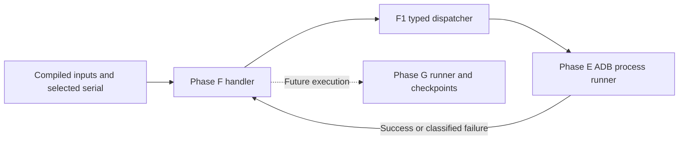

# Phase F — Real device commands and current handlers

## Overview

Phase F lets Runtime carry out a supported node on the selected Android
device. Phase C supplies compiled inputs and Phase E supplies the ADB
toolchain and device selection. Phase F defines and implements the handler
boundary. Phase G will call that boundary in workflow order.

## Specifications

| Step | Responsibility | Status |
|---|---|---|
| F1 | [Typed ADB command dispatcher](../f_device_commands/f1_command_dispatcher.md) | Implemented. Remaining native and live acceptance pending. |
| F2 | [Launch App on a selected Android device](../f_device_commands/f2_launch_app.md) | Implemented and registered. Remaining native and live acceptance pending. |
| F3 | [Tap on a selected Android device](../f_device_commands/f3_tap.md) | All three modes implemented and registered. Remaining native and live acceptance pending. |
| F4 | [Swipe on a selected Android device](../f_device_commands/f4_swipe.md) | Both modes implemented and registered. Remaining native and live acceptance pending. |
| F5 | [Type text into the focused Android field](../f_device_commands/f5_input_text.md) | Implemented and registered. Remaining native and live acceptance pending. |
| F6 | [Press Back and Press Home](../f_device_commands/f6_key_events.md) | Both handlers implemented and registered. Remaining native and live acceptance pending. |
| F7 | [Capture a full screen or rectangular region](../f_device_commands/f7_screenshot.md) | Capture and D4/D5 smoke persistence implemented. G/A7 integration and remaining acceptance pending. |
| F8 | [Start, End, and Delay](../f_device_commands/f8_flow_handlers.md) | Local completion criteria met. Log deferred. Workflow integration belongs to G. |
| F9 | [Executable node handler registry](../f_device_commands/f9_handler_registry.md) | Local completion criteria met. Runtime Info exposes ten shipped pairs. |
| F10 | [Long Press on a selected Android device](../f_device_commands/f10_long_press.md) | All three modes implemented and registered. Remaining native and live acceptance pending. |

## Verification and Phase G handoff

Linux automated checks cover handlers, controlled ADB subprocesses, API
capabilities, and D4/D5 persistence. Race checks, Linux build, and Windows
cross-compilation pass. Native Windows execution and the remaining
real-device acceptance cases in each subphase require release verification.

The shipped registry contains seven Android action pairs and Start, End,
and Delay. The local Screenshot smoke runner supplies the staging callback
and commits through D4/D5 using the normal Runtime storage location. It
prints the SQLite and PNG paths and requires the Runtime server to release
its storage lock before the smoke run.

Phase G can build on these handlers. Its runner must supply Screenshot's
attempt-scoped staging callback and pass the stage record to D4 before
publishing output. A7 adds authenticated artifact retrieval, and F9 enables
the shipped Screenshot registration after that integration is verified.
Switch and Set Variable execution belong to G. Wait for Variable scheduling
belongs to H, and Log remains deferred under F8.

The [Runtime roadmap](plan.md#phase-f--real-device-commands-and-current-handlers)
defines the first single-device workflow milestone and later integration.
