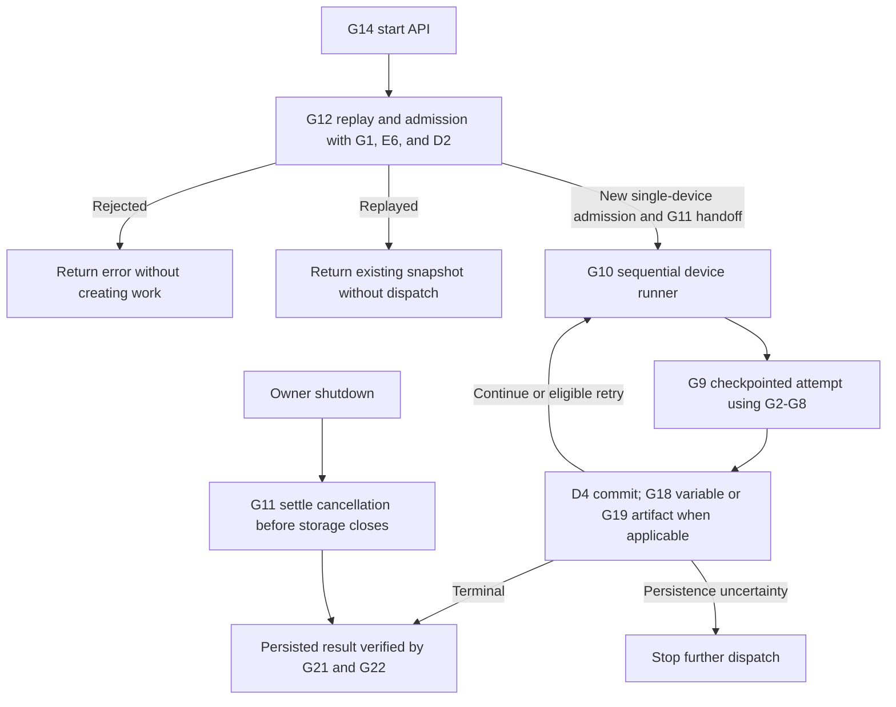

# Phase G — Workflow engine

## Overview

Phase G executes the exact admitted Runtime IR sequentially on one selected
Android device. Small steps separately deliver input resolution, attempts,
routing, persistence integration, APIs, variables, and screenshots. Existing
C, D, E, and F components provide compilation, checkpoints, device readiness,
and callable handlers.

**Status** — G1 is implemented and accepted. G2–G13 are implemented and
verified internally with Linux tests and Windows amd64 cross-compilation.
G10's real-ADB manual milestone and native Windows execution remain pending.
G11 shutdown is verified with controlled workflows, SQLite, and Linux owner
processes. Live Android stop acceptance remains unverified. G12 admission is
implemented and verified with real SQLite and controlled device readiness.
G13 snapshot APIs are implemented and Linux-verified; native Windows execution
remains unverified. G14 single-device POST is implemented and Linux-verified, including live
Waydroid and managed shutdown/recovery. Windows cross-compilation passes;
native Windows remains unverified. H1/H2 remain later multi-device work.
G15 Switch execution is implemented and Linux-verified, including compile/start/
snapshot integration with real SQLite. Windows cross-compilation passes;
native Windows remains unverified.
G16–G22 specifications and code are pending. The
[Phase G roadmap](plan.md#phase-g--workflow-engine) defines the numbered
implementation order and acceptance conditions. G1 behavior is unchanged.

## Specifications

One numbered step is one implementation task. Create its detailed spec when
that step is taken up, then link it here. There are no grouped or decimal
sub-phase numbers.

| Step | Responsibility                         | Specification and status                                                                                                                                                                                                                                                                             |
| ---- | -------------------------------------- | ---------------------------------------------------------------------------------------------------------------------------------------------------------------------------------------------------------------------------------------------------------------------------------------------------- |
| G1   | Runtime IR admission validator         | [G1 specification](../g_workflow_engine/g1_runtime_ir_admission.md). Implemented and accepted.                                                                                                                                                                                                       |
| G2   | Direct input bindings                  | [G2 specification](../g_workflow_engine/g2_direct_input_bindings.md). Implemented and verified through the G9 attempt and G10 runner.                                                                                                                                                                |
| G3   | Handler output validation              | [G3 specification](../g_workflow_engine/g3_handler_output_validation.md). Implemented and verified through G9 output/checkpoint integration.                                                                                                                                                         |
| G4   | Previous-node output bindings          | [G4 specification](../g_workflow_engine/g4_previous_node_output_bindings.md). Implemented and verified; G9/G10 committed snapshot publication and device-local view are verified.                                                                                                                    |
| G5   | Ordinary routing                       | [G5 specification](../g_workflow_engine/g5_ordinary_routing.md). Implemented and verified through the G9 attempt and G10 runner.                                                                                                                                                                     |
| G6   | Attempt deadlines                      | [G6 specification](../g_workflow_engine/g6_attempt_deadlines.md). Implemented and verified through the G9 attempt and G10 runner.                                                                                                                                                                    |
| G7   | Execution outcome normalization        | [G7 specification](../g_workflow_engine/g7_execution_outcome_normalization.md). Implemented and verified through the G9 attempt and G10 runner.                                                                                                                                                      |
| G8   | Safe retry policy                      | [G8 specification](../g_workflow_engine/g8_safe_retry_policy.md). Implemented and verified; G9/G10 retry execution is verified; G11 retry-gap cancellation settlement is verified.                                                                                                                   |
| G9   | Checkpointed node attempt              | [G9 specification](../g_workflow_engine/g9_checkpointed_node_attempt.md). Implemented and verified. One checkpointed attempt; G10 owns retry waiting and the loop.                                                                                                                                   |
| G10  | Sequential device runner               | [G10 specification](../g_workflow_engine/g10_sequential_device_runner.md). Internal runner implemented and verified. JSON smoke/SQLite checks pass; real-ADB and native Windows acceptance remain pending.                                                                                           |
| G11  | Runner shutdown                        | [G11 specification](../g_workflow_engine/g11_runner_shutdown.md). Implemented and verified on Linux. Fence/join work, retain owner stop cause, commit intentional cancellation, and preserve D6 fallback; Windows cross-build passes, native Windows/live Android stop acceptance remain unverified. |
| G12  | Admission coordination                 | [G12 specification](../g_workflow_engine/g12_admission_coordination.md). Internal service implemented and Linux-verified. Replay, ordered G1/G10/E6 preparation, G11-fenced D2 admission, and CREATED-only work handoff pass real-SQLite/race/smoke checks. Windows cross-compilation passes; scheduling and HTTP remain later integration. |
| G13  | Run snapshot APIs                      | [G13 specification](../g_workflow_engine/g13_run_snapshot_apis.md). Implemented and Linux-verified: authenticated snapshot routes, real-SQLite/cursor/read-only tests, built-agent checks, and client guides. Windows cross-compilation passes; native Windows remains unverified. |
| G14  | Start-run API                          | [G14 specification](../g_workflow_engine/g14_start_run_api.md). Implemented and Linux-verified: strict POST DTOs, 201/200 replay, tracked G11 handoff, real SQLite, live Waydroid, and managed stop/crash recovery. Exactly one device per new start; Phase H expands scheduling. Windows cross-build passes; native Windows unverified. |
| G15  | Switch execution                       | [G15 specification](../g_workflow_engine/g15_switch_execution.md). Implemented and Linux-verified: strict comparisons, lazy ordered operands, UUID/default/error routing, deadlines, checkpoints, registry capability, and compile/start/snapshot/replay integration with real SQLite. Windows agent/test cross-compilation passes; native Windows unverified. |
| G16  | Scoped variable storage                | Specification and implementation pending.                                                                                                                                                                                                                                                            |
| G17  | Variable input bindings                | Specification and implementation pending.                                                                                                                                                                                                                                                            |
| G18  | Set Variable execution                 | Specification and implementation pending.                                                                                                                                                                                                                                                            |
| G19  | Screenshot execution integration       | Specification and implementation pending.                                                                                                                                                                                                                                                            |
| G20  | Artifact API                           | Specification and implementation pending.                                                                                                                                                                                                                                                            |
| G21  | Final-result verification              | Specification and implementation pending.                                                                                                                                                                                                                                                            |
| G22  | Workflow-engine integration acceptance | Specification and implementation pending.                                                                                                                                                                                                                                                            |

## Delivery milestones

| Through step | Outcome                                                                                                     | Boundary                                                                                              |
| ------------ | ----------------------------------------------------------------------------------------------------------- | ----------------------------------------------------------------------------------------------------- |
| G10          | Internal single-device workflow with durable attempts, routing, and safe retries; implemented and verified. | JSON smoke/SQLite checks pass; real-ADB and native Windows acceptance remain pending. No new run API. |
| G11          | Intentional owner shutdown settles execution before SQLite closes.                                          | Bring forward required H6 behavior before integrating a desktop client.                               |
| G14          | Authenticated start and snapshot APIs.                                                                      | Exactly one device per new start; Phase H expands admission and bounded scheduling to 1–32.                            |
| G18          | Switch, scoped variable reads, and atomic Set Variable execution.                                           | Cross-device wait scheduling remains H.                                                               |
| G20          | Screenshot execution and authenticated committed PNG retrieval.                                             | Reuse F7 and D4/D5.                                                                                   |
| G22          | Combined single-device engine acceptance.                                                                   | G21 checks terminal results; G22 checks complete feature interactions and failure boundaries.         |

## Execution API ownership

All paths below have the `/api/v1` prefix and follow the existing A7 bearer-auth,
strict DTO, error, and disclosure contracts.

| Step | Route                         | Behavior                                                                                                                            |
| ---- | ----------------------------- | ----------------------------------------------------------------------------------------------------------------------------------- |
| G13  | `GET /runs/active`            | Return the current committed non-terminal snapshot or the A7 not-found response. |
| G13  | `GET /runs/{runGroupId}`      | Return a known run's committed snapshot during execution or after termination. |
| G14  | `POST /runs`                  | Return `201` after new admission; execute asynchronously. Return `200` for an admitted request-ID replay without another execution. |
| G20  | `GET /artifacts/{artifactId}` | Return a committed Screenshot PNG through D5's ID-based lookup.                                                                     |

G12 preserves request replay order, G1/E6 preflight, and G11-fenced D2 atomic
admission. Only confirmed CREATED returns prepared executable work. The later
process-owned start use case transfers that work to scheduling before reading
or sending its response snapshot; replay never schedules work.
G14 accepts exactly one selected device for a new public start and hands it to
G11-owned asynchronous execution. The array shape and internal G12/D2 capacity
remain multi-device capable. The [G14 ownership contract](../g_workflow_engine/g14_start_run_api.md#5-single-device-execution-ownership)
tracks admission through worker registration. H1/H2 later add the group queue,
configured concurrency, and public 1–32-device admission; follow the
[expansion checklist](../g_workflow_engine/g14_start_run_api.md#15-phase-h-expansion-checklist).
HTTP disconnection after admission does not cancel a run. G11 handles owner
shutdown through the managed process lifecycle.

Each API step updates its integration-guide section using the actual verified
request, response, authentication, failure, and lifetime behavior. Paginated
attempt history and SSE replay/live delivery remain tracked A7/I1 integration
work. They are not implied by completion of G13. Launcher package authorization
remains I2.

## State and feature boundaries

G10 owns the checked IR and device inputs during execution. G9 persists a
running attempt before dispatch and confirms its completion before advancing.
A persistence failure or uncertain commit stops dispatch; ordinary node error
routing and retries cannot override that rule. Commit precedes output visibility
and event notification.

G15 evaluates Switch rules in order. G16 approves variable representation,
limits, confidentiality, retention, and restart behavior before storage code.
G17 reads values from the correct scope. G18 writes the resolved scalar and
successful checkpoint in one transaction. Phase H owns cross-device visibility
verification and Wait Variable scheduling. G19 supplies the attempt-scoped
Screenshot callback and settles its stage through D4/D5 before exposing output.
Enable each new handler pair only when its actual runner path is usable.

G21 reuses D4/repository final-state and summary calculations. G22 then checks
complete workflows and failure boundaries instead of treating passing helper
tests as engine completion. Full multi-device scheduling and Pause/Resume
remain Phase H work. Log remains deferred under F8.

## Working and review scope

A step's spec must name its input/output contract, exact responsibility,
direct source dependencies, expected changed files, and focused checks. Target
roughly 3–6 files and 100–300 production lines per implementation step; report
tests and documentation separately. Split substantial preparatory refactoring
before implementation. These are planning targets rather than reasons to leave
a correctness requirement unfinished.

Keep the [Runtime roadmap](plan.md#phase-g--workflow-engine) as the numbering
source. The [Local API contract](../contracts/local_api_v1.md),
[execution-state contract](../contracts/execution_state_v1.md), and
[workflow bindings](../contracts/workflow_bindings.md) retain their business
semantics.
