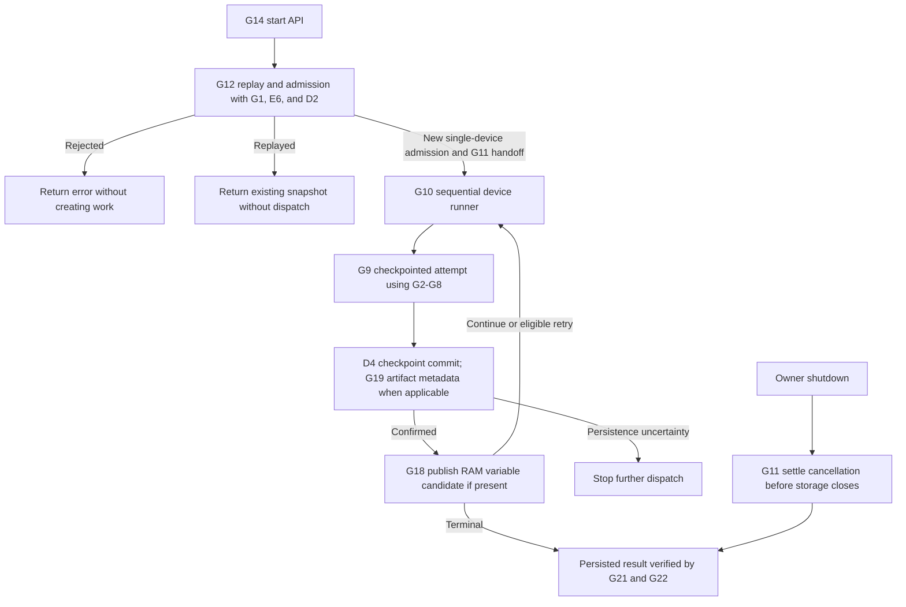

# Phase G — Workflow engine

## Overview

Phase G executes the exact admitted Runtime IR sequentially on one selected
Android device. Small steps separately deliver input resolution, attempts,
routing, persistence integration, APIs, variables, and screenshots. Existing
C, D, E, and F components provide compilation, checkpoints, device readiness,
and callable handlers.

**Status** — G1 is implemented and accepted. G2–G13 are implemented and
verified internally with Linux tests and Windows amd64 cross-compilation.
G10's real-ADB manual milestone and native Windows execution remain pending.
G11 shutdown is verified with controlled workflows, SQLite, and Linux owner
processes. Live Android stop acceptance remains unverified. G12 admission is
implemented and verified with real SQLite and controlled device readiness.
G13 snapshot APIs are implemented and Linux-verified; native Windows execution
remains unverified. G14 single-device POST is implemented and Linux-verified, including live
Waydroid and managed shutdown/recovery. Windows cross-compilation passes;
native Windows remains unverified. H1/H2 remain later multi-device work.
G15 Switch execution is implemented and Linux-verified, including compile/start/
snapshot integration with real SQLite. Windows cross-compilation passes;
native Windows remains unverified.
G16 RAM-only scoped storage is implemented and Linux-verified, including quotas,
checkpoint-confirmed publication, concurrency/cancellation tests, and a local
smoke demo. Windows cross-compilation passes; native Windows remains unverified.
G17 internal variable reads are implemented and Linux-verified through resolver,
runner, and attempt integration, including real-SQLite checkpoint tests and a
local RAM/resolver demo. Windows cross-compilation passes; native Windows is
unverified. G18 now supplies live run ownership and Set Variable execution.
G18 is implemented and Linux-verified: checkpoint-confirmed RAM writes,
CREATED-only store/views, joined cleanup, and compile/start/poll/replay pass.
Real-SQLite fault/rollback tests and built-agent managed shutdown, owner loss,
and forced crash/restart checks pass with controlled ADB readiness. Full/race
tests, vet, formatting, Linux build, and Windows amd64 agent/test cross-builds
pass; native Windows and live Android acceptance remain unverified.
G19 Screenshot execution is implemented and Linux-verified through the actual
handler registry, real PNG/SQLite settlement, and built-agent HTTP flows with
controlled ADB output. Full/race tests, vet, Linux build, and Windows amd64
agent/test cross-compilation pass. Managed stop/owner loss and forced crash
at PNG publication preserve committed images, remove orphan files on restart,
and never recapture old work. Native Windows/live Android remain unverified.
G20's authenticated PNG download API is implemented and Linux-verified.
Automatic committed-output discovery remains A7/I1.
G21 final-result verification is complete and Linux-verified: 23 focused scenarios
plus existing terminal-race, persistence, recovery, and lifecycle regressions
pass. Full/race tests, vet, Linux build, and Windows cross-compilation pass;
no production change was needed. Native Windows/live Android remain unverified.
G22 specification, combined example, and automated Linux process acceptance are
delivered: ten scenarios pass against the real built agent with controlled ADB,
plus full/race suites and an independently race-instrumented child agent.
No production change was needed. Real Android and native Windows acceptance
remain pending; the M5 real-device gate is not yet closed. The
[Phase G roadmap](plan.md#phase-g--workflow-engine) defines the numbered
implementation order and acceptance conditions. G1 behavior is unchanged.

## Specifications

One numbered step is one implementation task. Create its detailed spec when
that step is taken up, then link it here. There are no grouped or decimal
sub-phase numbers.

| Step | Responsibility                         | Specification and status                                                                                                                                                                                                                                                                             |
| ---- | -------------------------------------- | ---------------------------------------------------------------------------------------------------------------------------------------------------------------------------------------------------------------------------------------------------------------------------------------------------- |
| G1   | Runtime IR admission validator         | [G1 specification](../g_workflow_engine/g1_runtime_ir_admission.md). Implemented and accepted.                                                                                                                                                                                                       |
| G2   | Direct input bindings                  | [G2 specification](../g_workflow_engine/g2_direct_input_bindings.md). Implemented and verified through the G9 attempt and G10 runner.                                                                                                                                                                |
| G3   | Handler output validation              | [G3 specification](../g_workflow_engine/g3_handler_output_validation.md). Implemented and verified through G9 output/checkpoint integration.                                                                                                                                                         |
| G4   | Previous-node output bindings          | [G4 specification](../g_workflow_engine/g4_previous_node_output_bindings.md). Implemented and verified; G9/G10 committed snapshot publication and device-local view are verified.                                                                                                                    |
| G5   | Ordinary routing                       | [G5 specification](../g_workflow_engine/g5_ordinary_routing.md). Implemented and verified through the G9 attempt and G10 runner.                                                                                                                                                                     |
| G6   | Attempt deadlines                      | [G6 specification](../g_workflow_engine/g6_attempt_deadlines.md). Implemented and verified through the G9 attempt and G10 runner.                                                                                                                                                                    |
| G7   | Execution outcome normalization        | [G7 specification](../g_workflow_engine/g7_execution_outcome_normalization.md). Implemented and verified through the G9 attempt and G10 runner.                                                                                                                                                      |
| G8   | Safe retry policy                      | [G8 specification](../g_workflow_engine/g8_safe_retry_policy.md). Implemented and verified; G9/G10 retry execution is verified; G11 retry-gap cancellation settlement is verified.                                                                                                                   |
| G9   | Checkpointed node attempt              | [G9 specification](../g_workflow_engine/g9_checkpointed_node_attempt.md). Implemented and verified. One checkpointed attempt; G10 owns retry waiting and the loop.                                                                                                                                   |
| G10  | Sequential device runner               | [G10 specification](../g_workflow_engine/g10_sequential_device_runner.md). Internal runner implemented and verified. JSON smoke/SQLite checks pass; real-ADB and native Windows acceptance remain pending.                                                                                           |
| G11  | Runner shutdown                        | [G11 specification](../g_workflow_engine/g11_runner_shutdown.md). Implemented and verified on Linux. Fence/join work, retain owner stop cause, commit intentional cancellation, and preserve D6 fallback; Windows cross-build passes, native Windows/live Android stop acceptance remain unverified. |
| G12  | Admission coordination                 | [G12 specification](../g_workflow_engine/g12_admission_coordination.md). Internal service implemented and Linux-verified. Replay, ordered G1/G10/E6 preparation, G11-fenced D2 admission, and CREATED-only work handoff pass real-SQLite/race/smoke checks. Windows cross-compilation passes; scheduling and HTTP remain later integration. |
| G13  | Run snapshot APIs                      | [G13 specification](../g_workflow_engine/g13_run_snapshot_apis.md). Implemented and Linux-verified: authenticated snapshot routes, real-SQLite/cursor/read-only tests, built-agent checks, and client guides. Windows cross-compilation passes; native Windows remains unverified. |
| G14  | Start-run API                          | [G14 specification](../g_workflow_engine/g14_start_run_api.md). Implemented and Linux-verified: strict POST DTOs, 201/200 replay, tracked G11 handoff, real SQLite, live Waydroid, and managed stop/crash recovery. Exactly one device per new start; Phase H expands scheduling. Windows cross-build passes; native Windows unverified. |
| G15  | Switch execution                       | [G15 specification](../g_workflow_engine/g15_switch_execution.md). Implemented and Linux-verified: strict comparisons, lazy ordered operands, UUID/default/error routing, deadlines, checkpoints, registry capability, and compile/start/snapshot/replay integration with real SQLite. Windows agent/test cross-compilation passes; native Windows unverified. |
| G16  | Scoped variable storage                | [G16 specification](../g_workflow_engine/g16_scoped_variable_storage.md). Implemented and Linux-verified: RAM scopes, scalar codec, quotas, synchronized publication, cancellation/fencing, and cleanup. Full/race tests, vet, build, and local demo pass; Windows cross-compilation passes, native Windows unverified. G18 live ownership/writes are implemented; Phase H controls remain pending. |
| G17  | Variable input bindings                | [G17 specification](../g_workflow_engine/g17_variable_input_bindings.md). Implemented and Linux-verified: Flow/Global resolution, view identity, destination checks, cancellation/fencing, runner/attempt transport, and lazy Switch reads. Full/race tests, vet, build, real-SQLite integration, and local demo pass; Windows cross-compiles, native execution unverified. G18 live ownership and Set Variable are implemented. |
| G18  | Set Variable execution                 | [G18 specification](../g_workflow_engine/g18_set_variable_execution.md). Implemented and Linux-verified: pure handler, checkpoint-confirmed RAM assignments, CREATED-only store/views, joined cleanup, and actual compile/start/poll/replay. Full/race tests, SQLite faults, managed stop/crash/restart, vet, Linux build, and Windows agent/test cross-builds pass with controlled ADB readiness; native Windows/live Android unverified. No variable SQL or Phase H scheduling. |
| G19  | Screenshot execution integration       | [G19 specification](../g_workflow_engine/g19_screenshot_execution.md). Implemented and Linux-verified: attempt-bound staging, metadata/output pairing, D4/D5 settlement, safe cleanup, and actual registry/API flows. Full/race tests, SQLite faults, managed stop/crash/restart, vet, Linux build, and Windows cross-builds pass with controlled ADB PNG output. Native Windows/live Android unverified; G20 now separately implements retrieval. |
| G20  | Artifact API                           | [G20 specification](../g_workflow_engine/g20_artifact_api.md). Implemented and Linux-verified: authenticated D5 PNG streaming, safe errors/aborts and handle closure. Real HTTP, PNG/SQLite, built-agent lifecycle, full/race tests, vet, Linux build, and Windows cross-compilation pass. Native Windows/live Android/UI unverified; automatic output discovery remains A7/I1. |
| G21 | Final-result verification | [G21 specification](../g_workflow_engine/g21_final_result_verification.md). Complete for the verification scope, Linux-verified: 23 new final-result/summary/shutdown/recovery scenarios and existing terminal-race/persistence/crash regressions pass. No production change needed. Full/race tests, vet, Linux build, Windows agent/test cross-compilation pass; native Windows/live Android unverified. |
| G22 | Workflow-engine integration acceptance | [G22 specification](../g_workflow_engine/g22_workflow_engine_acceptance.md). Spec/tests/example delivered; ten real-agent Linux process scenarios with controlled ADB pass, including replay, retry, rollback, disconnect, shutdown and crash. Full/race tests and race-instrumented agent pass; Windows agent/portable tests cross-compile. Real Android/native Windows and M5 device acceptance remain pending. No production changes. |

## Delivery milestones

| Through step | Outcome                                                                                                     | Boundary                                                                                              |
| ------------ | ----------------------------------------------------------------------------------------------------------- | ----------------------------------------------------------------------------------------------------- |
| G10          | Internal single-device workflow with durable attempts, routing, and safe retries; implemented and verified. | JSON smoke/SQLite checks pass; real-ADB and native Windows acceptance remain pending. No new run API. |
| G11          | Intentional owner shutdown settles execution before SQLite closes.                                          | Bring forward required H6 behavior before integrating a desktop client.                               |
| G14          | Authenticated start and snapshot APIs.                                                                      | Exactly one device per new start; Phase H expands admission and bounded scheduling to 1–32.                            |
| G18 | Switch, scoped variable reads, and checkpoint-confirmed RAM Set Variable execution; implemented and Linux-verified. | Cross-device wait scheduling and controls remain Phase H. |
| G20          | Screenshot execution and authenticated committed PNG retrieval.                                             | Reuse F7 and D4/D5.                                                                                   |
| G22 | Combined single-device engine automation passes; real-device acceptance remains open. | G21 verifies terminal results; G22 verifies feature interactions and process failures. Native Windows/live Android acceptance is pending. |

## Execution API ownership

All paths below have the `/api/v1` prefix and follow the existing A7 bearer-auth,
strict DTO, error, and disclosure contracts.

| Step | Route                         | Behavior                                                                                                                            |
| ---- | ----------------------------- | ----------------------------------------------------------------------------------------------------------------------------------- |
| G13  | `GET /runs/active`            | Return the current committed non-terminal snapshot or the A7 not-found response. |
| G13  | `GET /runs/{runGroupId}`      | Return a known run's committed snapshot during execution or after termination. |
| G14  | `POST /runs`                  | Return `201` after new admission; execute asynchronously. Return `200` for an admitted request-ID replay without another execution. |
| G20  | `GET /artifacts/{artifactId}` | Return a committed Screenshot PNG through D5's ID-based lookup.                                                                     |

G12 preserves request replay order, G1/E6 preflight, and G11-fenced D2 atomic
admission. Only confirmed CREATED returns prepared executable work. The later
process-owned start use case transfers that work to scheduling before reading
or sending its response snapshot; replay never schedules work.
G14 accepts exactly one selected device for a new public start and hands it to
G11-owned asynchronous execution. The array shape and internal G12/D2 capacity
remain multi-device capable. The [G14 ownership contract](../g_workflow_engine/g14_start_run_api.md#5-single-device-execution-ownership)
tracks admission through worker registration. H1/H2 later add the group queue,
configured concurrency, and public 1–32-device admission; follow the
[expansion checklist](../g_workflow_engine/g14_start_run_api.md#15-phase-h-expansion-checklist).
HTTP disconnection after admission does not cancel a run. G11 handles owner
shutdown through the managed process lifecycle.

Each API step updates its integration-guide section using the actual verified
request, response, authentication, failure, and lifetime behavior. Paginated
attempt history and SSE replay/live delivery remain tracked A7/I1 integration
work. They are not implied by completion of G13. Launcher package authorization
remains I2.

## State and feature boundaries

G10 owns the checked IR and device inputs during execution. G9 persists a
running attempt before dispatch and confirms its completion before advancing.
A persistence failure or uncertain commit stops dispatch; ordinary node error
routing and retries cannot override that rule. Commit precedes output visibility
and event notification.

G15 evaluates Switch rules in order. G16 defines bounded RAM-only scopes,
scalar encoding, confidentiality, live pause lifetime, and cleanup. No variable
schema, migration, repository method, or durable value history is added.
G17 reads values from the correct scope. G18 confirms the existing successful
node checkpoint, then publishes its RAM candidate before readers or execution
continue. Restart interrupts old runs; it never restores variables or resumes
them. Phase H owns cross-device visibility
verification and Wait Variable scheduling. G19 supplies the attempt-scoped
Screenshot callback and settles its stage through D4/D5 before exposing output.
Enable each new handler pair only when its actual runner path is usable.

G21 reuses D4/repository final-state and summary calculations. G22 then checks
complete workflows and failure boundaries instead of treating passing helper
tests as engine completion. Full multi-device scheduling and Pause/Resume
remain Phase H work. Log remains deferred under F8.

## Working and review scope

A step's spec must name its input/output contract, exact responsibility,
direct source dependencies, expected changed files, and focused checks. Target
roughly 3–6 files and 100–300 production lines per implementation step; report
tests and documentation separately. Split substantial preparatory refactoring
before implementation. These are planning targets rather than reasons to leave
a correctness requirement unfinished.

Keep the [Runtime roadmap](plan.md#phase-g--workflow-engine) as the numbering
source. The [Local API contract](../contracts/local_api_v1.md),
[execution-state contract](../contracts/execution_state_v1.md), and
[workflow bindings](../contracts/workflow_bindings.md) retain their business
semantics.
