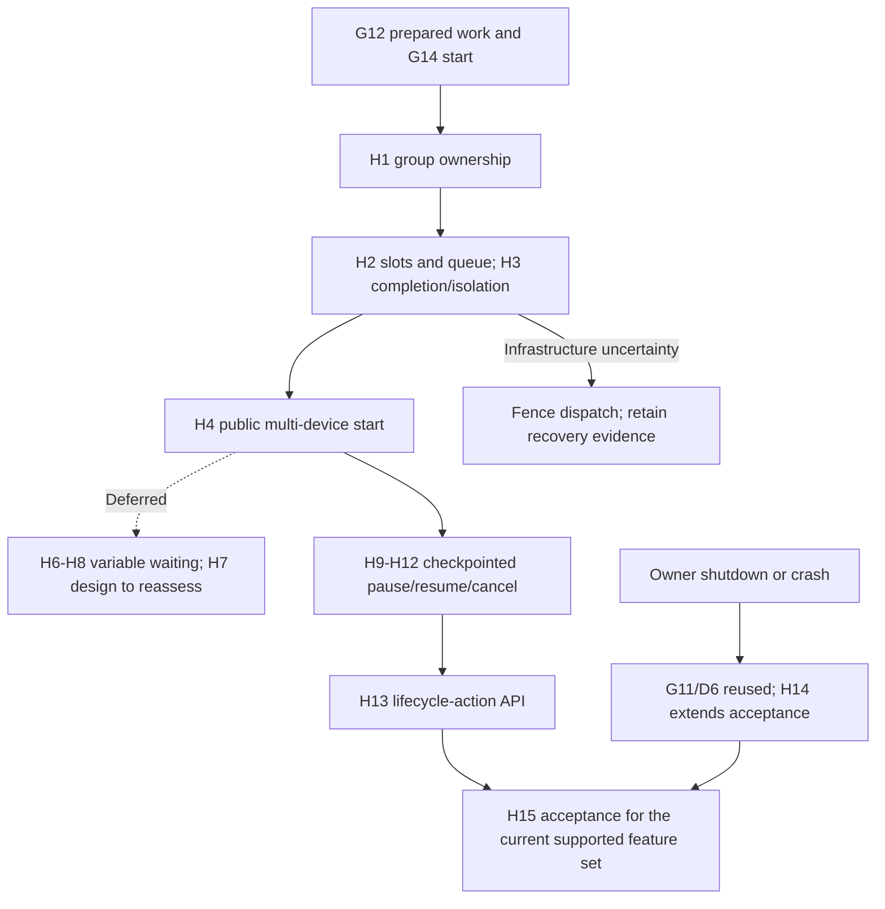

# Phase H — Multi-device scheduling and execution controls

## Overview

Phase H expands the existing G14 one-device start into bounded multi-device
execution, then adds group lifecycle controls. Variable waiting is deferred under
H6–H8. It consumes
G12/D2 admission, G10/G11 workers, D4 checkpoints/result calculation, and D6
recovery. It does not create replacement admission or result engines.

The first delivery milestone is H4: one POST admits a non-empty device selection
without a fixed count ceiling. Capacity equals the admitted device count; no separate
maximum-device setting is required. Internal Pause/Resume is implemented under
H9–H13; the action API exposes
pause/resume/cancel while Runtime remains alive; owner shutdown retains G11.

**Status** — H1 group ownership is implemented and Linux-verified: copied
device work, shared RAM lifetime, bounded prior-owner joining, and cleanup
before drain pass focused, full/race, SQLite/API and built-agent checks.
Linux build and Windows agent/affected-test cross-compilation pass; native
Windows/live Android were not verified for H1. H2's no-fixed-count foundations pass existing 64/128-member checks.
The optional concurrency setting is removed from code and documentation;
existing removal/queue/owner tests, race and managed-process checks pass. Evidence
is recorded in H2 section 12.1. H3 internal worker coordination is now
implemented: independent completion, ordinary failure isolation, fatal fencing
and all-worker shared-RAM retirement pass focused SQLite/race/process checks.
H4 now exposes the complete group through POST /runs with per-device inputs,
whole-selection rejection and typed availability diagnostics. Linux actual-agent
HTTP/SQLite acceptance passes for 2 and 33 controlled endpoints, replay after lost
response, shutdown and restart without redispatch. See H4 section 8.1 for the
verification commands and limits. H5's shared-adapter code is implemented. H15 now verifies focused transport
mapping/cancellation/deadline tests and actual-agent two-device disconnect
isolation under controlled ADB; live disconnect evidence remains pending.
H6–H8 are deferred by the 2026-11-22 decision below.
H9–H11 are implemented and Linux-verified; the shared
[spec and evidence](../h_multi_device_execution/h9_h11_pause_resume.md#13-implementation-and-verification-evidence--2026-11-22)
records atomic checkpoint, pause/resume/RAM/retry, stop-race and controlled-smoke
results. Native Windows/real-device acceptance remain separate.
[H12 group cancellation](../h_multi_device_execution/h12_run_cancellation.md#14-implementation-and-verification-evidence--2026-11-23)
is implemented and Linux-verified: focused repeated race tests, exact-target
settlement, control/stop/deadline cases and same-process Cancel/fresh-run smoke pass.
Windows affected binaries cross-compile; native Windows/live Android remain unverified.
The [H13 action API](../h_multi_device_execution/h13_lifecycle_action_api.md#12-implementation-and-verification-evidence--2026-11-23)
is implemented and Linux-verified: strict auth/DTO/mapping tests, real two-device
lifecycle/SQLite API tests and actual built-agent Pause/Resume/Cancel/fresh-run
acceptance pass. The [shared action guide](../integration/run_actions.md) includes
Linux, Windows and Postman integration.
The [H14 shutdown/recovery handoff](../h_multi_device_execution/h14_scheduler_shutdown_and_recovery.md)
is implemented and verified on Linux with controlled devices: 12 actual-agent stop/loss/crash/
recovery scenarios pass with persistent dispatch journals, artifact/history
preservation, replay and fresh runs. S1–S15 map to executed new/reused tests;
native Windows and H15 independent-target acceptance remain separate.
The [H15 acceptance specification](../h_multi_device_execution/h15_combined_multi_device_acceptance.md)
now has a readable acceptance pack: eight actual-agent scenarios, private outputs,
Global publication/fresh scopes, real controls, disconnect isolation and artifacts
pass Linux controlled checks. A01–A14 map to new/reused evidence in H15 section 14.
Independent Android targets and native Windows remain PENDING; full supported-scope
acceptance is not declared complete.
The unfiltered suite still fails the existing G22 test because its Python harness
is missing; that regression gate stays open. Windows cross-build evidence does
not establish native Windows or independent real Android acceptance.

## Device-capacity policy — approved 2026-11-22

- Runtime imposes no fixed device-count or concurrent-device ceiling; practical
  capacity depends on customer hardware. Only explicitly selected, admitted
  devices execute; discovered but unselected devices do not create workers.
- Capacity equals admitted member count N; users control resource usage through
  device selection. Remove the optional configuration field and YAML/env/CLI/UI
  maximum. Do not replace it with another count cap, per-product allowance or
  automatic CPU/RAM throttle. No restart is needed for a new selection.
- Queue size and variable-store membership follow the admitted selection.
  Existing byte/schema/per-variable limits and deadlines remain separate;
  actual resource exhaustion is a runtime failure, never a product count limit
  or permission to repeat an uncertain action.
- Align the old count-dependent G1/E6/G12/H1/G16 and D2/D4/D6 paths before H3.
  Snapshot/recovery queries must not use current concurrency to limit old
  records. Large admission/cancellation/recovery event sets use bounded append
  batches under one atomic transaction. Report this prerequisite separately
  from H3 completion handling; do not hide cross-layer changes in that step.
- Complete membership/reads and atomic bounded write batches are implemented.
  The optional throttle is removed; capacity derives only from membership.
  Available race tests and managed-process checks pass. The missing G22 fixture remains an open regression
  gate; native Windows/live multi-device acceptance is not claimed. Implemented H4 removes
  the public single-device gate and reuses the verified H3 coordinator.
- Studio/Launcher expose device selection, with no separate maximum-device
  preference or capacity launch setting. Changing the next selection requires
  no restart. H15 tests above-32 controlled membership as well as real independent
  devices; fixture size is not a product or hardware maximum.

## Steps and specifications

Create one detailed spec when its step is selected; link it here after approval.
The numbering and responsibility names follow the [roadmap](plan.md#phase-h--multi-device-scheduling-and-execution-controls).

| Step | One responsibility                                                                                 | Direct prerequisites         | Observable checkout                                                                                                                                                                                          |
| ---- | -------------------------------------------------------------------------------------------------- | ---------------------------- | ------------------------------------------------------------------------------------------------------------------------------------------------------------------------------------------------------------ |
| H1   | [Group execution ownership](../h_multi_device_execution/h1_group_execution_ownership.md)           | G10–G14, G16–G18             | Implemented and Linux-verified: group-owned contexts/work/RAM, cleanup/join races and consecutive starts pass. Windows cross-build passes; native execution unverified.                                      |
| H2   | [Bounded queue and worker slots](../h_multi_device_execution/h2_bounded_queue_and_worker_slots.md) | H1                           | Implemented; membership-derived capacity with no separate setting or fixed count ceiling. Existing 1/64/128-member, race and managed-process checks pass; evidence in H2. G22 fixture missing; H4 now exposes public multi-device starts. |
| H3   | [Worker completion and failure isolation](../h_multi_device_execution/h3_worker_completion_and_failure_isolation.md) | H2, D4 | Implemented and Linux-verified: private complete-group coordination, isolated failures, fatal fencing and joined RAM retirement. SQLite 64-member, race and managed-process checks pass; Windows cross-build passes, native unverified. G22 fixture missing; H4 now exposes this coordinator publicly.                                                                                   |
| H4   | [Public multi-device start](../h_multi_device_execution/h4_public_multi_device_start.md)                                                                          | H1–H3, G12/G14               | Implemented and Linux-verified: complete ordered selection, isolated inputs, atomic handoff, indexed availability diagnostics and replay. Actual-agent HTTP/SQLite 2/33-member and managed shutdown checks pass; see H4 evidence.                                                                           |
| H5   | [Device-disconnect handling](../h_multi_device_execution/h5_device_disconnect_handling.md) | H4, E/F/G outcomes | Code implemented; existing regressions/race and Windows cross-build pass. Failure-only bounded observation, no action replay/watcher. H15 now verifies focused transport/context tests and controlled two-device disconnect isolation; live targets/native Windows remain pending. See H5 section 13. |
| H6 | Variable-wait registration | G16/G18; revisit when waiting is resumed | **Deferred.** Keep atomic existence-check/registration and committed-publication notification requirements; no waiter code is required before H9. |
| H7 | Release and reacquire worker capacity | H2/H6; reassess design before resuming | **Deferred; design review required.** Membership-derived capacity means waiting does not block siblings. Do not build slot release/reacquisition solely for the old limited-worker model. |
| H8 | Wait Variable node integration | Resumed H6/H7 decision; finalized Backend node contract; G6–G9/G17–G18 | **Deferred.** No executable Wait Variable capability is claimed; resume catalog/handler integration and wait acceptance together later. |
| H9 | [Pause checkpoint transitions](../h_multi_device_execution/h9_h11_pause_resume.md) | A5/D4; approved pause policy | Implemented and Linux-verified: atomic pause/resume checkpoints, unchanged history, 128-member batched events, rollback/idempotence and commit read-back tests pass. |
| H10 | [Pause coordination](../h_multi_device_execution/h9_h11_pause_resume.md) | H1–H3/H9 | Implemented and Linux-verified: dispatch fence, safe-boundary pause, retained worker/RAM ownership and shutdown joining. Pending work settles before PAUSED; public actions are delivered by H13. |
| H11  | [Resume coordination](../h_multi_device_execution/h9_h11_pause_resume.md) | H9–H10                       | Implemented and Linux-verified: confirmed Resume releases the same workers; outputs, Flow/Global RAM and retry identity survive. Controlled smoke finishes with 10 attempts/2 Home actions; Windows cross-build only. |
| H12 | [Run cancellation](../h_multi_device_execution/h12_run_cancellation.md) | H1–H3/H9–H11, G11 | Implemented and Linux-verified: exact-group settlement, joined controls/RAM retirement, duplicate/rollback/deadline guards and same-process fresh run pass focused/race/smoke checks. Windows cross-build only; public actions remain H13 and waiter cleanup deferred. |
| H13 | [Lifecycle-action API](../h_multi_device_execution/h13_lifecycle_action_api.md) | H10–H12, A7 | Implemented and Linux-verified: authenticated PAUSE/RESUME/CANCEL, strict 1,024-byte DTO, exact 200/202/409 mappings, real lifecycle/SQLite and built-agent acceptance, shared/app-specific guides. Windows cross-build only; wider H15/native acceptance pending. |
| H14 | [Scheduler shutdown and recovery](../h_multi_device_execution/h14_scheduler_shutdown_and_recovery.md) | H1–H5/H9–H13, G11/D6 | Implemented; Linux controlled S1–S15 acceptance mapped and verified. Twelve actual-agent scenarios, joined controls, 128-member recovery, retained artifacts/history and no redispatch pass; no production fix needed. Native Windows/live targets remain separate; waits deferred. |
| H15 | [Combined multi-device acceptance](../h_multi_device_execution/h15_combined_multi_device_acceptance.md) | H4–H5/H9–H14, G21–G22 | Acceptance pack implemented; eight Linux controlled actual-agent scenarios and focused SQLite publication/transport checks pass. A01–A14 evidence mapped; independent Android/native Windows and the missing G22 regression harness remain pending. Full H15 acceptance is not complete; waits deferred. |

## Dependencies and boundaries

- H5 uses command-observed device loss: one bounded discovery after a nonzero
  ADB process result, within the attempt deadline. Successful commands add no
  probes. Delay/variable-only work does not receive continuous connectivity
  monitoring; see the H5 detection/reconnect limits and remaining acceptance gap.
- G15–G22 continue under their existing plan. H6–H8 specifically require the
  G16–G18 variable storage/binding/write behavior; H15 requires the complete
  approved single-device feature set and G21/G22 evidence.
- H1 moves the current one-device start behind group ownership. H2–H3 add the
  internal all-device handoff and bounded scheduling before H4 enables them
  publicly. Implemented H4 removed AdmitSingleDevice and the live one-device handoff guard
  together, preserving G14 replay, the outer start lease, and no-partial-admission rules.
- Keep one active RunGroup and a non-empty ordered device/input selection
  without a fixed count ceiling. Derive capacity from admitted
  membership; no maximum-device preference or launch setting is required. Preserve isolated inputs/outputs and
  last-committed-write-wins Global writes.
  Global scope remains one RunGroup on one Runtime, not an account-wide store.
- The combined H9–H11 spec defines group pause at an all-worker safe-boundary
  barrier: finish permitted attempts and retry delays, retain live workers/RAM,
  commit PAUSED atomically, then commit Resume before releasing workers. H9–H11
  remain separate code deliveries. Variable-wait semantics are deferred.
- H12 cancels only the current group and permits a later new run. G11 owner
  shutdown still stops Runtime; H14 verifies their interaction rather than
  reimplementing process ownership.
- Every percentage action reads the selected device's current display size;
  Swipe uses one measurement for both endpoints. Display caching stays a
  measured future optimization requiring reliable invalidation.

## Wait Variable deferral — approved 2026-11-22

Defer H6–H8 as one feature and continue with H9. Preserve these phase IDs; this
is a delivery-scope change, not completed waiting support. The Backend Wait
Variable node is unfinished. H6's internal mechanism could be built independently,
but is deferred with its consumer to keep implementation reviewable and useful.
Existing Set Variable, Flow/Global reads and shared-RAM publication remain in scope.

| Deferred step | Work to retain for resumption |
| --- | --- |
| H6 | Atomically check existence/register, notify only after confirmed checkpoint and RAM publication, and clean up on cancellation/timeout/store closure. False, zero and empty string count as present. |
| H7 | Reassess whether a separate step is needed. Every admitted device already has capacity; a channel-based wait can suspend without blocking siblings. No artificial slot ceiling or one-slot test requirement. Any suspended execution must remain owned/joinable. |
| H8 | Finalize the Backend catalog/schema contract, integrate the handler, advertise only actual executable support and verify timeout/error routing plus cross-device wakeup. |

H9–H15 proceed against current executable nodes. Do not add fake wait handlers,
placeholder state transitions or executable Runtime Info claims to satisfy their
old prerequisites. The planned Wait Variable contract remains clearly deferred.

When waiting resumes, review the following localized integration work together:

| Area | Required follow-up |
| --- | --- |
| H9–H11 pause/resume | Define waiter registration and timeout behavior while paused; notification alone must never bypass pause authority or dispatch a continuation. |
| H12/H13 cancellation | Unregister/unblock waiters, preserve idempotent control responses and join them under existing group ownership. No new endpoint shape is assumed. |
| H14 shutdown | Include suspended waits in stop/join and crash-interruption acceptance; no old-run resume. |
| H15 and client guides | Add present-key, concurrent-publication, timeout/cancel, pause/notification and independent-device scenarios. Distinguish the current supported-feature gate from deferred wait acceptance. |

Variables/wait registrations remain RAM-only; this deferral requires no Runtime
code or migration change. Reuse existing group ownership, committed publication
and control boundaries when the feature returns. Review any new public contract
separately rather than assuming a broader API or database redesign is necessary.

## Completion and integration evidence

H4 is the early multi-device milestone; it does not imply waits or controls.
H15 may close acceptance for the current supported scope while explicitly
leaving H6–H8 deferred; it must not claim full original Wait Variable acceptance.
H13 updates the shared/Studio/Launcher lifecycle API references with exact
200/202/409 examples. H14/H15 separate controlled concurrency/fault checks from
real independent-device and native-Windows evidence. Summaries and final group
status reuse D2/D4; no second stored-counter calculator is added.

Follow the [Wait Variable contract](../contracts/workflow_bindings.md#wait-for-variable),
[A5 state transitions](../contracts/execution_state_v1.md),
[A7 action API](../contracts/local_api_v1.md#9-execution-reads-and-lifecycle-control),
and [G14 expansion checklist](../g_workflow_engine/g14_start_run_api.md#15-phase-h-expansion-checklist).
