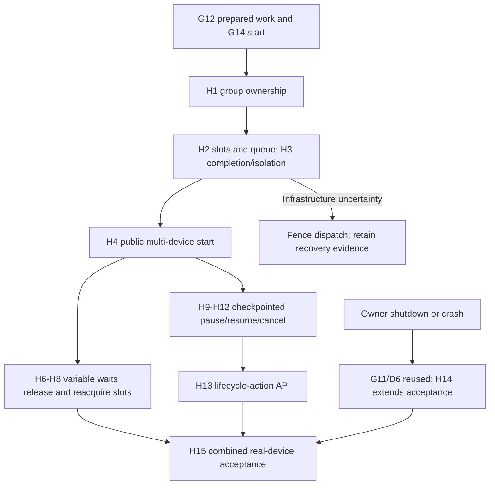

# Phase H — Multi-device scheduling and execution controls

## Overview

Phase H expands the existing G14 one-device start into bounded multi-device
execution, then adds variable waits and group lifecycle controls. It consumes
G12/D2 admission, G10/G11 workers, D4 checkpoints/result calculation, and D6
recovery. It does not create replacement admission or result engines.

The first delivery milestone is H4: one POST admits 1–32 devices and runs them
under a configured slot limit. H8 adds a wait that frees capacity. H13 exposes
pause/resume/cancel while Runtime remains alive; owner shutdown retains G11.

**Status** — H1 group ownership is implemented and Linux-verified: copied
device work, shared RAM lifetime, bounded prior-owner joining, and cleanup
before drain pass focused, full/race, SQLite/API and built-agent checks.
Linux build and Windows agent/affected-test cross-compilation pass; native
Windows/live Android were not verified for H1. H2–H15 remain planned without
detailed step specs. G14 remains one-device until the H4 gate passes.

## Steps and specifications

Create one detailed spec when its step is selected; link it here after approval.
The numbering and responsibility names follow the [roadmap](plan.md#phase-h--multi-device-scheduling-and-execution-controls).

| Step | One responsibility                                                                       | Direct prerequisites         | Observable checkout                                                                                                                                                     |
| ---- | ---------------------------------------------------------------------------------------- | ---------------------------- | ----------------------------------------------------------------------------------------------------------------------------------------------------------------------- |
| H1   | [Group execution ownership](../h_multi_device_execution/h1_group_execution_ownership.md) | G10–G14, G16–G18             | Implemented and Linux-verified: group-owned contexts/work/RAM, cleanup/join races and consecutive starts pass. Windows cross-build passes; native execution unverified. |
| H2   | Bounded queue and worker slots                                                           | H1                           | Three admitted devices with two slots produce two running executions and one queued execution.                                                                          |
| H3   | Worker completion and failure isolation                                                  | H2, D4                       | Completion releases capacity; ordinary device failure leaves siblings running; infrastructure uncertainty fences dispatch.                                              |
| H4   | Public multi-device start                                                                | H1–H3, G12/G14               | POST /runs accepts 1–32 ordered serial/input pairs with one admission/handoff and correct request-ID replay.                                                            |
| H5   | Device-disconnect handling                                                               | H4, E/F/G outcomes           | Disconnecting one endpoint fails only its execution with the approved device error and no unsafe action replay.                                                         |
| H6   | Variable-wait registration                                                               | G16/G18                      | Existence checking and waiter registration cannot miss a concurrent committed write; false, zero, and empty string count as present.                                    |
| H7   | Release and reacquire worker capacity                                                    | H2, H6                       | A waiting execution frees its slot, remains supervised, and reacquires capacity before continuing.                                                                      |
| H8   | Wait Variable node integration                                                           | H6–H7, G6–G9/G17–G18         | With one slot, A waits, B commits the key, and A continues; timeout/error routing and cancellation are verified.                                                        |
| H9   | Pause checkpoint transitions                                                             | A5/D4; approved pause policy | Persist valid group/device pause transitions while preserving next position, attempt evidence, and atomic events.                                                       |
| H10  | Pause coordination                                                                       | H2/H7/H9                     | Fence new node dispatch, settle active work at the approved boundary, then acknowledge PAUSED.                                                                          |
| H11  | Resume coordination                                                                      | H9–H10                       | Requeue paused devices under the current slot limit without repeating completed actions or losing execution inputs/outputs.                                             |
| H12  | Run cancellation                                                                         | H1–H3/H8–H11, G11            | Cancel active/queued/waiting work while Runtime stays alive; a later new run starts normally.                                                                           |
| H13  | Lifecycle-action API                                                                     | H10–H12, A7                  | Expose group PAUSE/RESUME/CANCEL with exact 200/202/409 bodies, idempotency, and guide examples.                                                                        |
| H14  | Scheduler shutdown and recovery                                                          | H1–H13, G11/D6               | Queued, waiting, paused, and active work settle on owner stop or become INTERRUPTED after crash, without redispatch.                                                    |
| H15  | Combined multi-device acceptance                                                         | H4–H14, G21–G22              | Verify bounds, isolation, committed global-variable visibility, derived summaries, and two independent real Android targets.                                            |

## Dependencies and boundaries

- G15–G22 continue under their existing plan. H6–H8 specifically require the
  G16–G18 variable storage/binding/write behavior; H15 requires the complete
  approved single-device feature set and G21/G22 evidence.
- H1 moves the current one-device start behind group ownership. H2–H3 add the
  internal all-device handoff and bounded scheduling before H4 enables them
  publicly. H4 lifts AdmitSingleDevice and the live one-device handoff guard
  together, preserving G14 replay, the outer start lease, and no-partial-admission rules.
- Keep one active RunGroup, 1–32 ordered device/input pairs, bounded worker
  slots, isolated inputs/outputs, and last-committed-write-wins Global writes.
  Global scope remains one RunGroup on one Runtime, not an account-wide store.
- Approve pause behavior for queued work, retry delay, and variable waits in
  H9's spec before checkpoint changes. H10 acknowledges pause at safe node
  boundaries. H11 requeues paused devices under the current slot limit.
- H12 cancels only the current group and permits a later new run. G11 owner
  shutdown still stops Runtime; H14 verifies their interaction rather than
  reimplementing process ownership.
- Every percentage action reads the selected device's current display size;
  Swipe uses one measurement for both endpoints. Display caching stays a
  measured future optimization requiring reliable invalidation.

## Completion and integration evidence

H4 is the early multi-device milestone; it does not imply waits or controls.
H13 updates the shared/Studio/Launcher lifecycle API references with exact
200/202/409 examples. H14/H15 separate controlled concurrency/fault checks from
real independent-device and native-Windows evidence. Summaries and final group
status reuse D2/D4; no second stored-counter calculator is added.

Follow the [Wait Variable contract](../contracts/workflow_bindings.md#wait-for-variable),
[A5 state transitions](../contracts/execution_state_v1.md),
[A7 action API](../contracts/local_api_v1.md#9-execution-reads-and-lifecycle-control),
and [G14 expansion checklist](../g_workflow_engine/g14_start_run_api.md#15-phase-h-expansion-checklist).
