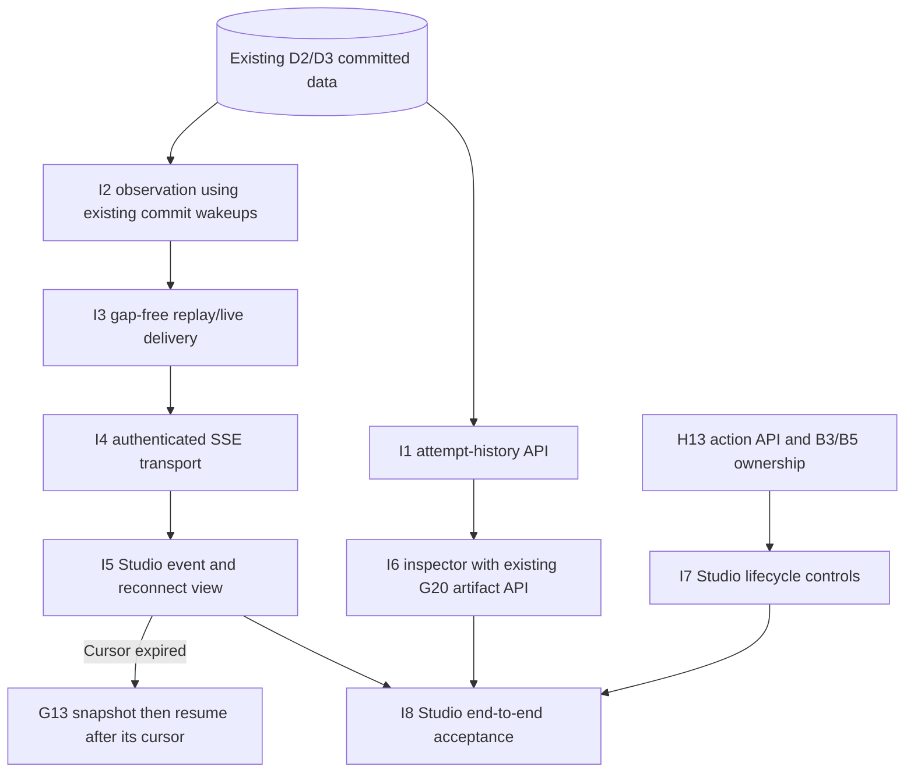

# Phase I — Observability APIs and Studio integration

## Overview

Phase I exposes persisted node attempts and a continuous committed-event
stream, then connects those APIs and H controls to Studio. Initial Studio
validation/compilation, G14 single-device execution, and G13 polling can be
integrated now; they do not wait for SSE.

D2 already reads attempts. D3 already stores/replays events and supplies
EventWakeup after commit. I1–I4 adapt those foundations to authenticated API
consumers. I5–I8 are explicit Studio-owner integration/acceptance assignments,
with Runtime defects handled in focused changes.

**Status** — I1–I8 are planned; initial G14/G13 Studio integration can proceed
independently. Detailed specs are created per selected step, not as placeholders.

## Steps and specifications

| Step | One responsibility                     | Direct prerequisites     | Observable checkout                                                                                                             |
| ---- | -------------------------------------- | ------------------------ | ------------------------------------------------------------------------------------------------------------------------------- |
| I1   | Node-attempt history API               | D2, A7                   | Read ordered attempts with bounded pagination through the existing repository and publish exact client examples.                |
| I2   | Committed-event observation            | D3/D4                    | Reuse EventWakeup for bounded observer lifetime; commit wakes observers, rollback does not, and coalesced signals lose no data. |
| I3   | Replay-to-live continuity              | I2, D3/A6                | Replay retained events and continue live without a gap; bound buffering and terminate slow consumers safely.                    |
| I4   | Authenticated SSE endpoint             | I3, B5/B6/A7             | Verify framing, cursor errors, expiry, heartbeats, stream write deadlines, disconnect cleanup, and shutdown.                    |
| I5   | Studio event and reconnect integration | I4, G13; Studio owner    | Studio resumes from its processed cursor and repairs expiry using a watermarked authoritative snapshot.                         |
| I6   | Studio execution inspector             | I1, G20; Studio owner    | Display attempts, outputs, failures, and committed screenshots for the correct run/device/node identity.                        |
| I7   | Studio lifecycle controls              | H13, B3/B5; Studio owner | Connect pause/resume/cancel and owner shutdown to clear pending, achieved, conflict, and failure UI states.                     |
| I8   | Studio end-to-end acceptance           | I5–I7, G/H               | Exercise editing, compilation, run, observation, controls, reconnect, and app exit with explicit platform evidence.             |

## API and ownership boundaries

- I1 consumes existing Attempts pagination. I2 reuses D3 EventWakeup and
  after-commit notification semantics; it must not create another broker or
  rewrite the event repository. Coalesced wakeups trigger cursor-based reads,
  not assumed one-signal-per-event delivery.
- I3/I4 together satisfy A7: ordered replay without a live gap, correct
  connection-time watermark, bounded slow-consumer handling, cursor errors
  before streaming, heartbeat-aware write deadlines, and subscriber cleanup.
  Expose the production route only when those guarantees are available.
- I4 uses a native streaming client capable of Authorization headers; no token
  in the SSE URL. Filter Runtime-wide events by their existing correlation IDs.
  Publisher-authored utility.log is separate deferred work, not a new A6 event.
- I6 consumes G20 Screenshot retrieval; it does not implement a duplicate
  artifact API. I7 consumes H13 controls and the B3/B5 owner protocol.
- Studio owns graph/schema capture, input forms, view state, and the shared
  native client. Each operation uses actual readiness/current credentials;
  concurrent startup/replacement is shared. Keep the accepted one-owner rule,
  Stop and exit / Stay open flow, and suspended automatic validation after
  explicit Runtime shutdown.

## Acceptance and handoff

Update the [shared guide](../integration/managed_runtime.md) and
[Studio guide](../integration/studio.md) with each verified API. I8 consolidates
client evidence; it is not the first documentation delivery. Include lost start
responses, saved results, cursor expiry, an unavailable Runtime, lifecycle
conflicts, and closing the owning app. Record native Windows separately from
cross-compilation. Studio work is assigned to its developer; Runtime API work
and discovered fixes keep their own reviewable scopes.

Authoritative contracts are [A6 events](../contracts/event_error_v1.md),
[A7 history/SSE](../contracts/local_api_v1.md#10-sse-replay-and-live-delivery),
and [A8 fixtures](../contracts/contract_fixtures_v1.md).
