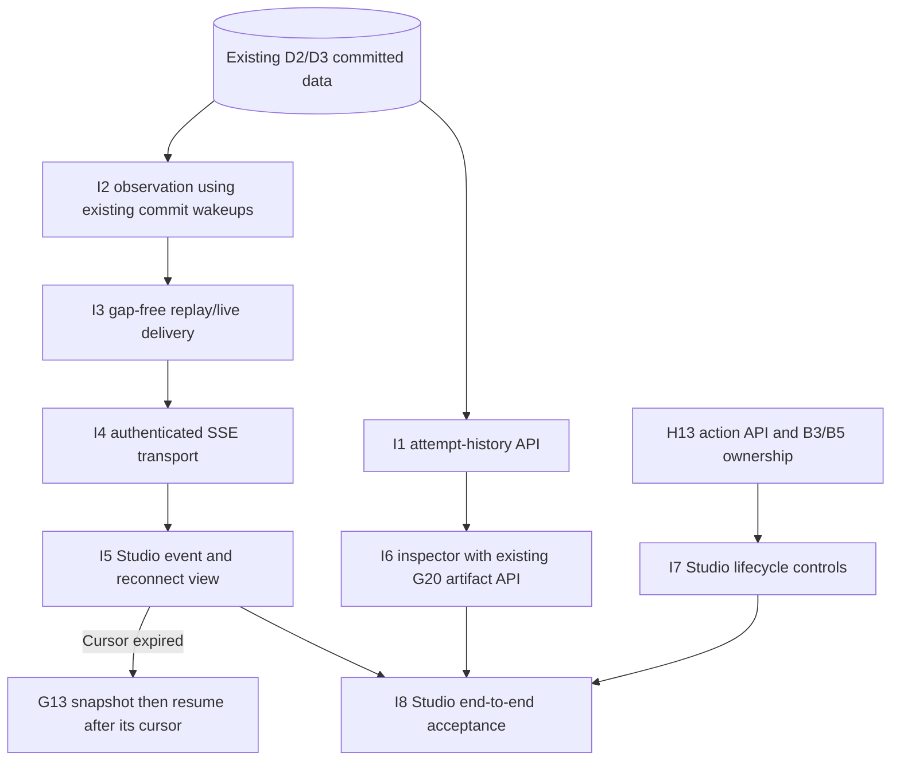

# Phase I — Observability APIs and Studio integration

## Overview

Phase I exposes persisted node attempts and a continuous committed-event
stream, then connects those APIs and H controls to Studio. Initial Studio
validation/compilation, G14 single-device execution, and G13 polling can be
integrated now; they do not wait for SSE.

D2 already reads attempts. D3 already stores/replays events and supplies
EventWakeup after commit. I1–I4 adapt those foundations to authenticated API
consumers. I5–I8 are explicit Studio-owner integration/acceptance assignments,
with Runtime defects handled in focused changes.

**Status** — [I1 attempt history](../i_observability_apis/i1_node_attempt_history_api.md#12-implementation-and-verification-evidence--2026-11-24)
is implemented and Linux-verified: strict read API, real SQLite paging/active
updates, per-device/retry/recovery projections, Screenshot-ID discovery and
retained actual-agent reads across fresh sessions pass focused/race checks.
Windows cross-build passes; native Windows and Studio UI remain unverified.
The full race suite still fails the known missing G22/H14/H15 harnesses; their
repair remains separate. [I2 observation](../i_observability_apis/i2_committed_event_observation.md#12-implementation-and-verification-evidence--2026-11-24)
is implemented and Linux-verified with focused/repeated race tests, real SQLite
notification checks and Windows cross-builds. [I3 delivery](../i_observability_apis/i3_replay_to_live_continuity.md#11-implementation-and-verification-evidence--2026-11-24)
is implemented and Linux-verified for internal preparation, ordered replay/live
delivery, bounded pages and cancellation. [I4 SSE](../i_observability_apis/i4_authenticated_sse_endpoint.md#13-implementation-and-verification-evidence--2026-11-24)
is implemented and Linux-verified with real HTTP/SQLite, blocked-write shutdown
and built-agent replay/45-second heartbeat/owner checks. Guides are updated;
I5–I8 and native Windows/UI acceptance remain planned. The
[I5 Studio observer spec](../i_observability_apis/i5_studio_event_reconnect_integration.md)
defines the client implementation and acceptance handoff; writing it does not
implement the Studio observer.
The [I6 inspector spec](../i_observability_apis/i6_studio_execution_inspector.md)
and [single source-mapped Studio handoff](../integration/studio_observability.md) are also
ready for the Studio owner; inspector code and host acceptance remain pending.
The [I7 controls spec](../i_observability_apis/i7_studio_lifecycle_controls.md)
and its section in that same handoff are ready for Studio implementation.
The [I8 gateway review and acceptance spec](../i_observability_apis/i8_studio_end_to_end_acceptance.md)
is prepared with 22 acceptance criteria, all NOT RUN. Gateway review and E2E
remain deferred until the user pulls the implemented Studio code and requests
verification; none is executed here.

## Steps and specifications

| Step | One responsibility                     | Direct prerequisites     | Observable checkout                                                                                                             |
| ---- | -------------------------------------- | ------------------------ | ------------------------------------------------------------------------------------------------------------------------------- |
| I1   | [Node-attempt history API](../i_observability_apis/i1_node_attempt_history_api.md) | D2, A7 | Implemented and Linux-verified: strict authenticated paging, real SQLite/device isolation/active refresh, retry/recovery projections, Screenshot-ID discovery and retained built-agent reads. Guides updated; Windows cross-build only. Known full-suite missing harnesses remain open. |
| I2   | [Committed-event observation](../i_observability_apis/i2_committed_event_observation.md) | D3/D4 | Implemented and Linux-verified: register-before-read, cancellable waits, one-second fallback and real SQLite commit/rollback/coalescing checks pass focused/repeated race tests. Windows cross-builds pass; I3/I4 own delivery and actual stream shutdown. Known full-suite missing harnesses remain open. |
| I3   | [Replay-to-live continuity](../i_observability_apis/i3_replay_to_live_continuity.md) | I2, D3/A6 | Implemented and Linux-verified: first-page preparation, one-page ordered replay/live delivery, sink failure/cancellation, retention and independent consumers pass focused/repeated race checks. Windows cross-builds pass. I4 owns the HTTP stream and actual socket/shutdown guarantees; missing full-suite harnesses remain open. |
| I4   | [Authenticated SSE endpoint](../i_observability_apis/i4_authenticated_sse_endpoint.md) | I3, B5/B6/A7 | Implemented and Linux-verified: strict authenticated GET /events, replay/live frames, heartbeat/deadline control, error-aware flush, disconnect and blocked-write shutdown pass. Built agent passes replay, real 45-second heartbeats, fresh sessions and owner stop/loss. Guides updated; Windows cross-build only. Missing full-suite harnesses remain open. |
| I5   | [Studio event and reconnect integration](../i_observability_apis/i5_studio_event_reconnect_integration.md) | I4, G13; Studio owner | Spec ready for Studio implementation: one native stream, processed cursor, selected-run reconciliation, expiry repair and owner-aware reconnect. Client/UI implementation and host acceptance remain pending. |
| I6   | [Studio execution inspector](../i_observability_apis/i6_studio_execution_inspector.md) | I1, G20; Studio owner | Spec and source-mapped handoff ready: selected-device attempt paging, saved details, live refresh and bounded authenticated PNG preview. Studio implementation and host acceptance remain pending. |
| I7   | [Studio lifecycle controls](../i_observability_apis/i7_studio_lifecycle_controls.md) | H13, B3/B5; Studio owner | Spec and consolidated I5–I7 handoff ready: action disposition/uncertainty, conflict snapshots, full-group controls and explicit shutdown/exit. Studio implementation and host acceptance remain pending. |
| I8   | [Studio gateway review and end-to-end acceptance](../i_observability_apis/i8_studio_end_to_end_acceptance.md) | I5–I7, G/H | Spec ready; all 22 criteria NOT RUN. Review the freshly pulled Studio gateway and verify the full business flow only when the user requests it, with separate native-host evidence. |

## API and ownership boundaries

- I1 consumes existing Attempts pagination. I2 reuses D3 EventWakeup and
  after-commit notification semantics; it must not create another broker or
  rewrite the event repository. Coalesced wakeups trigger cursor-based reads,
  not assumed one-signal-per-event delivery.
- I2 owns only registration and cancellable waiting; it adds no supervised
  daemon or public route. I3/I4 compose the helper with the existing repository.
  I4 must explicitly cancel stream contexts on Runtime stop before HTTP drain;
  ordinary HTTP Shutdown does not itself cancel active handlers.
- I3/I4 together satisfy A7: ordered replay without a live gap, correct
  connection-time watermark, bounded slow-consumer handling, cursor errors
  before streaming, heartbeat-aware write deadlines, and subscriber cleanup.
  Expose the production route only when those guarantees are available.
- I3 prepares the cursor/first page before streaming and uses synchronous
  Deliver/Idle callbacks with no event queue. I4 supplies bounded network I/O,
  heartbeat policy and production composition; it must not add a concurrent
  heartbeat writer or advertise SSE based only on I3 internal tests.
- I4 unwraps Gin for error-aware flush/control while
  retaining tracked body writes. Cancel server-owned request contexts before
  HTTP drain and interrupt blocked stream writes without changing checkpoint
  shutdown order or disabling ordinary request timeouts globally.
- I4 uses a native streaming client capable of Authorization headers; no token
  in the SSE URL. Filter Runtime-wide events by their existing correlation IDs.
  Publisher-authored utility.log is separate deferred work, not a new A6 event.
- I6 consumes G20 Screenshot retrieval; it does not implement a duplicate
  artifact API. I7 consumes H13 controls and the B3/B5 owner protocol.
- Studio owns graph/schema capture, input forms, view state, and the shared
  native client. Each operation uses actual readiness/current credentials;
  concurrent startup/replacement is shared. Keep the accepted one-owner rule,
  Stop and exit / Stay open flow, and suspended automatic validation after
  explicit Runtime shutdown.

## Acceptance and handoff

Update the [shared guide](../integration/managed_runtime.md) and
[Studio guide](../integration/studio.md) with each verified API. I8 consolidates
client evidence; it is not the first documentation delivery. Include lost start
responses, saved results, cursor expiry, an unavailable Runtime, lifecycle
conflicts, and closing the owning app. Record native Windows separately from
cross-compilation. Studio work is assigned to its developer; Runtime API work
and discovered fixes keep their own reviewable scopes.

Authoritative contracts are [A6 events](../contracts/event_error_v1.md),
[A7 history/SSE](../contracts/local_api_v1.md#10-sse-replay-and-live-delivery),
and [A8 fixtures](../contracts/contract_fixtures_v1.md).
