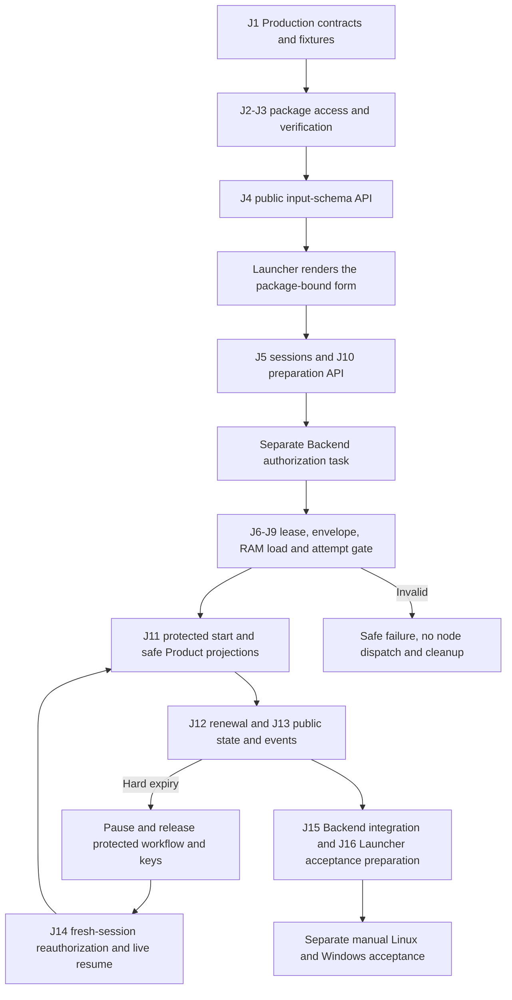

# Phase J — Protected package execution and Launcher integration

## Overview

Phase J adds a protected Product API family beside Studio's Development APIs.
Launcher first reads an installed package's public input schema, then prepares
an authorization session only after the customer confirms Run. Backend issues
a signed lease and a session-encrypted key envelope. Runtime verifies them,
decrypts in RAM, and reuses the existing G/H engine.

**Status:** J1's [contract specification](../j_protected_execution/j1_production_contracts.md)
and test-only protocol fixtures are delivered. J2–J16 code and acceptance remain
planned. No Production endpoint or Backend lease issuer exists merely because
J1 defines it. The current POST /runs remains Development-only.

## One execution order and platform ownership

Follow [phase_j_implementation.md](../../../phase_j_implementation.md) **row by
row**, including its intervening Backend, Launcher and manual tasks. The J
numbers below belong only to Runtime; they are not cross-platform work packages.
This J1–J16 index replaces the prior index. J4 is public schema reading;
all new specifications and handoffs use the numbers below.

| Step                                                      | Runtime responsibility                      | Ordered-plan step | Observable checkout                                                                                                                                                                                     |
| --------------------------------------------------------- | ------------------------------------------- | ----------------: | ------------------------------------------------------------------------------------------------------------------------------------------------------------------------------------------------------- |
| [J1](../j_protected_execution/j1_production_contracts.md) | Production contracts                        |                 1 | Contract and protocol fixtures delivered; runtime implementation remains in later phases.                                                                                                               |
| J2                                                        | Constrained package reading                 |                 5 | Planned. Read installed `.a2m` packages with bounded ZIP processing and safe package references.                                                                                                        |
| J3                                                        | Manifest and package verification           |                 6 | Planned. Verify required entries, identities, hashes and compatibility.                                                                                                                                 |
| J4                                                        | Package input-schema API                    |                 7 | Planned. Return the verified public input schema without authorization-session creation, decryption, run creation or ADB operations.                                                                    |
| J5                                                        | Authorization sessions                      |                10 | Planned. Generate ephemeral keys, bind sessions to the package/owner and clean expired or abandoned sessions.                                                                                           |
| J6                                                        | Lease verification                          |                14 | Planned. Verify signatures, trusted signing-key IDs, timestamps, package/session bindings and replay rules against Backend fixtures.                                                                    |
| J7                                                        | Key-envelope opening                        |                16 | Planned. Validate envelope bindings and open it only with the matching Runtime session key.                                                                                                             |
| J8                                                        | Protected workflow loading                  |                17 | Planned. Authenticate/decrypt in RAM, validate IR/schema consistency and clean protected material on failure.                                                                                           |
| J9                                                        | Authorization gate and hard expiry          |                18 | Planned. Prevent unauthorized attempt starts; enforce remaining-time rules, safe checkpointing, expiry pause and protected-memory cleanup.                                                              |
| J10                                                       | Session-preparation API                     |                19 | Planned. Expose the verified package/session preparation operation through the authenticated local API.                                                                                                 |
| J11                                                       | Protected start API                         |                21 | Planned. Admit authorized packages through the existing engine. Implement start idempotency, Production provenance and protected-result disclosure across existing read APIs.                           |
| J12                                                       | Renewal acceptance                          |                24 | Planned. Accept valid advancing renewals without repeated decryption or execution interruption.                                                                                                         |
| J13                                                       | Authorization state and signals             |                25 | Planned. Expose approved renewal-required, active and expired state/signals without protected material.                                                                                                 |
| J14                                                       | Reauthorization and resume                  |                29 | Planned. Create a fresh session, reload the same package and continue the live paused run after its confirmed checkpoint.                                                                               |
| J15                                                       | Real Backend integration acceptance         |                32 | Planned. Run automated integration against real Backend-issued packages/authorization. Cover denial, tampering, mismatches, renewal, expiry and cleanup. Restore required missing regression harnesses. |
| J16                                                       | Launcher integration acceptance preparation |                33 | Planned. Finalize verified Launcher integration guidance, Runtime-side acceptance support and Linux/Windows behavior checks.                                                                            |

## Integration and security gates

- J1 fixes exact [Product routes, types and policy](../j_protected_execution/j1_production_contracts.md#4-runtime-production-endpoint-inventory)
  and matching Backend contracts. Separate Backend tasks implement immutable
  package consistency, entitled download, lease persistence, issuance, envelopes
  and renewal **before** their dependent Runtime/manual steps.
- J2/J3 reuse the [three-entry package format](../../a2matex-backend/product_submission_release/product_release.md#6-zip-package-contract).
  J4 exposes only its public schema and identity, without decryption or a lease.
- J5/J7/J8 implement secret cleanup with material creation/opening/loading.
  J9 enforces attempt budgets and hard expiry. J11 must not enable start before
  J6–J9 and the Product privacy fences are implemented and verified.
- J11 persists minimal provenance, not protected IR, keys, tokens or input maps.
  Product snapshots/controls and J13 Product events have separate projections;
  Development history/artifact/event APIs cannot bypass Product disclosure.
  Reuse repositories/streaming/engine code, not a second database or broker.
- Ordinary renewal reuses the active decrypted IR. J14 requires a fresh key,
  advancing same-family authorization, the same package and confirmed live
  checkpoint. It preserves live RAM execution state and never resumes old runs
  after Runtime restart or blindly redispatches uncertain Android work.
- Local session authentication, customer Backend authentication and signed
  Product execution permission are distinct. There is no global mode flag,
  commercial device ceiling or automatic hardware-based selection reduction.
- Backend schema migrations are prepared/reviewed by the implementation task
  and applied only by the user at the ordered manual database step.

## Completion and guides

Update the [Launcher handoff](../integration/launcher.md) and shared API reference
with each implemented endpoint, its exact requests/statuses/retry behavior and
stated host evidence. J1 examples are contracts, not a runnable-build guide.
J15 tests a real Backend exchange; J16 prepares final Launcher acceptance.
The final manual row verifies the actual Launcher on Linux and Windows.
Neither fixtures, cross-compilation nor documentation alone closes that gate.

The shared business/security sources remain
[Production authorization](../../../specifications/production_execution_authorization_v1.md)
and [key security](../../../specifications/cryptographic_key_security.md).
