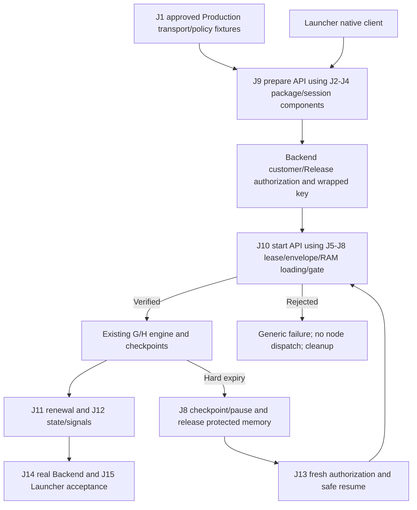

# Phase J — Protected package execution and Launcher integration

## Overview

Phase J gives Launcher a protected Product Run path alongside Studio's
Development API. Runtime reads an installed .a2m ZIP, verifies immutable package
identity and Backend authorization, opens the session-bound key envelope,
decrypts/validates Runtime IR in memory, and reuses the G/H engine.

The installed encrypted package may remain on disk. Plaintext workflow and
transient private/content keys are held only for their authorized lifetime;
cleanup belongs to every owning step. Session preparation and protected start
are separate APIs. J10 cannot expose execution before the authorization and
hard-expiry gate is ready.

**Status** — J1–J15 are planned. The current POST /runs is Development only.
Exact Production paths/DTOs/error codes are not invented by this index; J1
approves them before implementation. Backend and Launcher counterparts are
explicit dependencies, not implied delivered features.

## Steps and specifications

| Step | One responsibility                         | Direct prerequisites                           | Observable checkout                                                                                                                     |
| ---- | ------------------------------------------ | ---------------------------------------------- | --------------------------------------------------------------------------------------------------------------------------------------- |
| J1   | Production transport and policy contract   | Production authorization/key/package contracts | Approve session/start/renewal/status schemas, identity bindings, errors, disclosure, lifecycle signals, and cross-component fixtures.   |
| J2   | Constrained package access and ZIP reading | J1, Backend package format                     | Resolve an approved installed .a2m reference and reject path escapes, invalid entries, and archive size/decompression violations.       |
| J3   | Package identity and manifest verification | J2                                             | Detect modified package bytes, invalid manifests/hashes, and incompatible metadata before protected execution.                          |
| J4   | Runtime authorization sessions             | J1/J3, B3/B5                                   | Generate ephemeral session keys/public metadata and bound pending-session lifetime, count, ownership, and cleanup.                      |
| J5   | Execution-lease verification               | J1/J4, Backend signing fixtures                | Verify signatures, required claims, time bounds, session/public-key identity, and immutable package/release bindings without dispatch.  |
| J6   | Key-envelope opening                       | J4–J5                                          | Open only the envelope bound to the accepted Runtime session/lease and retain no plaintext key outside its owned lifetime.              |
| J7   | Protected workflow loading                 | J3/J6, G1                                      | Authenticate/decrypt in RAM, verify IR/schema consistency, validate exact IR, and return only approved Production disclosure.           |
| J8   | Authorization attempt gate and hard expiry | J5/J7, H pause lifecycle                       | Prevent unauthorized attempt starts; checkpoint/pause safely at hard expiry and release protected plaintext/key material.               |
| J9   | Production session-preparation API         | J1–J4                                          | Expose bounded package/session preparation with current local authentication and exact Launcher request/response examples.              |
| J10  | Production start API                       | J5–J9, G12/H scheduler                         | Admit verified protected work through the existing engine/scheduler with correct replay, ownership, errors, and no plaintext transport. |
| J11  | Lease renewal                              | J5/J8/J10, Backend renewal fixtures            | Accept valid advancing renewals without repeating workflow decryption or interrupting authorized execution.                             |
| J12  | Authorization status and renewal signals   | J1/J4/J8/J11                                   | Expose approved state/renewal-required signals so Launcher can renew in time without exposing lease/key/plaintext material.             |
| J13  | Reauthorization and resume                 | J4–J8/J10–J12, H11                             | Use a fresh authorization session after hard expiry and continue the same package from a confirmed checkpoint without action replay.    |
| J14  | Backend authorization integration          | J1–J13; Backend owner                          | Verify a real entitled Release/package/key-envelope/lease round trip, renewal, denial, and session/package mismatch cases.              |
| J15  | Launcher integration acceptance            | J14; Launcher owner                            | Run an installed product, renew, expire, reauthorize/resume, stop, and reopen its saved result using verified guides.                   |

## Security, lifetime, and integration gates

- Reuse the [package format](../../a2matex-backend/product_submission_release/product_release.md#6-zip-package-contract),
  [Production authorization](../../../specifications/production_execution_authorization_v1.md),
  and [key-security contract](../../../specifications/cryptographic_key_security.md).
  J1 reconciles Runtime/Backend/Launcher transport, identity, disclosure,
  expiry/recovery, and authorization-state/event extensions before coding.
- J2/J3 use standard ZIP handling and bounded approved package references.
  Runtime reads workflow.enc and verifies hashes/manifest/schema bindings;
  an archive is never submitted to Studio authoring validation as a graph.
- J4/J6/J7 implement cleanup with material creation/loading, including failed
  admission, completion, cancellation, shutdown, pending-session expiry, and
  hard authorization expiry. Do not postpone cleanup to J15 or promise secure
  erasure beyond platform guarantees. No plaintext workflow/key persistence or
  plaintext response to Launcher is allowed.
- J8 enforces authorization at attempt boundaries and preserves the bounded
  safe-result rule for already dispatched Android work. Hard expiry pauses with
  the approved authorization state and drops protected execution material.
  J13 uses a fresh session and verified package/checkpoint; it never replays an
  uncertain side effect. Ordinary lease renewal reuses the active decrypted IR.
- J9 may prepare a session without starting nodes. J10 is enabled only after
  J5–J8 are verified. Fixture-based crypto tests are distinct from J14's actual
  Backend round trip and J15's actual Launcher integration.
- Backend owns entitlement/Release checks, signing, and wrapping. Launcher owns
  download, customer authentication, authorization/renewal requests, forwarding,
  and UI. Runtime owns verification, key lifetime, protected loading, deadlines,
  execution, and safe cleanup. API families coexist without a global mode flag.
  Local worker limits are resource bounds, not commercial device/lease limits.

## Completion and guides

Update the [Launcher guide](../integration/launcher.md) and shared API reference
with each delivered Production endpoint, including exact auth, request, success,
denial, renewal, and lost-response behavior. J15 consolidates verified examples
and end-to-end evidence; it does not begin guide writing. Include package/session
mismatch, denial, expiry, renewal, reauthorization, owner shutdown, and restart.
Only a real authorized installed product run completes the Production milestone.
