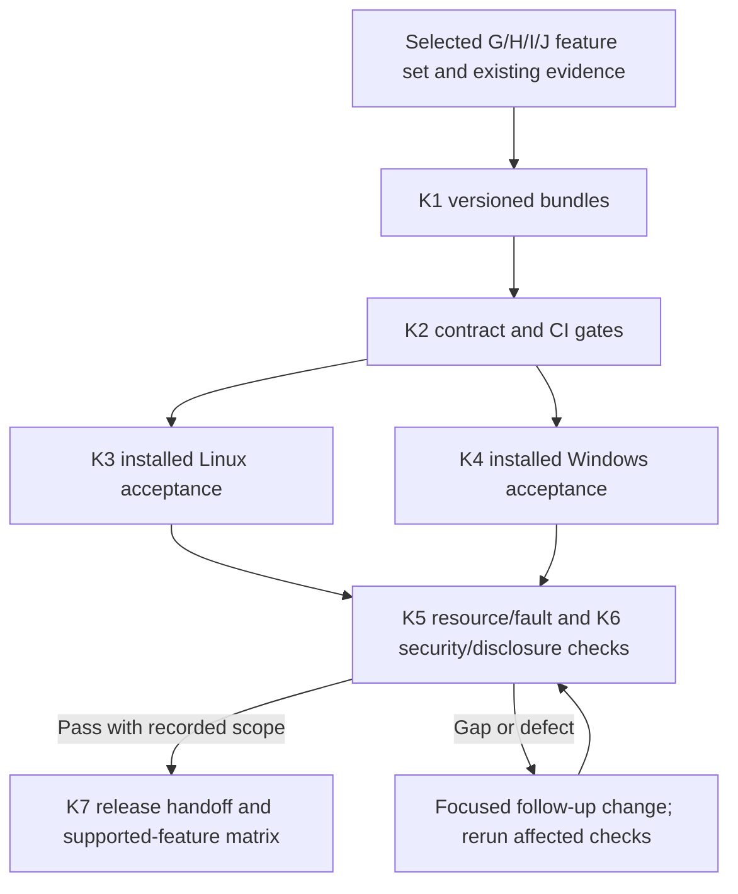

# Phase K — Distribution and release acceptance

## Overview

Phase K checks the assembled product as an installed release on Linux and
Windows. It builds distribution bundles, consolidates contract/resource/security
evidence, and records what users and client developers can rely on.

Earlier phases own their tests and fixes. K reuses that evidence and adds the
installed-system checks that isolated helpers cannot prove. A discovered defect
gets a focused follow-up change; K is not a catch-all implementation task.

**Status** — K1–K7 are planned release tasks. No platform, security, or package
acceptance is claimed by creating this index.

## Steps and specifications

| Step | One responsibility                 | Direct prerequisites               | Observable checkout                                                                                                                       |
| ---- | ---------------------------------- | ---------------------------------- | ----------------------------------------------------------------------------------------------------------------------------------------- |
| K1   | Distribution bundle                | Required G/H/I/J release features  | Produce versioned Linux/Windows bundles containing required ADB files and embedded migrations; define installed paths/configuration.      |
| K2   | Contract and CI release checks     | K1, existing A8 and phase evidence | Run applicable Go/TypeScript fixtures, compiler/IR/API/event/Production checks, build, vet, race, and required release checks.            |
| K3   | Installed Linux acceptance         | K1–K2                              | Test installed startup, paths, migration/data preservation, Android execution, owner shutdown, reconnect, and crash recovery.             |
| K4   | Installed Windows acceptance       | K1–K2                              | Run equivalent native Windows process/storage/ADB tests; cross-compilation alone cannot satisfy this checkout.                            |
| K5   | Resource and fault testing         | K1–K4, G/H/I/J bounds              | Check sustained execution/observation, bounded queues/goroutines/memory, injected persistence/process faults, and focused parser fuzzing. |
| K6   | Security and disclosure acceptance | J14–J15, K1–K5                     | Review tampering, authorization boundaries, injection/path handling, redaction, artifact access, and protected-data persistence.          |
| K7   | Final release handoff              | K2–K6, Studio/Launcher owners      | Publish the actual supported-feature/platform matrix, evidence, limitations, runnable demos, and verified integration guides.             |

## Evidence and scope

- Reuse earlier unit/integration tests for parsers, validators, handlers,
  transitions, atomic checkpoints, rollback/recovery, strict HTTP auth/decoding,
  replay idempotency, SSE continuity/backpressure, and package/lease verification.
  K2 checks the applicable hash-verified A8/Production fixtures across Go and
  TypeScript consumers and the selected release's existing required checks.
- K1 packages the supported executable and ADB toolchain, required Windows
  companion files, build identity, installation/configuration guidance, and
  embedded Goose migrations. A fresh install and existing user data must both
  be exercised without destructive database reset.
- K3/K4 record native process/pipe, path, permissions, SQLite lock/migration,
  Android action, app exit, and interruption evidence. Use the declared supported
  physical/emulator target matrix and independent targets for multi-device
  checks. Cross-compilation is build evidence, not native Windows acceptance.
- K5 includes goroutine/resource bounds, slow clients, long runs, fault injection,
  race checks, and focused ADB/IR/package parser fuzzing. Intentional retained
  execution history is not automatically deleted as a resource-test workaround.
- K6 includes injection, traversal, package/lease tampering, artifact ownership,
  log redaction, generic Production disclosure, and checks for persisted
  plaintext workflow/keys/authorization material.
- K7 reports implemented, verified, pending, and unsupported capabilities
  separately. It includes Studio/Launcher handoff and runnable manual examples;
  a missing acceptance host remains an explicit gap, not a passing check.

## Deferred work

Automatic app updating, catalog synchronization, generalized archival/search,
new connectors/graph semantics, publisher Log behavior, and speculative display
caching remain separately approved future work. Release defects do not authorize
unrelated refactoring or another platform's feature implementation.
