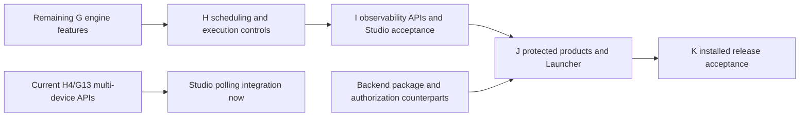

The Runtime Agent should be implemented as small, reviewable modules with strict contracts first. The core Runtime can be completed without the Submission module; only the Production package/license path depends on the later Product–Submission–Release backend group.

This reorganized plan also corrects the current LDPlayer-first and handler-version assumptions in the existing Runtime documents.

## 1. Product overview — how the Runtime Agent works

A2MaTeX lets a user design an Android automation visually, but the workflow
still needs a trusted component on the user's computer to turn that design into
real device operations. The Runtime Agent is that component. It is the local
execution bridge between Studio or Launcher and any Android endpoint that ADB
can detect, including physical devices and emulators. ADB, the Android Debug
Bridge, is the standard tool used to communicate with those devices.

The MVP is designed around a simple promise:

> Design the workflow once, select the available Android devices, and let the
> Runtime execute the same validated steps on each device while preserving a
> trustworthy record of what happened.

### The user journey

1. The user builds a workflow from the supported nodes in Studio.
2. Studio sends the current `editorGraph` and `inputSchema` to the local Runtime
   for validation and compilation. It shows deterministic errors and may cache
   the returned Runtime IR in the local Project Draft.
3. Studio sends that exact executable Runtime IR—the machine-readable workflow
   package—together with per-device inputs and selected current ADB serials
   through the authenticated loopback run API.
4. The Runtime independently validates the executable document and rechecks
   every selected device. Invalid input creates no run and sends no device
   command.
5. The Runtime creates a persisted run group, schedules only the configured
   number of devices concurrently, and executes nodes sequentially on each
   device.
6. A node handler converts each approved workflow operation into one of the
   Runtime's predefined device commands. Only the device subsystem may
   translate that command into a process invocation for the selected ADB
   serial.
7. After every attempt, the Runtime atomically records the result, validated
   output, next node, execution state, and client event before continuing.
8. Studio or Launcher follows progress through snapshots and replayable events,
   and can pause, resume, or cancel a run without directly controlling ADB.

```text
Studio (Development) or Launcher (Production)
                 |
                 | authenticated local API
                 v
       validate exact workflow and inputs
                 |
                 v
       persist RunGroup and device work
                 |
          bounded scheduler
          /       |       \
         v        v        v
     Device A  Device B  Device C
      active    active     queued
         |        |
         v        v
      sequential node execution
                 |
                 v
        persisted checkpoints
                 |
                 v
       snapshots + replayable events
                 |
                 v
         observable client status
```

### Why this architecture matters

- **Real execution:** MVP Android nodes must perform real ADB operations; a
  fake executor is only a test double and cannot satisfy product acceptance.
- **Device independence:** the execution path depends on the ADB protocol, not
  on LDPlayer-specific APIs, so the same model supports physical devices and
  ADB-visible emulators.
- **Safety at the boundary:** workflows cannot provide executable paths, shell
  fragments, raw ADB arguments, target serials, or artifact paths.
- **Predictable multi-device operation:** all selected devices may run concurrently,
  with capacity derived from admitted membership and sequential nodes per device.
- **Observable and recoverable execution:** committed state is the source of
  truth; events describe committed changes, and a client can recover its view
  from a snapshot when event history is unavailable.
- **Failure isolation:** a disconnected or failed device does not silently
  corrupt another device's progress, and uncertain work is not automatically
  replayed after a crash.
- **Contract consistency:** Studio, Backend, and Runtime use the same accepted
  contract fixtures so disagreements can be detected before release.

Development mode connects Studio directly to the local Runtime for validation
and draft execution. Production mode later connects Launcher to the same core
engine after Backend package, entitlement, and release contracts exist. The
execution engine remains local in both modes; neither Studio nor Launcher owns
ADB commands or authoritative execution state.

This section describes the intended MVP behavior. Each capability becomes an
implemented claim only after its phase gate and real-device acceptance checks
pass.

## 2. MVP scope lock

The first usable Runtime release includes:

- Generic Android device discovery through ADB.
- Real execution—never simulated execution.
- The catalog has these 15 accepted node contracts; execution availability follows
  the tested feature matrix (Wait Variable is deferred with H6–H8; utility.log remains deferred):
  - `flow.start`
  - `flow.end`
  - `flow.delay`
  - `flow.set_variable`
  - `flow.wait_variable`
  - `flow.switch`
  - `utility.log`
  - `android.launch_app`
  - `android.tap`
  - `android.swipe`
  - `android.long_press`
  - `android.input_text`
  - `android.press_back`
  - `android.press_home`
  - `android.screenshot`
- Success and error transitions.
- Timeout, bounded retry, and error policies.
- Single-device and selection-driven multi-device execution without a fixed count ceiling.
- Persistent execution state, checkpoints, typed events, and screenshot artifacts, plus separate structured operational logs.
- Pause, resume, cancel, disconnect recovery, and crash interruption handling.
- Studio Development mode.
- Later, Launcher Production mode when the Backend release APIs exist.

Explicitly deferred until after release:

- Node-handler versioning.
- Loops and parallel/join graph logic.
- Wait-for-element.
- OCR and image matching.
- HTTP, Telegram, Google Sheets, and other connectors.
- Test-one-node and arbitrary run-from-node modes until their binding and
  stopping contracts are defined.
- Automatic replay of uncertain side-effecting nodes after crashes.
- Performance-oriented handler/version rollout mechanisms.
- Persistent device registry, aliases, provider correlation, and emulator
  lifecycle management.

Handler versioning is deferred, but these versions remain necessary:

- Runtime application version.
- Runtime IR format version.
- `minimumRuntimeVersion` compatibility checks.

## 3. Proposed logical architecture

These are logical module boundaries, not yet approved folder names:

```text
Runtime Agent
├── Contracts
│   ├── Runtime IR
│   ├── Local API
│   ├── Session device selection rules
│   ├── Execution state
│   ├── Events and errors
│   └── Typed device commands
├── Agent foundation
│   ├── Configuration
│   ├── Supervisor
│   ├── Structured logging
│   └── Local authentication
├── Validation subsystem
│   ├── Editor Graph validator
│   ├── Deterministic diagnostics
│   ├── Supported-node contract checks
│   └── Runtime IR admission validator
├── Device subsystem
│   ├── Safe process runner
│   ├── ADB toolchain
│   ├── Generic ADB discovery
│   ├── Readiness probe
│   └── Session inventory
├── Execution subsystem
│   ├── IR admission gate
│   ├── Binding resolver
│   ├── Handler registry
│   ├── Workflow transition engine
│   ├── Device execution runner
│   └── Multi-device scheduler
├── Persistence
│   ├── SQLite store
│   ├── Atomic checkpoints
│   ├── Execution events
│   └── Artifact metadata
├── Integrations
│   ├── Studio Development mode
│   └── Launcher Production mode
└── Node handlers
    ├── Flow handlers
    └── Android handlers
```

The Go design should use explicit constructors, small interfaces defined by their consumers, context propagation, bounded concurrency, and a clear owner for every goroutine.

## 4. Detailed implementation sequence

Each numbered item is one independently reviewable checkout. We stop for review after each one.

### Phase A — Freeze contracts before writing the engine

| ID  | Module                        | Deliverable                                                                                                                                           | Checkout condition                                                                                       |
| --- | ----------------------------- | ----------------------------------------------------------------------------------------------------------------------------------------------------- | -------------------------------------------------------------------------------------------------------- |
| A1  | Contract decision register    | Decide Runtime IR version representation, local transport, event transport, ADB resolution policy, artifact location, and identifier formats          | No unresolved decision blocks schema authoring                                                           |
| A2  | Runtime IR v1 contract        | Strict workflow, node, edge, binding, timeout, retry, error-policy, capability, and metadata rules                                                    | All 15 accepted MVP nodes can be represented; unknown fields and invalid graphs are rejected             |
| A3  | Session device selection      | Freeze ephemeral ADB discovery, selection by current serial, start-time revalidation, and no-Device-entity rule                                       | Device ownership does not overlap A5, A6, or A7                                                          |
| A4  | Typed device command contract | Eight closed Android commands; non-screenshot success has no payload and Screenshot returns only `artifactId`                                         | Workflow data cannot control an executable, raw arguments, target serial, shell syntax, or artifact path |
| A5  | Execution schemas             | Three persisted records, reduced lifecycle states, atomic checkpoint operation, single-active-run invariant, and derived summary                      | Every transition, selected serial, node output, and interruption has one owner                           |
| A6  | Event and error schemas       | Four typed state events, Runtime-wide replay cursor, reduced stable errors, retryability, expiry recovery, and sanitization                           | Client can replay changes or recover from a watermarked snapshot without parsing logs                    |
| A7  | Local API schema              | Protected token handoff, compatibility info, separate validation and compilation, devices, idempotent start, status/control, snapshot, SSE, and screenshots | Every endpoint has strict request, response, error, authentication, and cursor semantics                 |
| A8  | Contract fixtures             | Accepted 19-case set plus a new immutable set of paired compiler inputs, exact IR outputs, and diagnostics                                            | Canonical bytes and expectations are reviewable; later Go and TypeScript suites consume them             |

A1 through A8 are accepted. Their authoritative decisions are recorded in
[`phase_a.md`](./phase_a.md).

Important contract rules:

- Unknown fields are rejected at trust boundaries.
- Collection sizes and string lengths are bounded.
- `formatVersion` versions the Runtime IR structure.
- Registry lookup is `runtimeHandler → handler`; there is no handler-version key yet.
- The Runtime validates node inputs and outputs against the approved node contracts.
- Node Definition changes cannot silently change the Runtime contract.
- A3 owns only selection rules; A5 owns persisted selected serials, A6 owns
  failures, and A7 owns device-related JSON payloads.
- A6 events describe committed A5 changes; they do not replace the A5 state
  snapshot or B4 operational logs.
- A7 exposes no generic CRUD: API projections cannot mutate A5 records or
  extend A6 payloads.

### Phase B — Runtime process foundation

| ID  | Module                | Depends on | Deliverable and checkout condition                                                                                                  |
| --- | --------------------- | ---------- | ----------------------------------------------------------------------------------------------------------------------------------- |
| B1  | Go project skeleton   | A1         | Minimal executable, internal packages, build metadata, and test layout; no unnecessary framework                                    |
| B2  | Configuration         | B1         | Strict startup configuration for shutdown, loopback HTTP, and logging; later subsystems add settings only with their implementation |
| B3  | Supervisor            | B1–B2      | Root context, component startup ordering, graceful shutdown, and bounded shutdown timeout                                           |
| B4  | Logging and redaction | B1         | Structured logs containing run/device/node correlations without secrets or protected workflow payloads                              |
| B5  | Local authentication  | A7, B2     | Per-startup random token, protected per-user connection-file handoff, constant-time verification, and cleanup                       |
| B6  | Minimal local API     | B3–B5      | Loopback-only minimal health plus the authenticated A7 runtime-information handshake                                                |

Gate: the agent starts, reports readiness, rejects unauthenticated requests, and exits cleanly without goroutine leaks.

### Phase C — Local workflow validation and compilation

This phase is an early Runtime reliability boundary. It gives Studio local,
deterministic authoring feedback and compiles source content before any
persistence, ADB discovery, run creation, or device command. Studio supplies
content and consumes the result; it does not own compiler logic.

| ID  | Module                  | Deliverable and checkout condition                                                                                                      |
| --- | ----------------------- | --------------------------------------------------------------------------------------------------------------------------------------- |
| C1  | Validation contracts    | Implement the A7 result envelope, stable diagnostic codes, deterministic ordering, diagnostic cap, and payload limits                   |
| C2  | Editor Graph decoder    | Strictly decode the supported Editor Graph version and reject unknown fields and invalid bounded values                                 |
| C3  | Topology validator      | Validate limits, unique IDs, Start/entry, endpoints, End rules, reachability, and acyclicity using bounded traversals                   |
| C4  | Node-contract validator | Validate node types, source ports, and static configuration against the Runtime's immutable supported-node registry                     |
| C5  | Local validation API    | Expose authenticated content-only validation for Studio without saving, compiling, enqueuing, or executing the workflow                 |
| C6  | Cross-language parity   | Vendor and run A8 Editor Graph fixtures against Backend/TypeScript and Runtime/Go; compare classifications and ordered diagnostic codes |
| C7  | Compilation registry    | Provide immutable installed node semantics needed to compile A2 without accepting definitions from Studio                              |
| C8  | Runtime IR compiler     | Validate and compile graph plus input schema into a complete A2 document or return diagnostics with no partial IR                       |
| C9  | Local compilation API   | Expose authenticated content-only compilation without project IDs, expected versions, persistence, run creation, ADB, or queue work    |

The local validator answers whether an Editor Graph is valid for authoring. It does not authorize execution and does not validate device availability. A saved `validationSummary` is evidence of an earlier check, not a trusted Runtime decision.

Gate: Studio can submit valid and invalid source fixtures and receive the same
bounded diagnostics and exact compiled IR from repeated calls. Validation and
compilation perform no database write, create no run, and invoke no ADB command.

### Phase D — Persistence and observability foundation

See the [Phase D specifications and integration review](phase_d.md).

Persistence comes before workflow execution so the first real execution is observable.
It does not persist Project Drafts or compiler results; Studio owns that local
cache and Phase D begins only after an exact Runtime IR is admitted for a run.

| ID  | Module                       | Deliverable and checkout condition                                                                                       |
| --- | ---------------------------- | ------------------------------------------------------------------------------------------------------------------------ |
| D1  | SQLite schema and migrations | Reviewed tables, unique RunGroup request IDs, constraints, indexes, migration mechanism, and retention model             |
| D2  | Execution repository         | Context-aware, parameterized state reads/writes with explicit transaction boundaries                                     |
| D3  | Event repository             | A1 Runtime-wide monotonic cursor allocation, retention, and reconnect queries                                            |
| D4  | Atomic checkpoint writer     | Attempt result, validated node output, next position, execution state, and resulting events persisted in one transaction |
| D5  | Artifact store               | Binary files outside SQLite; safe paths, hashes, dimensions, media type, and metadata inside SQLite                      |
| D6  | Startup recovery             | Previously active executions become `INTERRUPTED`; no automatic uncertain replay                                         |

Gate: committed state always exists before an event is broadcast.

The first real run uses D1–D4 and D6. Deliver D5 with F7 Screenshot, when the
engine needs to commit a retrievable image reference with a successful attempt.

Flow and Global variables are RAM-only under G16/G17. G18 confirms the existing
successful node checkpoint before publishing its assignment to RAM and owns
store handoff/cleanup. Variable values/maps are not added to SQLite or checkpoint
schemas. See the [G18 ownership and publication specification](../g_workflow_engine/g18_set_variable_execution.md).

### Phase E — Generic Android device subsystem
See the [Phase E specification index](phase_e.md).

| ID  | Module                 | Deliverable and checkout condition                                                                                                  |
| --- | ---------------------- | ----------------------------------------------------------------------------------------------------------------------------------- |
| E1  | Safe process runner    | Executes an explicit binary with separate arguments, timeout, cancellation, bounded output, exit code, stdout, stderr, and duration |
| E2  | ADB toolchain resolver | Selects a Runtime-controlled or explicitly configured ADB executable                                                                |
| E3  | ADB discovery parser   | Parses `adb devices -l`, including device, offline, unauthorized, and malformed output                                              |
| E4  | Device readiness probe | Checks boot completion and fixed command prerequisites without collecting unused platform or screen metadata                        |
| E5  | Session inventory      | Keeps the latest discovery result in memory only; no Device table, UUID, alias, history, or provider correlation                    |
| E6  | Selection preflight    | Rejects duplicate serials and revalidates every selected endpoint immediately before run admission                                  |
| E7  | Device API             | Implements the A7 discovery and refresh responses without creating persistent device records                                        |

Gate:

- A physical Android device works using only ADB.
- Android Studio Emulator and other ADB-visible emulators use the same
  session endpoint path.
- Restarting Runtime discards the inventory without losing execution history,
  because A5 persists the accepted serial on each device execution.

### Phase F — Real device commands and current handlers

See the [Phase F specification index](phase_f.md).

The Phase F dispatcher, registry, and required node handlers are implemented.
The index records shipped registrations, Linux verification, outstanding
native and live acceptance, and the Screenshot integration assigned to
Phase G/A7.

| ID  | Module             | Real operation                                                                                                  |
| --- | ------------------ | --------------------------------------------------------------------------------------------------------------- |
| F1  | [Command dispatcher](../f_device_commands/f1_command_dispatcher.md) | Binds every command to one explicit ADB serial and rejects arbitrary commands |
| F2  | [Launch App](../f_device_commands/f2_launch_app.md) | Dispatches a package-scoped launcher intent and checks Android's launch result |
| F3  | [Tap](../f_device_commands/f3_tap.md) | Taps using explicit pixel, screen-percentage, or selector-ID targeting |
| F4  | [Swipe](../f_device_commands/f4_swipe.md) | Swipes between two pixel or percentage targets with a bounded duration |
| F5  | [Input Text](../f_device_commands/f5_input_text.md) | Types supported text into the focused field through one safely quoted ADB argument |
| F6  | [Key events](../f_device_commands/f6_key_events.md) | Dispatches one fixed Back or Home key event on the selected Android device |
| F7  | [Screenshot](../f_device_commands/f7_screenshot.md) | Captures the full screen or a two-point pixel or percentage region and publishes its PNG through D5 |
| F8  | [Flow handlers](../f_device_commands/f8_flow_handlers.md) | Implements Start, End, and cancellable Delay. Log depends on approval of sensitive-data handling. |
| F9  | [Handler registry](../f_device_commands/f9_handler_registry.md) | Registers enabled type/handler pairs and supplies Runtime Info and future admission lookup. |
| F10 | [Long Press](../f_device_commands/f10_long_press.md) | Holds a pixel, percentage, or selector-ID target for the requested bounded duration |

The [Android targeting contract](../contracts/android_targeting.md) is split by
responsibility. C7–C9 compile the selected mode and its bindings into Runtime
IR without device access. Phase E provides the shared process runner, ADB
toolchain, and selected-device state. Phase F owns target resolution,
dispatcher and handler registration, execution error mapping, and real-device
acceptance. Percentage and selector lookups run on demand against the selected
device.

A fake device executor may exist only as a test double. Passing a fake test does not satisfy the product checkout. Each Android handler needs a real-device acceptance test.

Command completion must distinguish:

- Command dispatched successfully.
- Device operation observed successfully.
- Business result confirmed by a later explicit observation.

For example, a successful tap means ADB accepted the tap command; it does not prove that a purchase, login, or other business outcome occurred.

### Phase G — Workflow engine

See the [Phase G specification index](phase_g.md). G1 is accepted and implemented.
G2–G22 are the implementation order, with one focused responsibility per step.
G2–G13 are implemented and verified internally on Linux, with Windows amd64
cross-compilation. G10's real-ADB manual milestone and native Windows execution
remain pending.
G11 shutdown is verified with controlled workflows, SQLite, and Linux owner
processes. Live Android stop acceptance remains unverified.
G12 admission is implemented and verified with real SQLite and controlled
device readiness. G13 snapshot APIs are implemented and Linux-verified; native Windows execution
remains unverified. G14 single-device POST is implemented and Linux-verified, including live
Waydroid and managed shutdown/recovery. Windows cross-compilation passes;
native Windows remains unverified. H1/H2 remain later multi-device work.
G15 Switch execution is implemented and Linux-verified, including compile/start/
snapshot integration with real SQLite. Windows cross-compilation passes;
native Windows remains unverified.
G16 RAM-only scoped storage is implemented and Linux-verified, including quotas,
checkpoint-confirmed publication, concurrency/cancellation tests, and a local
smoke demo. Windows cross-compilation passes; native Windows remains unverified.
G17 internal variable reads are implemented and Linux-verified through resolver,
runner, and attempt integration, including real-SQLite checkpoint tests and a
local RAM/resolver demo. Windows cross-compilation passes; native Windows is
unverified. G18 now supplies live run ownership and Set Variable execution.
G18 is implemented and Linux-verified: checkpoint-confirmed RAM writes,
CREATED-only store/views, joined cleanup, and compile/start/poll/replay pass.
Real-SQLite fault/rollback tests and built-agent managed shutdown, owner loss,
and forced crash/restart checks pass with controlled ADB readiness. Full/race
tests, vet, formatting, Linux build, and Windows amd64 agent/test cross-builds
pass; native Windows and live Android acceptance remain unverified.
G19 Screenshot execution is implemented and Linux-verified through the actual
handler registry, real PNG/SQLite settlement, and built-agent HTTP flows with
controlled ADB output. Full/race tests, vet, Linux build, and Windows amd64
agent/test cross-compilation pass. Managed stop/owner loss and forced crash
at PNG publication preserve committed images, remove orphan files on restart,
and never recapture old work. Native Windows/live Android remain unverified.
G20's authenticated PNG download API is implemented and Linux-verified.
Automatic committed-output discovery remains A7/I1.
G21 final-result verification is complete and Linux-verified: 23 focused scenarios
plus existing terminal-race, persistence, recovery, and lifecycle regressions
pass. Full/race tests, vet, Linux build, and Windows cross-compilation pass;
no production change was needed. Native Windows/live Android remain unverified.
G22 specification, combined example, and automated Linux process acceptance are
delivered: ten scenarios pass against the real built agent with controlled ADB,
plus full/race suites and an independently race-instrumented child agent.
No production change was needed. Real Android and native Windows acceptance
remain pending; the M5 real-device gate is not yet closed.
Each step receives its own spec when that work is taken up; this roadmap does
not create placeholder specifications.

| ID  | Module                                                                                        | Deliverable and checkout condition                                                                                                                                                                                                                                  |
| --- | --------------------------------------------------------------------------------------------- | ------------------------------------------------------------------------------------------------------------------------------------------------------------------------------------------------------------------------------------------------------------------- |
| G1  | [Runtime IR admission validator](../g_workflow_engine/g1_runtime_ir_admission.md)             | Implemented. Validate the exact IR, graph, bindings, per-device inputs, installed handlers, compatibility, and content bounds before run creation.                                                                                                                  |
| G2  | [Direct input bindings](../g_workflow_engine/g2_direct_input_bindings.md)                     | Implemented and verified. Resolve literal and per-device workflow inputs into owned, typed handler inputs; reject missing or invalid values without dispatch.                                                                                                       |
| G3  | [Handler output validation](../g_workflow_engine/g3_handler_output_validation.md)             | Implemented and verified. Validate returned output against the installed definition before success, persistence, or downstream consumption.                                                                                                                         |
| G4  | [Previous-node output bindings](../g_workflow_engine/g4_previous_node_output_bindings.md)     | Implemented and verified. Resolve NODE_OUTPUT from successful committed results belonging to this device execution; reject unavailable or incompatible values.                                                                                                      |
| G5  | [Ordinary routing](../g_workflow_engine/g5_ordinary_routing.md)                               | Implemented and verified. Choose the success edge, configured error edge, or terminal result for ordinary nodes; preserve STOP and ERROR_BRANCH semantics. G9/G10 checkpoint and sequential dispatch integration is verified.                                       |
| G6  | [Attempt deadlines](../g_workflow_engine/g6_attempt_deadlines.md)                             | Implemented and verified. Invoke one registered handler under its effective attempt timeout and caller cancellation; return observations for G7. G9/G10 attempt and sequential execution integration is verified.                                                   |
| G7  | [Execution outcome normalization](../g_workflow_engine/g7_execution_outcome_normalization.md) | Implemented and verified. Map invocation and engine evidence to consistent attempt outcomes and safe A6 errors; prohibit unsafe continuation through an internal Stop flag. G9/G10 attempt and sequential execution integration is verified.                        |
| G8  | [Safe retry policy](../g_workflow_engine/g8_safe_retry_policy.md)                             | Implemented and verified. Reuse D4 metadata to decide proven-safe retries within attempt limits and provide a cancellable fixed delay; G9/G10 retry execution is verified; G11 retry-gap cancellation settlement is verified.                                       |
| G9  | [Checkpointed node attempt](../g_workflow_engine/g9_checkpointed_node_attempt.md)             | Implemented and verified. Coordinate one attempt through G2–G8 and D4; confirm begin before dispatch and finish before releasing output or continuation. G10 owns retry waiting and the loop.                                                                       |
| G10 | [Sequential device runner](../g_workflow_engine/g10_sequential_device_runner.md)              | Internal runner implemented and verified. Execute one admitted device through G9 with isolated inputs/outputs, retry waiting, and G11 handoff. JSON smoke and SQLite checks pass; real-ADB/native Windows acceptance remain pending.                                |
| G11 | [Runner shutdown](../g_workflow_engine/g11_runner_shutdown.md)                                | Implemented and Linux-verified. Preserve owner cause, fence/join work, and commit intentional cancellation before SQLite closes; owner loss/failure retains D6 fallback. Windows cross-build passes; native Windows/live Android stop acceptance remain unverified. |
| G12 | [Admission coordination](../g_workflow_engine/g12_admission_coordination.md) | Internal service implemented and Linux-verified. Replay, G1/G10/E6, fenced D2 admission, CREATED-only handoff, concurrency/shutdown/fault tests, and SQLite smoke pass. Windows cross-compilation passes; no scheduler/API is introduced. |
| G13 | [Run snapshot APIs](../g_workflow_engine/g13_run_snapshot_apis.md) | Implemented and Linux-verified. Both authenticated GET routes reuse consistent D2 reads; DTO/errors, real SQLite, concurrent cursors, built agent, ownership regression, and client guides verified. Windows agent/API tests cross-compile; native Windows remains unverified. |
| G14 | [Start-run API](../g_workflow_engine/g14_start_run_api.md) | Implemented and Linux-verified. Originally one device; H4 now uses G12.Admit and H1–H3 group ownership; 201 new/200 replay. Real SQLite, live Waydroid, and stop/recovery checks pass. Phase H expands scheduling; Windows cross-build passes, native Windows unverified. |
| G15 | [Switch execution](../g_workflow_engine/g15_switch_execution.md) | Implemented and Linux-verified. Resolve the left once, lazily evaluate ordered typed rules, and checkpoint UUID/default/error continuation. Compile/start/snapshot/replay and error-branch integration pass with real SQLite; Windows agent/test cross-compilation passes, native Windows unverified. |
| G16 | [Scoped variable storage](../g_workflow_engine/g16_scoped_variable_storage.md) | Implemented and Linux-verified. RAM scopes, codec, quotas, synchronized publication, cancellation/fencing, and cleanup; full/race tests, vet, Linux build, and local demo pass. Windows cross-compilation passes, native Windows unverified. No SQLite change; G18 live ownership/writes are implemented; H9–H13 controls are implemented; H6–H8 variable waiting remains deferred. |
| G17 | [Variable input bindings](../g_workflow_engine/g17_variable_input_bindings.md) | Implemented and Linux-verified. Flow/Global reads, destination validation, optional view identity/transport, and lazy Switch semantics; full/race tests, vet, build, real-SQLite checkpoint integration, and local demo pass. Windows cross-compiles; native execution unverified. G18 live ownership and writes are implemented. |
| G18 | [Set Variable execution](../g_workflow_engine/g18_set_variable_execution.md) | Implemented and Linux-verified: pure handler, checkpoint-confirmed RAM assignments, CREATED-only store/views, joined cleanup, and actual compile/start/poll/replay. Full/race tests, SQLite faults, managed stop/crash/restart, vet, Linux build, and Windows agent/test cross-builds pass with controlled ADB readiness; native Windows/live Android unverified. No variable SQL or Phase H scheduling. |
| G19 | [Screenshot execution integration](../g_workflow_engine/g19_screenshot_execution.md) | Implemented and Linux-verified: attempt-bound staging, metadata/output pairing, D4/D5 settlement, safe cleanup, and actual registry/API flows. Full/race tests, SQLite faults, managed stop/crash/restart, vet, Linux build, and Windows cross-builds pass with controlled ADB PNG output. Native Windows/live Android unverified; G20 now separately implements retrieval. |
| G20 | [Artifact API](../g_workflow_engine/g20_artifact_api.md) | Implemented and Linux-verified: authenticated GET /artifacts/{artifactId}, exact D5 PNG streaming, safe errors/aborts, and handle closure. Real HTTP, PNG/SQLite, built-agent lifecycle, full/race tests, vet, Linux build, and Windows cross-compilation pass. Native Windows/live Android/UI unverified; automatic output discovery remains A7/I1. |
| G21 | [Final-result verification](../g_workflow_engine/g21_final_result_verification.md) | Complete for the verification scope, Linux-verified: 23 focused real-runner/SQLite/event/HTTP and group-summary cases plus existing terminal-race/persistence/crash regressions pass. Existing D4/repository calculations are reused; no production change needed. Full/race tests, vet, Linux build, Windows agent/test cross-compilation pass; native Windows/live Android unverified. |
| G22 | [Workflow-engine integration acceptance](../g_workflow_engine/g22_workflow_engine_acceptance.md) | Spec/tests/example delivered. Ten actual-agent Linux process scenarios with controlled ADB, real HTTP/SQLite/PNGs/private owner pipes pass, plus full/race suites and independently instrumented agent. No production changes. Windows cross-compilation passes; real Android/native Windows and M5 device gate remain pending. |

**G1 implementation status (2026-11-18).** The pure admission service is implemented
and verified on Linux, with Windows amd64 cross-build passing. Its accepted
behavior and implementation remain unchanged. G10 consumes the checked content,
G12 connects admission, and G14 exposes the start API. See the G1 spec for its
verification record and build-version gate.

**Execution guarantees.** G1 always checks the exact executable document, even
when Phase C, Studio, or Backend previously validated the source. Development
uses the successful C9 IR; Production later uses the decrypted IR verified by J7/J10.
G1 never recompiles source or trusts a cached validation result. G10 owns that
checked document and per-device inputs for the run's in-memory lifetime. Losing
the HTTP connection after admission does not cancel execution; owner shutdown
does, through G11.

G2, G4, and G17 resolve the five accepted input sources. G3 checks output;
G5 and G15 select routes; G6–G8 enforce invocation outcomes and retry policy.
G9 advances only after a confirmed D4 commit. A failed or unresolved persistence
operation stops further dispatch; it is not an ordinary error branch or a
reason to repeat an uncertain Android action. Only committed results become
available to downstream bindings or observers. Runtime logs and A6 errors must
not reveal workflow inputs, variable values, raw process output, or protected IR.

The [workflow binding contract](../contracts/workflow_bindings.md) remains the
source for variable and Switch semantics. G16 defines bounded RAM-only storage;
no variable table, migration, repository method, or durable history is required.
G18 confirms the existing successful checkpoint before publishing its RAM
assignment and releasing readers/continuation. Live Pause/Resume retains maps;
run completion releases them after workers join. Exit/crash loses variables,
and restart never continues an old run. Phase H verifies shared RunGroup
visibility and last-committed-write-wins
across device workers. Wait Variable scheduling remains deferred under H6–H8. G15 and G18 advertise
their exact executable pairs only after runner integration is usable. G19 does
the same for Screenshot after its staging and checkpoint path is verified.

**Internal runnable milestone — G10.** Run `Start → Tap → End` on one real
Android device with durable checkpoints. Verify successful execution, an
unhandled failure, an error route, eligible retry, timeout, and `INTERRUPTED`
after restart during an uncertain action without redispatch. G11 verifies
**Stop and exit** through B3/B5 before desktop integration; H14 extends that
acceptance to scheduler states.

**Public run milestone — G12–G14, expanded by H4.** G12 coordinates
admission; G13 exposes committed snapshots. H4 now admits a non-empty ordered
selection through POST /runs, with separate inputs for each device and no fixed
count ceiling. It returns 201 after confirmed admission and owned group handoff;
request-ID replay returns 200 without another dispatch. Execution belongs to
Runtime independently of the HTTP connection.

The temporary AdmitSingleDevice wrapper and one-member dispatch guard are removed.
H1–H3 supply group ownership, membership-derived capacity and failure isolation.
G11's start lease covers admission through registration. Intentional shutdown
settles accepted work; uncertain admission/handoff failure fences dispatch and
uses the existing supervised failure path. H4 aligns A7, G12/G14, client guides
and tests. See the [H4 contract and evidence](../h_multi_device_execution/h4_public_multi_device_start.md).
G20 separately exposes committed Screenshot retrieval. Waits, lifecycle actions,
disconnect monitoring and combined real-device acceptance remain later Phase H.

**Full Phase G gate — G21–G22.** Verify existing terminal calculation first,
including a handled node failure followed by a successful End. Then exercise
complete single-device workflows combining the implemented features, with
consistent SQLite state, API snapshots, and committed events. Include output
publication, variable/artifact rollback, duplicate start, client disconnection,
intentional shutdown, and crash/no-redispatch checks. Keep automated integration
evidence distinct from real-device and native Linux/Windows acceptance.

Full multi-device scheduling, Pause/Resume, cross-device waits, and group
lifecycle controls retain their Phase H ownership. Production package
authorization belongs to Phase J. Attempt history is I1 and SSE is I2–I4;
G13 remains limited to snapshots.
Log remains deferred under F8's sensitive-data policy.

## H–K delivery map

The remaining work is split by functional responsibility and observable
checkout. H has 15 steps, I has 8, J has 15, and K has 7. All are planned unless
later evidence explicitly changes their status. Numbering in this roadmap and
the phase indexes is authoritative; detailed step specs are created only when
that step is selected. No placeholder step-spec files are generated.
Use sequential IDs within each phase. If a pending step needs splitting,
renumber the following pending steps directly rather than adding decimal IDs
or keeping parallel old/new implementation sequences.

| Phase           | Responsibility                                       | Delivery gate and owner                                                                                                      |
| --------------- | ---------------------------------------------------- | ---------------------------------------------------------------------------------------------------------------------------- |
| [H](phase_h.md) | Multi-device scheduling and execution controls       | Runtime: bounded multiple-device execution, pause/resume/cancel and shutdown/recovery; H6–H8 waits deferred.                               |
| [I](phase_i.md) | Observability APIs and Studio integration            | Runtime APIs, followed by explicit Studio-owner integration/acceptance. Current G14/G13 polling integration can proceed now. |
| [J](phase_j.md) | Protected package execution and Launcher integration | Runtime protection/authorization APIs, real Backend counterpart, then Launcher-owner acceptance.                             |
| [K](phase_k.md) | Distribution and release acceptance                  | Installed Linux/Windows bundles, consolidated evidence, and final client/release handoff.                                    |



**Review scope.** One step delivers one functional responsibility. Target 3–6
handwritten files and about 100–250 production lines in a normal code change.
Before exceeding eight handwritten files or roughly 400 production lines,
explain the dependency and propose a split before editing. These are review
triggers, not reasons to leave a correctness requirement unfinished. Report
production, tests, documentation, and generated changes separately while
counting all of them in the reviewed diff. Prepare substantial specs/guides
and structural refactoring as their own reviewable changes.

Each spec names the exact input/output and failure behavior, existing functions
to reuse, direct dependencies, expected files, and an observable test. Agree
appropriate test scope before coding; update the relevant guide with each
verified API rather than waiting for final client acceptance. New configuration,
concurrency, persistence, transport, and client UI work must have explicit
ownership instead of being hidden prerequisites in one large implementation.

### Phase H — Multi-device scheduling and execution controls

See the [H index](phase_h.md) for dependencies and acceptance boundaries.
G12/D2 already admit work, G10/G11 already execute/supervise devices, and D4
already calculates authoritative results. H extends those foundations.

| Step | One responsibility                      | Observable checkout                                                                                                                  |
| ---- | --------------------------------------- | ------------------------------------------------------------------------------------------------------------------------------------ |
| H1   | [Group execution ownership](../h_multi_device_execution/h1_group_execution_ownership.md) | Implemented and Linux-verified: group-owned contexts/work/RAM, joined cleanup and consecutive starts. Full/race and process checks pass; Windows cross-compiles, native execution unverified. |
| H2   | [Bounded queue and worker slots](../h_multi_device_execution/h2_bounded_queue_and_worker_slots.md) | Implemented; membership-derived capacity with no separate setting or fixed count ceiling. Existing 1/64/128-member, race and managed-process checks pass; evidence in H2. G22 fixture missing; H4 now exposes public multi-device starts. |
| H3   | [Worker completion and failure isolation](../h_multi_device_execution/h3_worker_completion_and_failure_isolation.md) | Implemented and Linux-verified: private complete-group coordination, ordinary failure isolation, fatal fencing and all-worker RAM retirement. SQLite 64-member, race and managed-process checks pass; Windows cross-build passes, native unverified. G22 fixture missing; H4 now exposes public multi-device starts.           |
| H4   | [Public multi-device start](../h_multi_device_execution/h4_public_multi_device_start.md)               | Implemented and Linux-verified: complete ordered selection, isolated inputs, indexed availability diagnostics and replay. Actual-agent HTTP/SQLite 2/33-member and managed shutdown checks pass; see H4 evidence.                         |
| H5   | [Device-disconnect handling](../h_multi_device_execution/h5_device_disconnect_handling.md) | Code implemented; existing regressions/race and Windows cross-build pass. Failure-only transport diagnosis; no replay/watcher. H15 now verifies focused transport/context tests and controlled two-device disconnect isolation; live targets/native Windows remain pending. See H5 section 13. |
| H6 | Variable-wait registration | **Deferred.** Keep atomic existence-check/registration and committed-publication notification requirements; no waiter code is required before H9. |
| H7 | Release and reacquire worker capacity | **Deferred; design review required.** Membership-derived capacity means waiting does not block siblings. Do not build slot release/reacquisition solely for the old limited-worker model. |
| H8 | Wait Variable node integration | **Deferred.** No executable Wait Variable capability is claimed; resume catalog/handler integration and wait acceptance together later. |
| H9 | [Pause checkpoint transitions](../h_multi_device_execution/h9_h11_pause_resume.md) | Implemented and Linux-verified: atomic pause/resume checkpoints, unchanged history, 128-member batched events, rollback/idempotence and commit read-back tests pass. |
| H10 | [Pause coordination](../h_multi_device_execution/h9_h11_pause_resume.md) | Implemented and Linux-verified: dispatch fence, safe-boundary pause, retained worker/RAM ownership and shutdown joining. Pending work settles before PAUSED; public actions are delivered by H13. |
| H11  | [Resume coordination](../h_multi_device_execution/h9_h11_pause_resume.md) | Implemented and Linux-verified: confirmed Resume releases the same workers; outputs, Flow/Global RAM and retry identity survive. Controlled smoke finishes with 10 attempts/2 Home actions; Windows cross-build only. |
| H12 | [Run cancellation](../h_multi_device_execution/h12_run_cancellation.md) | Implemented and Linux-verified: exact-group settlement, joined controls/RAM retirement, duplicate/rollback/deadline guards and same-process fresh run pass focused/race/smoke checks. Windows cross-build only; public actions remain H13 and waiter cleanup deferred. |
| H13 | [Lifecycle-action API](../h_multi_device_execution/h13_lifecycle_action_api.md) | Implemented and Linux-verified: authenticated PAUSE/RESUME/CANCEL, strict 1,024-byte DTO, exact 200/202/409 mappings, real lifecycle/SQLite and built-agent acceptance, shared/app-specific guides. Windows cross-build only; wider H15/native acceptance pending. |
| H14 | [Scheduler shutdown and recovery](../h_multi_device_execution/h14_scheduler_shutdown_and_recovery.md) | Implemented; Linux controlled S1–S15 acceptance mapped and verified. Twelve actual-agent scenarios, joined controls, 128-member recovery, retained artifacts/history and no redispatch pass; no production fix needed. Native Windows/live targets remain separate; waits deferred. |
| H15 | [Combined multi-device acceptance](../h_multi_device_execution/h15_combined_multi_device_acceptance.md) | Acceptance pack implemented; eight Linux controlled actual-agent scenarios and focused SQLite publication/transport checks pass. A01–A14 evidence mapped; independent Android/native Windows and the missing G22 regression harness remain pending. Full H15 acceptance is not complete; waits deferred. |

H4 is an early usable multi-device milestone. **H6–H8 are deferred as of
2026-11-22. H9–H14 are implemented for their stated verified scope; H15 controlled acceptance now passes, while live targets and the G22 regression gate remain pending.** See the [deferral and return checklist](phase_h.md#wait-variable-deferral--approved-2026-11-22).
H7 must be reassessed under membership-derived capacity, not implemented for an
obsolete limited-worker model. The [planned Wait Variable contract](../contracts/workflow_bindings.md#wait-for-variable)
is not executable support. The [combined H9–H11 spec](../h_multi_device_execution/h9_h11_pause_resume.md)
defines checkpoint, boundary and retained-worker continuation behavior for
current nodes, Delay and retry delay. H9, H10 and H11 were implemented with layer-specific checks; none depends on
deferred H6/H7. Linux and controlled smoke evidence is recorded in the spec;
public action routing remains H13.
H12–H15 cover supported work now and record waiter-specific control, shutdown
and acceptance as deferred follow-up. H12 cancels a group while Runtime stays
alive, distinct from G11 process shutdown verified further by H14.
Reuse D2/D4 summaries and final-state calculation, including concurrent finishes.

Context ownership remains Runtime → RunGroup → DeviceExecution → attempt.
Keep per-device fresh percentage display measurements; cache invalidation is
future optimization. Real multi-device acceptance requires independent targets.

The capacity policy has no fixed device-count ceiling or separate maximum-device
setting. Capacity equals admitted membership; users control resource usage through
device selection. H2 removed the startup throttle and its constructor/wiring;
complete G1/E6/G12/variable membership and D2/D4/D6 reads/settlement remain aligned. No new
selection may truncate or invalidate an older group. Large event sets remain
batched inside one transaction. H2 owns this simplification; H3 coordinates worker
completion; implemented H4 removes the public one-device guard and dispatches the full group.
The missing G22 harness remains a regression gap.

### Phase I — Observability APIs and Studio integration

See the [I index](phase_i.md). I1–I4 are Runtime deliveries; I5–I8 are explicit
Studio-owner work with focused Runtime fixes. Initial authoring and multi-device
Test Run integration using H4/G13 is available before these remaining steps.

| Step | One responsibility                     | Observable checkout                                                                                                             |
| ---- | -------------------------------------- | ------------------------------------------------------------------------------------------------------------------------------- |
| I1   | [Node-attempt history API](../i_observability_apis/i1_node_attempt_history_api.md) | Implemented and Linux-verified: strict authenticated paging, real SQLite/device isolation/active refresh, retry/recovery projections, Screenshot-ID discovery and retained built-agent reads. Guides updated; Windows cross-build only. Known full-suite missing harnesses remain open. |
| I2   | [Committed-event observation](../i_observability_apis/i2_committed_event_observation.md) | Implemented and Linux-verified: register-before-read, cancellable waits, one-second fallback and real SQLite commit/rollback/coalescing checks pass focused/repeated race tests. Windows cross-builds pass; I3/I4 own delivery and actual stream shutdown. Known full-suite missing harnesses remain open. |
| I3   | [Replay-to-live continuity](../i_observability_apis/i3_replay_to_live_continuity.md) | Implemented and Linux-verified: first-page preparation, one-page ordered replay/live delivery, sink failure/cancellation, retention and independent consumers pass focused/repeated race checks. Windows cross-builds pass. I4 owns the HTTP stream and actual socket/shutdown guarantees; missing full-suite harnesses remain open. |
| I4   | [Authenticated SSE endpoint](../i_observability_apis/i4_authenticated_sse_endpoint.md) | Implemented and Linux-verified: strict authenticated GET /events, replay/live frames, heartbeat/deadline control, error-aware flush, disconnect and blocked-write shutdown pass. Built agent passes replay, real 45-second heartbeats, fresh sessions and owner stop/loss. Guides updated; Windows cross-build only. Missing full-suite harnesses remain open. |
| I5   | [Studio event and reconnect integration](../i_observability_apis/i5_studio_event_reconnect_integration.md) | Spec ready for Studio implementation: one native stream, processed cursor, selected-run reconciliation, expiry repair and owner-aware reconnect. Client/UI implementation and host acceptance remain pending. |
| I6   | [Studio execution inspector](../i_observability_apis/i6_studio_execution_inspector.md) | Spec and source-mapped handoff ready: selected-device attempt paging, saved details, live refresh and bounded authenticated PNG preview. Studio implementation and host acceptance remain pending. |
| I7   | [Studio lifecycle controls](../i_observability_apis/i7_studio_lifecycle_controls.md) | Spec and consolidated I5–I7 handoff ready: action disposition/uncertainty, conflict snapshots, full-group controls and explicit shutdown/exit. Studio implementation and host acceptance remain pending. |
| I8   | [Studio gateway review and end-to-end acceptance](../i_observability_apis/i8_studio_end_to_end_acceptance.md) | Spec ready; all 22 criteria NOT RUN. Review the freshly pulled Studio gateway and verify the full business flow only when the user requests it, with separate native-host evidence. |

D2 already provides attempt reads and D3 already provides replay and EventWakeup.
I2 integrates those after-commit signals; no second broker/notifier is added.
I2 implements registration, cancellable waiting and the D3 fallback; no daemon
or production route is added. I3/I4 compose the helper, and I4 explicitly
connects stream cancellation to Runtime shutdown before HTTP drain.
I3 now implements first-page preparation and single-use ordered delivery through
synchronous Deliver/Idle callbacks with one bounded page and no event queue.
The I4 adapter supplies heartbeat policy and bounded network writes.
I4 now provides strict transport decoding, Gin-aware error reporting, owned
request cancellation and interruption of blocked writes before HTTP drain.
The production route, Linux HTTP/agent checks and client guides are delivered;
native Windows, actual UI integration and named missing harnesses remain open.
I3/I4 deliver A7 SSE as a combined correctness gate: no replay/live gap, bounded
slow consumers, heartbeats/write deadlines, expiry recovery, and cleanup.
G20 remains the artifact API owner. Test-one-node, arbitrary run-from-node, and
publisher-authored utility.log remain deferred under their existing contracts.

Use the [single I5–I7 Studio handoff](../integration/studio_observability.md)
for client integration. I8 review and end-to-end acceptance will be performed
after the user pulls the implementation and requests that review; this
documentation delivery does not execute or complete I8.

The shared native client preserves the accepted B3/B5 launch, actual readiness
before each operation, shared startup/replacement, current credentials, and
one-owner rule. Closing the owner offers Stop and exit / Stay open; explicit
Runtime shutdown suspends automatic validation until an explicit new operation.
Studio integration remains independent of Product/Submission/Release.

### Phase J — Protected package execution and Launcher integration

See the [J index](phase_j.md). The existing
[Production authorization contract](../../../specifications/production_execution_authorization_v1.md)
and [key-security contract](../../../specifications/cryptographic_key_security.md)
remain the business/security sources. J1 approves exact transport and policy
fixtures before implementation; Backend/Launcher counterpart work has explicit
owners and acceptance dependencies.

| Step | One responsibility                         | Observable checkout                                                                                                                     |
| ---- | ------------------------------------------ | --------------------------------------------------------------------------------------------------------------------------------------- |
| J1   | Production transport and policy contract   | Approve session/start/renewal/status schemas, identity bindings, errors, disclosure, lifecycle signals, and cross-component fixtures.   |
| J2   | Constrained package access and ZIP reading | Resolve an approved installed .a2m reference and reject path escapes, invalid entries, and archive size/decompression violations.       |
| J3   | Package identity and manifest verification | Detect modified package bytes, invalid manifests/hashes, and incompatible metadata before protected execution.                          |
| J4   | Runtime authorization sessions             | Generate ephemeral session keys/public metadata and bound pending-session lifetime, count, ownership, and cleanup.                      |
| J5   | Execution-lease verification               | Verify signatures, required claims, time bounds, session/public-key identity, and immutable package/release bindings without dispatch.  |
| J6   | Key-envelope opening                       | Open only the envelope bound to the accepted Runtime session/lease and retain no plaintext key outside its owned lifetime.              |
| J7   | Protected workflow loading                 | Authenticate/decrypt in RAM, verify IR/schema consistency, validate exact IR, and return only approved Production disclosure.           |
| J8   | Authorization attempt gate and hard expiry | Prevent unauthorized attempt starts; checkpoint/pause safely at hard expiry and release protected plaintext/key material.               |
| J9   | Production session-preparation API         | Expose bounded package/session preparation with current local authentication and exact Launcher request/response examples.              |
| J10  | Production start API                       | Admit verified protected work through the existing engine/scheduler with correct replay, ownership, errors, and no plaintext transport. |
| J11  | Lease renewal                              | Accept valid advancing renewals without repeating workflow decryption or interrupting authorized execution.                             |
| J12  | Authorization status and renewal signals   | Expose approved state/renewal-required signals so Launcher can renew in time without exposing lease/key/plaintext material.             |
| J13  | Reauthorization and resume                 | Use a fresh authorization session after hard expiry and continue the same package from a confirmed checkpoint without action replay.    |
| J14  | Backend authorization integration          | Verify a real entitled Release/package/key-envelope/lease round trip, renewal, denial, and session/package mismatch cases.              |
| J15  | Launcher integration acceptance            | Run an installed product, renew, expire, reauthorize/resume, stop, and reopen its saved result using verified guides.                   |

An installed encrypted .a2m may remain on disk; Runtime handles decrypted IR
and transient keys only within their authorized in-memory lifetime. Cleanup is
implemented with material creation/loading in each owning step, not postponed
to final acceptance. J10 starts no protected run before J5–J8 authorization and
expiry enforcement pass. Normal renewal reuses the active decrypted workflow;
reauthorization after hard expiry creates a fresh session without uncertain
side-effect replay. Both API families coexist without a global mode flag.
Backend commercial authorization has no machine/device/concurrent-run limit;
local worker bounds remain resource controls. Guides accompany each API.

### Phase K — Distribution and release acceptance

See the [K index](phase_k.md). Each feature is tested in its own phase; these
steps consolidate the release candidate's evidence and installed behavior.
A defect found here gets a focused follow-up instead of a catch-all rewrite.

| Step | One responsibility                 | Observable checkout                                                                                                                       |
| ---- | ---------------------------------- | ----------------------------------------------------------------------------------------------------------------------------------------- |
| K1   | Distribution bundle                | Produce versioned Linux/Windows bundles containing required ADB files and embedded migrations; define installed paths/configuration.      |
| K2   | Contract and CI release checks     | Run applicable Go/TypeScript fixtures, compiler/IR/API/event/Production checks, build, vet, race, and required release checks.            |
| K3   | Installed Linux acceptance         | Test installed startup, paths, migration/data preservation, Android execution, owner shutdown, reconnect, and crash recovery.             |
| K4   | Installed Windows acceptance       | Run equivalent native Windows process/storage/ADB tests; cross-compilation alone cannot satisfy this checkout.                            |
| K5   | Resource and fault testing         | Check sustained execution/observation, bounded queues/goroutines/memory, injected persistence/process faults, and focused parser fuzzing. |
| K6   | Security and disclosure acceptance | Review tampering, authorization boundaries, injection/path handling, redaction, artifact access, and protected-data persistence.          |
| K7   | Final release handoff              | Publish the actual supported-feature/platform matrix, evidence, limitations, runnable demos, and verified integration guides.             |

Applicable checks include hash-verified Go/TypeScript A8 and Production fixtures,
compiler defaults/exact IR, strict auth/decoding, stateless authoring, atomic
admission/checkpoint/recovery, request-ID replay, SSE continuity/backpressure,
race/resource/fault/fuzz checks, native Android execution, and redaction/access
review. Reuse earlier tests and add specific missing release evidence. Do not
reset user data or claim native Windows acceptance from cross-compilation.
Automatic updating and catalog synchronization remain separately approved work.

## 4. Release milestones

| Milestone                       | Observable result                                                                                      | Gate                                                         |
| ------------------------------- | ------------------------------------------------------------------------------------------------------ | ------------------------------------------------------------ |
| M1 — Contract ready             | Applicable shared contracts and cross-language fixtures approved.                                      | A and subsequent approved extensions.                        |
| M2 — Validation ready           | Studio receives bounded diagnostics and exact compilation results without execution.                   | C; Studio initial integration.                               |
| M3 — Device ready               | Runtime discovers, selects, and freshly checks generic ADB endpoints.                                  | E.                                                           |
| M4 — Command ready              | Declared Android handler operations execute on real devices with supported targeting modes.            | F and the declared device/platform matrix.                   |
| M5 — Single-device engine ready | Approved single-device features run with durable checkpoints/events and advertised executable pairs.   | G22; Wait Variable (H6–H8) and Log remain deferred.   |
| M6 — Multi-device ready         | Customer-controlled, isolated execution, controls, shutdown and derived results verified; variable waits deferred.                  | Early start H4; H15 gates the current supported scope, with H6–H8 tracked as deferred.         |
| M7 — Studio MVP                 | Draft workflows are tested, observed, inspected, and controlled end to end from Studio.                | I8; initial multi-device polling integration can start now. |
| M8 — Production MVP             | Launcher runs an authorized installed Release with renewal, expiry, and safe resume.                   | J15 with real Backend integration.                           |
| M9 — Release ready              | Distributed builds pass the declared installed platform/security/resource gates and have final guides. | K7; remaining gaps are explicit.                             |
| M10 — Post-release evolution    | Separately approved advanced nodes, graph semantics, updating, and catalog rollout.                    | Future work, not an implicit MVP promise.                    |

The catalog's 15 accepted definitions are not a claim that all 15 handlers are
executable at M5. Runtime Info advertises actual enabled pairs. Wait Variable
requires H scheduling; utility.log remains deferred until its sensitive-data
policy is approved. Milestones follow the tested feature matrix.

## Documentation reference follow-up

This pass updates this roadmap and four H–K phase indexes. Existing A–G specs,
contracts, and integration guides contain phase-number references that need a
separate, mechanical documentation pass before their numbers are used to assign
remaining work. Resolve responsibility from this roadmap/indexes in the interim.
That pass changes references only; approved business behavior and historical
verification evidence are not silently rewritten.

Reference owners are now: multi-device public start H4; disconnect H5; waits
H6–H8 (deferred); pause/resume H9–H11; run cancellation H12; action API H13; owner-stop
acceptance H14; attempts I1; SSE observation/continuity/transport I2–I4; Studio
handoff I5–I8; Production J1–J15; installed release gates K1–K7. It must also
update the Production authorization contract's phase label and A8's consumer
assignments. This is documentation follow-up, not additional implementation.

## 5. Existing documents that conflict with this plan

When you approve documentation work, these areas need revision:

- The current discovery plan is too dependent on LDPlayer’s bundled ADB.
- The current mapping plan prefers LDPlayer-specific control.
- Older exploratory documents still describe node-handler versions and
  transports that Phase A has superseded.
- They include conditional/loop behavior and connector execution that are now deferred.
- The existing draft starts persistence/events too late; they must precede real workflow execution.
- Older plans do not separate local Editor Graph diagnostics from mandatory
  Runtime IR execution admission.

Relevant current documents include:

- [Runtime functional requirements](/home/dino/dev/a2matex/a2matex-plan/specifications/3.1.4_3.2.5_a2matex_runtime_functional_requirements.md)
- [Runtime understanding](/home/dino/dev/a2matex/a2matex-plan/components/a2matex-runtime/understanding.md)
- [Existing draft implementation plan](/home/dino/dev/a2matex/a2matex-plan/components/a2matex-runtime/draft_implementation_plan.md)
- [LDPlayer and ADB discovery plan](/home/dino/dev/a2matex/a2matex-plan/components/a2matex-runtime/4_detect_ldplayer_instances_and_adb.md)
- [Current Backend Android node definitions](/home/dino/dev/a2matex/a2matex-be/src/routes/node-catalog/definitions/android-node-definitions.ts)
- [Current Backend flow node definitions](/home/dino/dev/a2matex/a2matex-be/src/routes/node-catalog/definitions/flow-node-definitions.ts)

The Go guidance materially influenced the bounded concurrency hierarchy, explicit context ownership, small consumer-owned interfaces, transaction-first event persistence, and verification gates.
