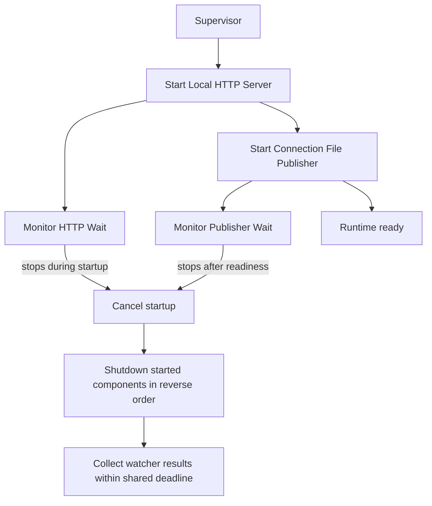

# B3 — Runtime Supervisor

**Status:** Standalone supervisor implemented. UI-managed ownership is approved for MVP and pending implementation.

**Phase:** B3 — Runtime process foundation

## Overview

B3 makes `internal/supervisor.App` the sole owner of the Runtime process
lifecycle. It starts components in dependency order, detects failures,
propagates cancellation, and shuts down every started component in reverse
order within the B2 `shutdown_timeout`.

A component here means an internal process subsystem that owns a long-lived
resource or background activity. It is not a workflow node, API route, feature
module, Product entity, or separate binary.

The current implementation manages the Local HTTP Server and B5 Connection File
Publisher. A component that stops while a later component is starting now
cancels startup immediately, so Runtime cannot publish false readiness.



Later phases add components to this same lifecycle only when those components
exist; B3 does not create placeholder storage, scheduling, or execution work.

## Why B3 matters

Each component owns a different kind of resource or long-running activity. A
component does not necessarily own a port or even a connection:

- a State Store owns storage handles;
- an HTTP Server owns a network listener and active requests;
- an Event Dispatcher owns event-delivery goroutines;
- an Execution Scheduler owns workflow workers; and
- a Connection File Publisher owns a discovery file.

Starting a component means preparing what it owns. Shutting it down means
performing the cleanup appropriate to that ownership:

| Order | Component | `Start` prepares | `Shutdown` cleans up |
|---:|---|---|---|
| 1 | State Store | Storage resources | Close storage resources |
| 2 | Event Dispatcher | Event-delivery loop | Drain events and join its goroutine |
| 3 | Execution Scheduler | Execution workers | Stop admission and join workers |
| 4 | Local HTTP Server | Loopback listener | Stop admission and drain requests |
| 5 | Connection File Publisher | Protected discovery file | Remove the discovery file |

Without a supervisor, each component could start or stop independently. That
can expose a half-initialized Runtime, leave workers using already-closed
storage, accept requests while dependencies are unavailable, or leak resources
when one component fails.

The supervisor does not replace component-specific cleanup. It provides one
process-level guarantee around it:

```text
Supervisor decides when and in which order
→ component decides how to prepare or clean up what it owns
```

This separation lets each component implement the cleanup it needs while the
Runtime remains predictably all-started, shutting-down, or stopped.

## Canonical example

The five components above are the only future composition used in this
specification. Their startup and shutdown paths are exact opposites:

```text
START
State Store
→ Event Dispatcher
→ Execution Scheduler
→ Local HTTP Server
→ Connection File Publisher
→ Runtime ready

STOP
Runtime stopping
→ remove Connection File
→ stop Local HTTP Server admission
→ stop/drain Execution Scheduler
→ stop/drain Event Dispatcher
→ close State Store
→ process stopped
```

The connection file is removed first so new clients cannot discover a stopping
Runtime. The State Store closes last so dependents can finish their final state
operations.

These names illustrate ordering only. State, events, scheduling, and connection
file publication remain owned by their later phases.

## UI-managed Runtime for MVP

Studio and Launcher each start the Runtime as a native child process when
their user needs it. The starting app owns that process until it exits.
The other app displays **Runtime already in use** if its launch conflicts
with the existing store owner. The D1 store lock arbitrates competing launches.
`make run` remains the standalone development entry point.

The native owner maintains a private control channel for readiness, shutdown,
and owner-lifetime detection. Losing SSE, reloading a window, or minimizing
the app does not close this channel. A managed child publishes readiness only
after D6 succeeds and the local listener is ready.

| Trigger | Supervisor behavior |
|---|---|
| Shutdown requested while idle | Close components and release the SQLite lock. |
| Confirmed shutdown during a run | Block admission and dispatch. Give H6 the existing shutdown deadline to settle attempts and commit terminal state before closing the checkpoint service and SQLite. |
| Owner channel closes unexpectedly | Block further work, perform bounded cleanup, and exit. D6 processes any unfinished rows at the next start. |
| Shutdown deadline expires | Exit after bounded cleanup. Preserve durable results and let D6 handle unfinished rows. |

The owner waits for actual process exit before displaying **Stopped**. A new
launch requires an explicit user action. Verify ready startup, idle stop,
owner loss, and competing launches with a test parent process before wiring
the desktop apps. Verify cancellation during a real run before client release.

## Current B3 scope

The registered component list is currently:

```text
1. Local HTTP Server
2. Connection File Publisher
```

Its complete path is:

```text
bind loopback listener
→ publish protected connection file
→ report internal readiness
→ serve until cancellation or component failure
→ remove connection file
→ gracefully shut down HTTP
→ join the serving goroutine
→ return
```

B3 must not add placeholder implementations of the future components.

## Lifecycle contract

The private contract is defined where it is consumed in `internal/supervisor`:

```go
type lifecycle interface {
	Start(ctx context.Context) error
	Wait() error
	Shutdown(ctx context.Context) error
}

type component struct {
	name      string
	lifecycle lifecycle
}
```

Concrete constructors continue to return concrete types. Wire passes them to
`app.New`, which registers each with a stable, non-secret name. B3 adds no
public lifecycle package, service locator, container, or dependency.

### `Start`

- Called once in declared order.
- Returns only after the component is usable, or returns its startup error.
- Honors cancellation and creates no goroutine that `Wait` cannot join.

For HTTP, readiness means `net.Listen` has bound the configured loopback
address. A log line saying that startup began is not readiness.

### `Wait`

- Called once after a successful `Start`.
- Blocks until all goroutines owned by that component have stopped.
- Returns the terminal error; an early `nil` return is an unexpected stop.

A passive component may wait on an internal completion signal and does not
need to create a worker goroutine.

### `Shutdown`

- Called once for every successfully started component, including the
  component whose `Wait` failed.
- Receives the supervisor's shared cleanup context.
- Stops admission, releases resources, and causes `Wait` to return.

Ignoring the cleanup context or leaving owned goroutines running violates this
contract.

## Supervisor flow

`main` converts `SIGINT`/`SIGTERM` into a root context. `App.Run` creates one
cancellable child context for the Runtime and does not store it on `App`.

```text
main: signal.NotifyContext
→ App.Run(parent context)
→ start registered components in order
→ monitor each successfully started component
→ receive parent cancellation or first component termination
→ cancel Runtime context
→ shut down started components in reverse order
→ join all component goroutines
→ return one final result to main
```

Each successfully started component gets one bounded watcher that calls
`Wait`. The result channel is sized to the registered component count, so a
watcher cannot become stranded while shutdown begins. All watchers must exit
before `App.Run` returns. B3 does not restart components.

## Failure behavior

### Startup rollback

Suppose the Execution Scheduler fails to start:

```text
State Store started
→ Event Dispatcher started
→ Execution Scheduler failed
→ shut down Event Dispatcher
→ close State Store
→ return Scheduler startup error
```

The HTTP Server and Connection File Publisher never start. The Scheduler was
not successfully started, so it is not part of rollback. Its startup error is
primary; cleanup errors are joined without hiding it.

In current B3, an HTTP bind failure follows the same rule: return immediately
and never report readiness.

### Failure after readiness

Suppose the Execution Scheduler fails while Runtime is ready:

```text
Scheduler Wait returns an error
→ cancel Runtime context
→ remove Connection File
→ stop Local HTTP Server
→ clean up Scheduler
→ stop Event Dispatcher
→ close State Store
→ return Scheduler error plus any cleanup errors
```

The first unexpected component termination initiates shutdown. Component names
may appear in errors, but secrets, workflow data, configuration dumps, and
local paths may not.

## One bounded shutdown

The supervisor creates one cleanup context after cancellation or failure:

```go
shutdownCtx, cancel := context.WithTimeout(
	context.WithoutCancel(runCtx),
	shutdownTimeout,
)
defer cancel()
```

Every component shares that single deadline; no component receives a fresh
full timeout. Reverse shutdown continues after ordinary cleanup errors while
time remains. Deadline expiry is a process failure.

For HTTP, `Shutdown(shutdownCtx)` first drains active requests. If the deadline
expires, `Close()` force-closes remaining connections. Normal cleanup collects
every watcher before `App.Run` returns. At deadline failure, the supervisor
performs one final result drain and returns instead of waiting forever for a
non-compliant component; Go cannot forcibly terminate an arbitrary goroutine.
Current components are required and tested to release their `Wait` calls.
`http.ErrServerClosed` caused by intentional shutdown is not an application
error.

A normal signal followed by clean shutdown returns `nil`. Startup failure,
unexpected termination, cleanup failure, or timeout returns a non-nil error.
Only `main` converts that final result into an exit code.

## Readiness boundary

Overall internal readiness requires every registered component to complete
`Start`. In current B3, this means only that the loopback listener is bound; it
does not claim A7 compliance, authentication, device availability,
persistence, or workflow-execution readiness. B6 owns the external health API.

In the future example, Runtime becomes discoverable only after the Connection
File Publisher writes its protected file. Publication failure rolls back HTTP,
Scheduler, Dispatcher, and State Store in reverse order.

## Implemented shape

1. `internal/supervisor` defines the private lifecycle registration.
2. `App` owns `shutdown_timeout`; HTTP does not create its own deadline.
3. HTTP startup uses synchronous `net.Listen`, then `Serve`.
4. HTTP exposes explicit `Start`, `Wait`, and `Shutdown` behavior.
5. `App.Run` owns monitoring, rollback, reverse shutdown, and final errors.
6. Wire output is generated through `make wire`, not edited manually.
7. README describes B3 without claiming B4–B6 behavior.

No new dependency is required.

## Verification

Focused standard-library tests now prove:

- a later startup failure rolls back only successfully started components;
- an earlier component failure cancels a blocked later startup and prevents
  `runtime_ready`;
- the component failure remains primary while cleanup errors are preserved;
- an early `nil` `Wait` result is treated as an unexpected stop;
- parent cancellation follows exact reverse shutdown order;
- one deadline bounds the entire cleanup sequence;
- normal shutdown collects every watcher before `App.Run` returns;
- deadline cleanup does not leave a permanently blocked compliant watcher; and
- HTTP bind failure is returned synchronously.

Repository formatting, unit, race, vet, build, diff, and manual process checks
pass. `golangci-lint` remains pending because the tool is unavailable locally.
The manual process check covers real loopback bind, readiness, authenticated
requests, SIGINT shutdown, and connection-file cleanup.

## Exclusions

B3 does not implement B4 logging policy, B5 authentication/connection-file
publication, B6 final handlers, or any State Store, Event Dispatcher, Execution
Scheduler, ADB monitor, artifact worker, workflow execution, Production
authorization, service installation, restart policy, per-component timeout, or
dynamic runtime registration.

## Completion condition

B3 is complete when the current HTTP listener binds synchronously, `App` owns
its entire lifecycle, failures cannot create false readiness, cleanup follows
the documented reverse path under one deadline, normal cleanup joins all owned
goroutines, deadline violations return a process failure, approved tests pass,
and no later-phase behavior is claimed.
