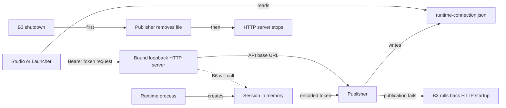
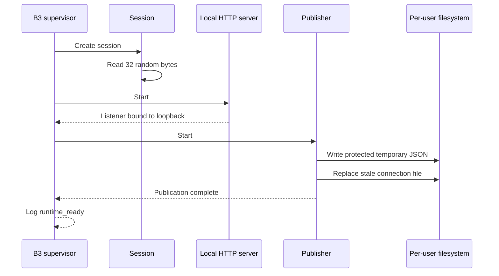
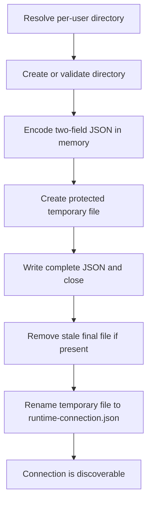

# B5 — Local Authentication

**Status:** Implemented; Windows verification and lint pending

**Phase:** B5 — Runtime process foundation

## Overview

Runtime, Studio, and Launcher are separate local processes. Studio and Launcher
cannot read Runtime memory directly, so they need a safe way to discover:

1. where the Runtime Local API is listening; and
2. which temporary credential belongs to this Runtime process.

B5 solves this with two small components:

| Component | Responsibility |
|---|---|
| `Session` | Generates one temporary token at Runtime startup and verifies bearer credentials. |
| `Publisher` | Writes the API address and encoded token to a protected per-user JSON file, then removes that file during shutdown. |

The connection file is discovery data, not workflow persistence. It does not
store emulator state, execution progress, checkpoints, logs, or user accounts.



The solid lines are implemented in B5. The final HTTP authentication connection
is intentionally deferred to B6; B5 creates the verifier but does not install
middleware on routes.

## What B5 adds to B2–B4

- **B2** already validates a numeric loopback listen address.
- **B3** already starts components in order, rolls back failed startup, and
  shuts components down in reverse order.
- **B4** already prevents authorization and token fields from entering logs.
- **B5** adds local caller authentication material and a filesystem handoff.

Loopback binding prevents remote machines from connecting, but it does not
distinguish trusted A2MaTeX applications from another process running under the
same machine. The per-start token adds that missing credential check.

## Runtime startup flow



The order matters: Runtime does not advertise an address until the HTTP listener
has bound successfully. If publication fails, B3 stops the already-started HTTP
server and Runtime never reports ready.

## Session contract

Runtime creates exactly one session before starting lifecycle components:

```text
32 bytes from crypto/rand.Reader
→ unpadded base64url encoding
→ 43-character token
```

Rules:

- every Runtime process start receives a new token;
- token generation failure stops startup;
- configuration, environment variables, flags, and requests cannot provide the
  token;
- the raw token stays inside `Session`;
- restart is the token-rotation mechanism; and
- token material and complete authorization values never enter logs.

`Session.VerifyAuthorization` accepts only one strict header value:

```http
Authorization: Bearer <43-character-token>
```

It rejects missing, duplicate, malformed, wrong-length, and incorrect values.
After decoding, it compares the fixed-length bytes with
`crypto/subtle.ConstantTimeCompare`. It returns only authenticated or
unauthenticated; B6 owns the HTTP `401` response.

## Managed launch credential handoff

For the approved MVP, a UI-managed child delivers its API base URL and fresh
session token to the owning native app over the private control channel from
B3, once recovery and listener startup succeed. The owner keeps credentials
in its native process. Use a dedicated channel separate from stdout/stderr
logging and apply the same bearer authentication to loopback HTTP. Standalone
development uses the connection-file handoff below. The managed handoff is
implemented and verified with a Linux parent harness. Native Windows
verification remains pending.

The owner clears the API URL and bearer token when the child exits, the
control channel closes, the authenticated readiness probe fails, or shutdown
begins. Keep the replacement session tied to the new child. After its private
ready message, the client probes the new authenticated session before sending
waiting requests. Each replacement receives a fresh token.

## Connection file

The Publisher writes exactly `runtime-connection.json`:

```json
{
  "apiBaseUrl": "http://127.0.0.1:8765/api/v1",
  "sessionToken": "<43-character-base64url-token>"
}
```

The document contains no process, device, workflow, build, log, or execution
state. It is never returned from an HTTP endpoint.

### File location

| Target | Final path |
|---|---|
| Windows | `%LOCALAPPDATA%\A2MaTeX\Runtime\runtime-connection.json` |
| Linux, preferred | `$XDG_RUNTIME_DIR/a2matex/runtime-connection.json` |
| Linux fallback | `$XDG_CONFIG_HOME/a2matex/runtime/runtime-connection.json` |
| Linux final fallback | `$HOME/.config/a2matex/runtime/runtime-connection.json` |

Linux uses the first valid location in that order. macOS support is deferred.
Runtime never falls back to the working directory, repository, workflow
directory, or a shared temporary directory.

### How the file is saved



On Linux, the directory mode is `0700` and file mode is `0600`. The Publisher
rejects symbolic-link directories and final targets. Windows uses the current
user's Local AppData isolation; explicit Windows ACL management is not added in
this phase.

The file is plaintext. Encrypting it would require handing clients another
local decryption key, which would recreate the same handoff problem.

The temporary-file flow prevents clients from reading partial JSON. During
replacement they may briefly observe no file and must treat Runtime as
unavailable and retry. B5 does not use `fsync` or claim crash durability because
the file is disposable discovery state.

## Client discovery and request flow

Studio and Launcher use the same platform path contract:

1. read `runtime-connection.json`;
2. treat a missing file as Runtime unavailable;
3. send the token as `Authorization: Bearer <token>`;
4. treat `401` as an invalid or stale connection document; and
5. consider Runtime available only after an authenticated request succeeds.

The Studio/Launcher reader and Runtime HTTP middleware belong to B6 or their
owning component; they are not implemented by B5.

## Shutdown and crash behavior

During clean shutdown, reverse B3 ordering removes discovery before stopping
HTTP. Removing an already absent file succeeds.

Before deletion, Publisher checks that the path still identifies the file and
content created by this process. It refuses to delete a replacement written by
another process.

After a crash, the stale token cannot authenticate to a new Runtime because each
process generates a new session. B5 does not preserve or resume workflow state;
that requires the later execution checkpoint store.

## Security and logging boundaries

B5 protects against accidental exposure and unauthorized local callers that do
not have access to the current user's protected connection file. It does not
protect against a compromised OS account, administrator/root access, process
memory inspection, or a client that deliberately copies the token.

Errors and logs must not contain:

- the token or authorization header;
- connection-document contents;
- client credentials; or
- resolved private user paths.

B5 adds no successful-operation logs. Existing B3 lifecycle records already
describe startup, readiness, and shutdown.

## Implementation mapping

| File | Purpose |
|---|---|
| `internal/auth/session.go` | Token generation and bearer verification |
| `internal/discovery/connection.go` | Two-field connection-document encoding |
| `internal/discovery/path_linux.go` | Linux directory selection |
| `internal/discovery/path_windows.go` | Windows directory selection |
| `internal/discovery/publisher.go` | Publication and B3 lifecycle cleanup |
| `internal/supervisor/supervisor.go` | HTTP-before-publisher startup ordering |
| `cmd/agent/wire.go` | Constructor wiring |

No authentication framework, database, watcher, queue, network call, or
background worker is added.

## Runtime cost

- Startup: one 32-byte random read, one base64 encoding, and one small file
  publication.
- Each protected request after B6: one small base64 decode and one 32-byte
  constant-time comparison.
- Shutdown: one bounded file check and removal.
- Supervision: one existing B3 wait goroutine for the Publisher lifecycle.

## Acceptance criteria

B5 is complete when:

1. each Runtime start creates a new 32-byte session token;
2. malformed and incorrect bearer credentials fail closed without secret data
   entering logs;
3. Runtime publishes exactly the API base URL and token after listener bind;
4. Linux uses `0700` directory and `0600` file permissions;
5. clients cannot observe a partially written final document;
6. publication failure rolls back the HTTP server before readiness;
7. clean shutdown removes the owned document before HTTP shutdown;
8. a crash-stale document is replaced by the next successful Runtime start;
9. tests pass under the race detector; and
10. Windows path behavior is verified on Windows before Windows completion is
    declared.

Repository verification remains:

```text
make wire
make fmt
make test
make build
git diff --check
```

## Deferred work

- B6 HTTP authentication middleware, health exemption, response headers, and
  exact A7 error envelope;
- Studio and Launcher connection-file readers;
- macOS path support;
- Windows ACL hardening if target-environment verification requires it;
- production entitlement, license, lease, and execution authorization;
- process locking, service installation, restart policy, and file watching;
- workflow checkpoint persistence and crash recovery; and
- remote monitoring or log upload.
