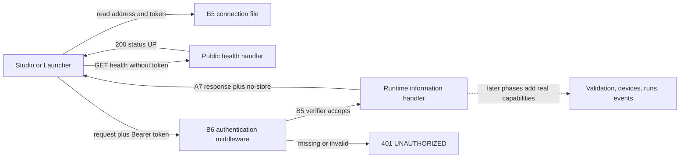

# B6 — Minimal Local API

**Status:** Implemented and verified; lint pending

**Phase:** B6 — Runtime process foundation

## Overview

B1–B5 can start a loopback HTTP server, supervise it, log requests safely,
create a per-process session token, and publish that token for a local client.
The missing connection is enforcement: the current HTTP server does not use
the B5 verifier, and its two preliminary responses do not match the accepted
A7 Local API contract.

B6 closes that gap. It keeps one public liveness route, protects every other
request with the B5 token, and exposes the smallest authenticated compatibility
response that is truthful for the features implemented so far.



Solid paths are B6 scope. The dotted path is deferred. B6 does not implement a
Studio/Launcher file reader, workflow validation, device discovery, execution,
persistence, events, screenshots, Production authorization, or node handlers.

The smallest successful handshake is:

```text
Runtime starts and B5 publishes runtime-connection.json
→ client reads apiBaseUrl and sessionToken
→ unauthenticated GET /health proves only HTTP liveness
→ authenticated GET /runtime-info returns compatibility metadata
→ client decides whether this Runtime release is usable
```

## What changes from B1–B5

| Existing behavior | B6 behavior |
|---|---|
| B2 restricts the listener to a numeric loopback address | Unchanged; B6 adds caller authentication, not another network boundary |
| B3 starts and stops the HTTP server | Unchanged; no new lifecycle component or goroutine |
| B4 logs route patterns and redacts authentication fields | Unauthorized requests use the same safe completion log; no separate credential log |
| B5 creates `Session.VerifyAuthorization` and publishes its token | B6 calls that verifier for every request except exact health |
| Health returns `{"status":"ok"}` | Health returns the accepted A7 value `{"status":"UP"}` |
| Runtime information exposes build and host diagnostics | Runtime information returns only A7 compatibility fields |
| Both current routes are public | Only exact `GET /api/v1/health` is public |

After B6, `runtime_ready` means the listener is bound, the protected connection
document is published, public health is available, and the authenticated
compatibility route is installed. It still does not mean ADB, persistence, or
workflow execution is ready.

## Scope

B6 implements only:

1. global Local API authentication with an exact health exemption;
2. `Cache-Control: no-store` on every non-health response;
3. the accepted A7 health response;
4. the authenticated A7 Runtime-information response;
5. stable A7 JSON errors for unauthorized and unmatched requests; and
6. constructor wiring that gives the HTTP server the existing B5 `Session`.

No new dependency is required.

## Route and authentication contract

The base path remains `/api/v1`.

| Request | Authentication | Result |
|---|---|---|
| `GET /api/v1/health` | Not required and ignored | `200` health response |
| `GET /api/v1/runtime-info` | Required | `200` compatibility response or `401` |
| Any future registered non-health route | Required | Middleware authenticates before its handler |
| Unmatched method or path | Required | `401` without a valid token; otherwise A7 `404` |

Only the exact health method and path bypass authentication. A different
method, a path spelling variation, or an unmatched path is not health.

The middleware passes all `Authorization` header values to the existing
`Session.VerifyAuthorization` method. The token is accepted only in that
header. Query parameters, cookies, and request bodies never authenticate a
request.

Missing, duplicate, malformed, stale, and incorrect credentials receive the
same response:

```http
HTTP/1.1 401 Unauthorized
Content-Type: application/json; charset=utf-8
Cache-Control: no-store
```

```json
{
  "error": {
    "code": "UNAUTHORIZED",
    "message": "local session token is missing or invalid",
    "retryable": false
  }
}
```

The response does not reveal whether a token was absent, malformed, stale, or
incorrect. Authentication failure creates no additional log record; the B4
request-completion record already captures the route, `401` status, and Error
level without headers or token values.

## Response policies

Every response except exact health includes:

```http
Cache-Control: no-store
```

This includes successful compatibility responses, authentication failures,
unmatched routes, and recovered internal errors. B6 does not introduce CORS,
cookies, browser storage, redirects, compression, or another cache layer.

JSON responses use `application/json; charset=utf-8`. B6 aligns the existing
panic response with the A7/A6 error shape by including `retryable: false` while
retaining the generic safe message.

An authenticated unmatched request returns:

```json
{
  "error": {
    "code": "RESOURCE_NOT_FOUND",
    "message": "resource was not found",
    "retryable": false
  }
}
```

B6 does not add a `405` contract because A7 does not define one. An unsupported
method is an unmatched resource and returns the authenticated `404` response.

## Health endpoint

### `GET /api/v1/health`

The public response is exactly:

```json
{
  "status": "UP"
}
```

Health proves only that the process can answer HTTP. It exposes no Runtime
version, token state, build details, operating system, devices, workflow state,
or dependency checks. It performs no filesystem read, self-probe, database
operation, or ADB command.

Authentication headers on health are ignored rather than validated. This keeps
liveness independent from a stale client token and prevents an orchestrator
from needing the protected connection document.

## Runtime-information endpoint

### `GET /api/v1/runtime-info`

After successful authentication, the response has exactly these fields:

```json
{
  "runtimeVersion": "0.1.0",
  "runtimeIrFormatVersions": [1],
  "supportedNodes": []
}
```

Rules:

- `runtimeVersion` comes from the existing injected `buildinfo.Info.Version`;
- `runtimeIrFormatVersions` contains the accepted Runtime IR contract version
  `1` in ascending order;
- `supportedNodes` is a non-null array of unique `{type, runtimeHandler}` pairs
  sorted lexically by `type`; and
- the response contains no additional fields.

At B6, `supportedNodes` is intentionally empty. The Runtime has no executable
node-handler registry yet, so advertising the 11 planned node types would claim
capability that the process cannot execute. H-phase handler registration will
populate this field from the real immutable registry. B6 does not create a
placeholder registry or duplicate the planned catalog.

Advertising Runtime IR format `1` identifies the accepted wire contract. It
does not claim that a run endpoint exists. Clients must also inspect the route
availability and `supportedNodes`; G1 and H-phase admission remain authoritative.

The current preliminary fields are removed from this HTTP response:

- `name`;
- `version` in favor of `runtimeVersion`;
- `commit` and `buildTime`;
- `goVersion`;
- `operatingSystem`; and
- `architecture`.

Those values do not help Studio decide contract compatibility and unnecessarily
expose host/build details. `buildinfo.Info` may retain them for build tooling;
B6 only narrows the API projection.

## Middleware order and failure behavior

The request path remains inside the existing B3-managed HTTP server:

```text
panic recovery
→ B4 request logging
→ B6 no-store policy
→ B6 authentication, with exact health bypass
→ matched handler or authenticated not-found handler
```

Required behavior:

- authentication aborts the request before a protected handler runs;
- a panic still returns the generic A7 error without protected data;
- B4 emits one request completion record, or its existing panic record, but
  never a second authentication-specific record;
- a stale token after Runtime restart receives `401`;
- the new token published by B5 succeeds; and
- authentication failure does not stop the HTTP server or Runtime process.

B6 adds no retry loop, session refresh, token rotation timer, process lock, or
client notification mechanism.

## Security boundary

B6 protects Local API routes from callers that cannot read the current user's
protected B5 connection file. Loopback binding remains mandatory.

The implementation must never:

- log, echo, hash for logging, or persist an authorization header or token;
- accept credentials from a URL, query parameter, cookie, or body;
- distinguish missing, stale, malformed, and incorrect credentials in the
  response;
- return build, host, filesystem, configuration, or process diagnostics from
  Runtime information; or
- enable wildcard CORS for browser JavaScript.

As established by B5, this does not defend against administrator/root access,
process-memory inspection, or a fully compromised current OS account.

## Efficiency and reduction

For each protected request, B6 adds only:

```text
read the Authorization header values
→ validate fixed syntax and length
→ decode at most one 43-character base64url value
→ compare 32 bytes in constant time
```

The work and memory are constant with respect to workflow or device count.
Health performs no authentication work. Runtime information is an immutable,
small in-memory projection and performs no filesystem, database, ADB, or
network operation.

The following are deliberately omitted because they have no B6 consumer or
measured need:

- authentication frameworks, JWT, OAuth, refresh tokens, user accounts, and
  mutable server-side sessions;
- rate limiting for a 256-bit token on a loopback-only endpoint;
- a node registry before real handlers exist;
- response caching or pre-serialized response bytes;
- request IDs, tracing, metrics, or authentication-success logs;
- a second HTTP server, readiness worker, or background goroutine; and
- client connection-file watching or retry logic.

## Implementation mapping

The intended change is limited to the current HTTP composition:

| File or package | B6 responsibility |
|---|---|
| `internal/api/router.go` | Register exact A7 routes and accept the existing B5 verifier |
| `internal/api/middleware` | Apply no-store, recovery, logging, and authentication |
| `internal/api/foundation` | Return typed health and Runtime-information projections |
| `internal/api/response/error.go` | Keep the small A7 error envelope consistent across middleware and handlers |
| `internal/platform/httpserver/server.go` | Own loopback bind, serve, wait, and shutdown only |
| `pkg/constants/api.go` | Own shared Local API path, format version, and stable transport codes |
| `cmd/agent/wire.go` | Supply the same `Session` to HTTP and the B5 Publisher |
| generated Wire output | Regenerate with `make wire`; never edit manually |
| `README.md` | Replace the B5 warning with the implemented B6 authentication and endpoint behavior |

These filenames may be combined when the implementation remains clearer as a
smaller change. B6 must not introduce an abstraction that has no current
consumer.

## Verification

Focused tests should prove:

- exact health succeeds without an authorization header and returns only
  `{"status":"UP"}`;
- health ignores a malformed authorization header;
- Runtime information rejects missing, duplicate, malformed, stale, and wrong
  credentials with the same exact `401` envelope;
- a token in a query parameter, cookie, or body does not authenticate;
- the current B5 token returns the exact Runtime-information shape;
- `supportedNodes` is `[]`, not `null`, until real handlers exist;
- every non-health response carries `Cache-Control: no-store`;
- an unmatched request is protected before returning the exact `404` envelope;
- the panic response follows the A7/A6 error shape;
- B4 request logs contain route and status but no authorization value; and
- a token from a stopped Runtime fails after restart while the newly published
  token succeeds.

Manual black-box verification must read the real B5 connection file and use
`curl` against the built process. It must demonstrate:

```text
GET health without token                    → 200
GET runtime-info without token              → 401
GET runtime-info with wrong token           → 401
GET runtime-info with published token       → 200
GET unknown path without token              → 401
GET unknown path with published token       → 404
restart, then use old token                  → 401
restart, then use newly published token      → 200
```

Repository verification remains:

```text
make wire
make fmt
make test
go test -race ./...
make build
git diff --check
```

## Acceptance criteria

B6 is complete when:

1. only exact `GET /api/v1/health` is unauthenticated;
2. every other request is rejected before handler execution unless the B5
   verifier accepts exactly one bearer credential;
3. unauthorized responses are indistinguishable and contain no credential
   data;
4. health and Runtime information match the accepted A7 field names and values;
5. Runtime information advertises only capabilities implemented in the current
   process;
6. all non-health responses prevent caching;
7. B4 logging remains single-record and secret-free for both successful and
   failed requests;
8. B3 startup, readiness, failure monitoring, and shutdown behavior remain
   unchanged;
9. the manual restart test proves old-token rejection and new-token acceptance;
   and
10. no unused authentication, registry, persistence, or client infrastructure
    is introduced.

## Deferred work

B6 intentionally does not add:

- Studio or Launcher connection-file readers and retry behavior;
- Editor Graph validation, device, run, action, event, or artifact routes;
- executable node-handler registration or non-empty `supportedNodes`;
- Production package, entitlement, license, lease, or authorization checks;
- persistent workflows, checkpoints, logs, or sessions;
- multiple concurrently discoverable Runtime processes or process locking;
- macOS connection-file support or additional Windows ACL hardening;
- browser CORS support, WebSocket, SSE, or remote access; or
- external logging, monitoring, crash reporting, or telemetry.

Each deferred capability remains owned by its phase and must extend this
authenticated boundary rather than bypass it.
