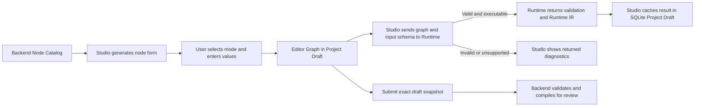

# Studio Node Definition to Project Draft Guide

## Overview

Studio treats the Backend Node Catalog as the authoring contract. It uses a
Node Definition to build the palette and inspector and saves only instance
values in the Editor Graph. Studio must never copy Node Definition schemas into
a Project Draft and never compiles Runtime IR. Runtime Agent compiles local Test
Run IR, while Backend compiles authoritative IR from the frozen Submission snapshot.



## 1. Load and identify nodes

Fetch `GET /node-catalog?runtimeVersion=X.Y.Z` and cache the response by
`catalogHash`. Match a Project Draft node to its definition through `node.type`.
Do not persist the definition, icon, schemas, runtime handler, or capability
metadata in that Editor Graph node.

Use the definition as follows:

- `name`, `description`, and `category`: palette and inspector;
- `configSchema`: static configuration fields;
- `inputSchema`: ordinary binding fields;
- `outputPorts`: connection handles;
- `editorHints.targeting`: mode-dependent targeting form, when present.

Studio owns icons, colors, field layout, port labels, and target-mode labels.
Render one static connector per `outputPorts.ports` entry in array order. `STOP`
is always available; expose `ERROR_BRANCH` only when the list contains `error`.

## 2. Ordinary node conversion

For a node without `editorHints.targeting`, generate controls from
`configSchema` and `inputSchema`. Save static config values in `node.config`.
Save input values as binding-source objects in `node.bindings`; a direct value
uses `{ "kind": "LITERAL", "value": ... }`.

Every node may also save optional execution settings:

```json
{
  "timeoutMs": 30000,
  "retryPolicy": {
    "maxAttempts": 3,
    "delayMs": 1000
  }
}
```

Studio may explain the defaults in its UI, but does not resolve them. Runtime and
Backend compilers use `NodeDefinition.defaultTimeoutMs` when `timeoutMs` is omitted
and resolve missing retry fields to `maxAttempts: 1` and `delayMs: 0`.

The Project Draft node keeps only instance data:

```json
{
  "id": "delay_01",
  "type": "flow.delay",
  "config": {},
  "bindings": {
    "durationMs": { "kind": "LITERAL", "value": 1000 }
  },
  "errorPolicy": "STOP",
  "editor": { "x": 420, "y": 180 }
}
```

## 3. Targeting node conversion

When `editorHints.targeting` exists:

1. Render the selector from `targeting.modes` in array order.
2. Save the selected `mode` as `config.targetMode`.
3. Render only that mode's `bindingSchema`; Studio owns the visual field order.
4. Save only the selected mode's values in `bindings`.
5. Require strict literal bindings for the current targeting contract.
6. On a mode change, remove every binding owned by the previous mode before
   writing the new values.

Example selected percentage Tap:

```json
{
  "id": "tap_login",
  "type": "android.tap",
  "config": { "targetMode": "SCREEN_PERCENT" },
  "bindings": {
    "xPercent": { "kind": "LITERAL", "value": 50 },
    "yPercent": { "kind": "LITERAL", "value": 75 }
  },
  "errorPolicy": "STOP",
  "editor": { "x": 660, "y": 180 }
}
```

This record must not also contain `x`, `y`, or `selector_id`. The mode schemas
remain in the Node Catalog and are not copied into the draft.

## 4. Mode switching

Before changing a targeting mode, collect the union of binding names from all
`targeting.modes`. Remove those names from the node bindings, set the new
`config.targetMode`, and initialize only the new mode's form state. Keep future
non-target bindings untouched if a targeting node later defines any.

A targeting edit makes cached `runtimeIr`, validation results, and test results
stale. Studio does not regenerate or have to clear that cache on every autosave.
It records which local draft revision produced the cache and must call Runtime
again before executing a null or stale cache. Submission ignores cached Project
Draft Runtime IR and compiles the frozen server snapshot independently.

## 5. Runtime compile API boundary

Studio sends an immutable content snapshot:

```json
{
  "editorGraph": {},
  "inputSchema": {}
}
```

Runtime owns Node Definition resolution, validation, binding conversion, policy
defaults, capability derivation, and Runtime IR construction. A successful
response contains the validation output and complete Runtime IR; a failed
compilation contains diagnostics and no partial Runtime IR.

Studio may use a successful response immediately or save it into the same
Project Draft shape used by Backend:

```json
{
  "editorGraph": {},
  "inputSchema": {},
  "runtimeIr": {},
  "validationSummary": {}
}
```

SQLite stores compile-cache provenance in local coordination state rather than
adding a field to the shared Project Draft content. Studio may execute cached IR
only when `runtime_ir_source_revision` matches the current `source_revision`.
Cloud Sync
can extract the four content fields directly; Backend may store the cache but
does not trust it for Submission.

## 6. Validation boundary

Studio validation improves authoring feedback but is not authoritative and does
not produce Runtime IR. Runtime compiles the local snapshot and validates the
compiled IR again before execution. Backend independently validates and compiles
the frozen Submission snapshot. Studio blocks a local test when Runtime returns
diagnostics or cannot execute a selected handler, but may still save or submit
unfinished content. Submission findings remain private for Admin review.

The complete Backend contracts are documented in
[Node Catalog](../a2matex-backend/studio_project_workflow/node_catalog.md),
[Workflow Validation](../a2matex-backend/studio_project_workflow/workflow_validation.md),
and [Project Draft](../a2matex-backend/studio_project_workflow/project_draft.md).
