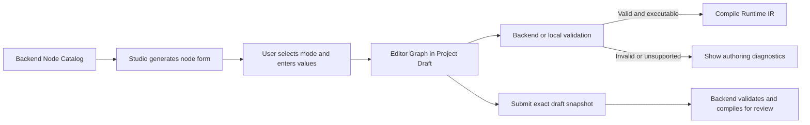

# Studio Node Definition to Project Draft Guide

## Overview

Studio treats the Backend Node Catalog as the authoring contract. It uses a
Node Definition to build the palette and inspector and saves only instance
values in the Editor Graph. Studio must never copy Node Definition schemas into
a Project Draft. Studio may compile a local preview, while the Backend compiles
the authoritative Runtime IR from the frozen Submission snapshot.



## 1. Load and identify nodes

Fetch `GET /node-catalog?runtimeVersion=X.Y.Z` and cache the response by
`catalogHash`. Match a Project Draft node to its definition through `node.type`.
Do not persist the definition, icon, schemas, runtime handler, or capability
metadata in that Editor Graph node.

Use the definition as follows:

- `name`, `description`, and `category`: palette and inspector;
- `configSchema`: static configuration fields;
- `inputSchema`: ordinary binding fields;
- `outputPorts`: connection handles;
- `editorHints.targeting`: mode-dependent targeting form, when present.

Studio owns icons, colors, field layout, port labels, and target-mode labels.
Render one static connector per `outputPorts.ports` entry in array order. `STOP`
is always available; expose `ERROR_BRANCH` only when the list contains `error`.

## 2. Ordinary node conversion

For a node without `editorHints.targeting`, generate controls from
`configSchema` and `inputSchema`. Save static config values in `node.config`.
Save input values as binding-source objects in `node.bindings`; a direct value
uses `{ "kind": "LITERAL", "value": ... }`.

Every node may also save optional execution settings:

```json
{
  "timeoutMs": 30000,
  "retryPolicy": {
    "maxAttempts": 3,
    "delayMs": 1000
  }
}
```

Omitted `timeoutMs` uses `NodeDefinition.defaultTimeoutMs`. Omitted retry fields
resolve to `maxAttempts: 1` and `delayMs: 0` during compilation.

The Project Draft node keeps only instance data:

```json
{
  "id": "delay_01",
  "type": "flow.delay",
  "config": {},
  "bindings": {
    "durationMs": { "kind": "LITERAL", "value": 1000 }
  },
  "errorPolicy": "STOP",
  "editor": { "x": 420, "y": 180 }
}
```

## 3. Targeting node conversion

When `editorHints.targeting` exists:

1. Render the selector from `targeting.modes` in array order.
2. Save the selected `mode` as `config.targetMode`.
3. Render only that mode's `bindingSchema`; Studio owns the visual field order.
4. Save only the selected mode's values in `bindings`.
5. Require strict literal bindings for the current targeting contract.
6. On a mode change, remove every binding owned by the previous mode before
   writing the new values.

Example selected percentage Tap:

```json
{
  "id": "tap_login",
  "type": "android.tap",
  "config": { "targetMode": "SCREEN_PERCENT" },
  "bindings": {
    "xPercent": { "kind": "LITERAL", "value": 50 },
    "yPercent": { "kind": "LITERAL", "value": 75 }
  },
  "errorPolicy": "STOP",
  "editor": { "x": 660, "y": 180 }
}
```

This record must not also contain `x`, `y`, or `selector_id`. The mode schemas
remain in the Node Catalog and are not copied into the draft.

## 4. Mode switching

Before changing a targeting mode, collect the union of binding names from all
`targeting.modes`. Remove those names from the node bindings, set the new
`config.targetMode`, and initialize only the new mode's form state. Keep future
non-target bindings untouched if a targeting node later defines any.

A targeting edit makes cached local `runtimeIr`, validation results, and test
results stale. Studio does not need to regenerate or clear that cache on every
autosave. It must compile the current immutable local snapshot before a local
test run. Submission ignores cached Project Draft Runtime IR and compiles the
frozen server snapshot independently.

## 5. Runtime IR conversion

Copy `config.targetMode`. Convert each Editor Graph literal binding:

```json
{ "kind": "LITERAL", "value": 50 }
```

into the Runtime IR input source:

```json
{ "source": "LITERAL", "value": 50 }
```

Use the Node Definition for `runtimeHandler`, default timeout, capabilities, and
ports. Use the node's `timeoutMs` when present, otherwise use
`NodeDefinition.defaultTimeoutMs`. Resolve missing retry fields to
`maxAttempts: 1` and `delayMs: 0`. Copy the node instance's selected
`errorPolicy` only after validating it against the definition's ports: `STOP`
is always valid and `ERROR_BRANCH` requires an `error` port. Do not copy editor
position, labels, descriptions, catalog schemas, or unused targeting modes into
Runtime IR.

All supported binding mappings preserve their source metadata:

| Editor Graph binding | Runtime IR input |
|---|---|
| `{ "kind": "WORKFLOW_INPUT", "inputName": "name" }` | `{ "source": "WORKFLOW_INPUT", "inputName": "name" }` |
| `{ "kind": "NODE_OUTPUT", "nodeId": "capture", "field": "artifactId" }` | `{ "source": "NODE_OUTPUT", "nodeId": "capture", "field": "artifactId" }` |
| `{ "kind": "FLOW_VARIABLE", "name": "score" }` | `{ "source": "FLOW_VARIABLE", "name": "score" }` |
| `{ "kind": "GLOBAL_VARIABLE", "name": "bestScore" }` | `{ "source": "GLOBAL_VARIABLE", "name": "bestScore" }` |

`flow.set_variable` maps `bindings.value` to `inputs.value` and keeps its
validated `name` and optional `scope` config. `flow.wait_variable` keeps only
`config.name`; its effective node `timeoutMs` is the wait deadline.
`flow.switch` preserves ordered rules, maps the left and rule operands into
`inputs`, and preserves each rule ID, `default`, and conditional `error` as edge
`sourcePort` values.

## 6. Validation boundary

Studio validation improves feedback but is not authoritative. Backend validates
and compiles the frozen Submission snapshot, and Runtime validates the compiled
IR again before execution. Studio must block a local test when it cannot compile
the current snapshot or the Runtime cannot execute a selected handler. It may
still save or submit unfinished content; the Submission scan keeps detailed
findings private for Admin review and prevents approval when compilation fails.

The complete Backend contracts are documented in
[Node Catalog](../a2matex-backend/studio_project_workflow/node_catalog.md),
[Workflow Validation](../a2matex-backend/studio_project_workflow/workflow_validation.md),
and [Project Draft](../a2matex-backend/studio_project_workflow/project_draft.md).
