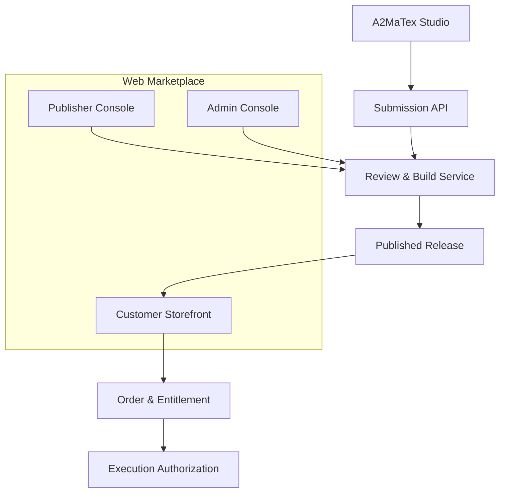

# 2. Thành phần tổng quan

## Các component chính

| Component             | Công dụng                                                   |
| --------------------- | ----------------------------------------------------------- |
| `Storefront`          | Danh sách sản phẩm, chi tiết, mua hàng và thư viện customer |
| `Publisher Console`   | Theo dõi submission, phiên bản và phản hồi từ admin         |
| `Admin Console`       | Review source snapshot, capability, script và test report   |
| `Review Service`      | Quản lý kết quả review và audit                             |
| `Build Service`       | Compile lại graph và JavaScript bằng compiler đáng tin cậy  |
| `Catalog Service`     | Quản lý thông tin sản phẩm được hiển thị                    |
| `Commerce Service`    | Order, payment và pricing plan                              |
| `Entitlement Service` | Kiểm tra quyền sử dụng sản phẩm                             |
| `Revocation Service`  | Thu hồi quyền và dừng execution đang chạy                   |
