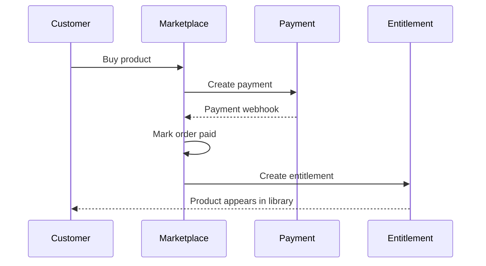

# 10. Marketplace Storefront

Customer có các màn hình chính:

## Product List

- Tìm kiếm.
- Lọc category.
- Product card.
- Giá.
- Publisher.
- Supported Android version.

## Product Detail

- Description.
- Screenshot.
- Required permissions.
- Target applications.
- Input cần cung cấp.
- Output sản phẩm tạo ra.
- Giá và thời hạn sử dụng.
- Giới hạn thiết bị.
- Giới hạn execution đồng thời.
- Version và release notes.

## My Library

Hiển thị:

- Sản phẩm đã mua.
- Trạng thái quyền sử dụng.
- Ngày bắt đầu.
- Ngày hết hạn.
- Device limit.
- Concurrent execution limit.
- Nút `Open in A2MaTex App`.

## Purchase History

- Order.
- Amount.
- Payment status.
- Product.
- License plan.
- Thời điểm thanh toán.

# 11. Pricing Plan cho MVP

Mỗi product chỉ nên có một plan trong MVP.

```json
{
  "name": "Standard",
  "price": 99000,
  "currency": "VND",
  "durationDays": 30,
  "maxDevices": 3,
  "maxConcurrentExecutions": 1
}
```

Sau này mới mở rộng:

- Monthly.
- Yearly.
- Lifetime.
- Personal.
- Team.
- Device farm.
- Usage-based pricing.

Một plan duy nhất giúp giảm đáng kể logic checkout, entitlement và renewal trong MVP.

# 12. Quy trình mua sản phẩm



Quy tắc quan trọng:

- Không tạo entitlement chỉ dựa trên redirect từ payment page.
- Payment webhook hoặc kết quả xác thực server-to-server mới là nguồn tin cậy.
- Webhook phải xử lý idempotent.
- Một payment không được tạo hai entitlement.

Order MVP chỉ cần:

```text
PENDING
PAID
CANCELLED
```
