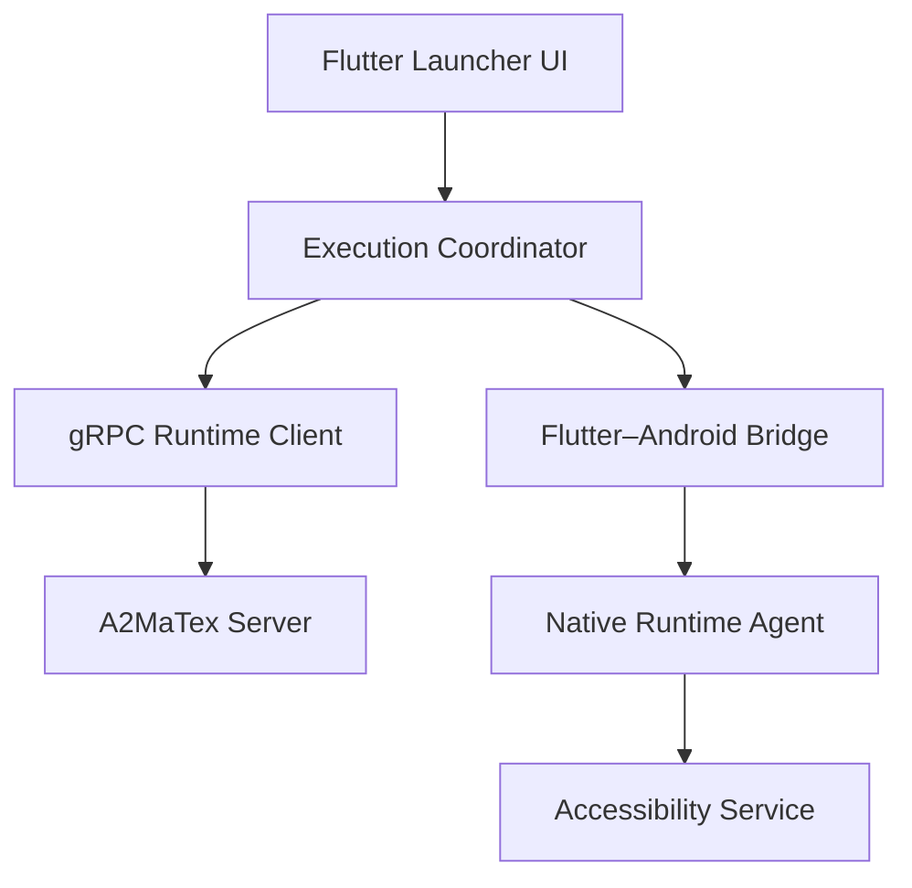

# A2MaTex Mobile App — Flutter

Định hướng phù hợp cho MVP:

- Chỉ xây một ứng dụng Flutter Android.
- Launcher và Runtime Agent là hai module logic trong cùng app, không phải hai APK.
- Flutter xử lý UI, đăng nhập, thư viện sản phẩm và gRPC.
- Một native Android plugin nhỏ xử lý Accessibility Service và thao tác thiết bị.
- Mobile không tải Workflow IR, JavaScript hay source graph.
- Mobile chỉ nhận từng command nguyên tử từ server.
- Mất gRPC stream thì execution thất bại và phải chạy lại từ đầu.

# 1. Launcher và Runtime Agent

## 1.1. Launcher

Launcher là phần giao diện người dùng:

- Đăng nhập.
- Đăng ký thiết bị.
- Hiển thị sản phẩm đã mua.
- Hiển thị entitlement.
- Nhập tham số workflow.
- Kiểm tra permission.
- Bấm Run/Stop.
- Hiển thị execution status và log cơ bản.

## 1.2. Runtime Agent

Runtime Agent là subsystem chạy workflow:

- Mở gRPC stream.
- Handshake với server.
- Nhận command.
- Validate command.
- Gọi native Android handler.
- Trả ACK và result.
- Dừng execution khi mất kết nối hoặc bị revoke.

## 1.3. Cấu trúc A2MaTeX app

```text
A2MaTex App
├── Flutter Launcher UI
├── Execution Session Coordinator
├── gRPC Runtime Client
└── Android Automation Plugin
    ├── Accessibility Service
    ├── Foreground Service
    ├── Selector Engine
    └── Command Handlers
```



Về mặt sản phẩm, người dùng chỉ cài một A2MaTex App. “Runtime Agent” là tên module nền bên trong app.

Studio có thể đóng gói cùng APK này hoặc một debug build variant để cài lên thiết bị publisher bằng ADB.

# 2. Phân chia Flutter và Android Native

## Flutter/Dart

Flutter xử lý:

- UI.
- Authentication.
- Product Library.
- Device registration.
- Product inputs.
- Start/stop execution.
- Execution state.
- gRPC bidirectional stream.
- Protobuf serialization.
- Command validation cấp session.
- Hiển thị log và lỗi.

Dart gRPC hỗ trợ code generation từ `.proto`, nên Flutter có thể trực tiếp mở bidirectional stream với NestJS. ([Dart](https://grpc.io/docs/languages/dart/basics))

## Android native plugin

Native Android xử lý:

- `AccessibilityService`.
- Query accessibility tree.
- Click element.
- Input text.
- Swipe/gesture.
- Back/Home.
- Launch application.
- Foreground service.
- Theo dõi foreground package.
- Trả kết quả native về Dart.

Flutter hỗ trợ gọi platform-specific code thông qua platform channel và plugin. ([docs.flutter.dev](https://docs.flutter.dev/platform-integration/platform-channels))

## Team không biết Kotlin có làm được không?

Có, nhưng không thể làm toàn bộ bài toán bằng Dart thuần.

`AccessibilityService` là Android component đặc thù, phải được:

- Khai báo trong `AndroidManifest.xml`.
- Cấu hình bằng XML.
- Implement bằng Android native code.
- Được người dùng bật thủ công trong Settings.

Android quản lý lifecycle của Accessibility Service và chỉ kích hoạt sau khi người dùng chủ động bật service trong phần cài đặt. ([API reference](https://developer.android.com/reference/android/accessibilityservice/AccessibilityService))

Để giảm khối lượng Kotlin, MVP chỉ cần một Flutter plugin nội bộ với API nhỏ:

```text
isAccessibilityEnabled()
openAccessibilitySettings()
launchApp(packageName)
findElement(selector)
tapElement(selector)
inputText(selector, text)
swipe(direction, duration)
pressBack()
getElementText(selector)
```

Phần lớn codebase vẫn là Flutter/Dart.
