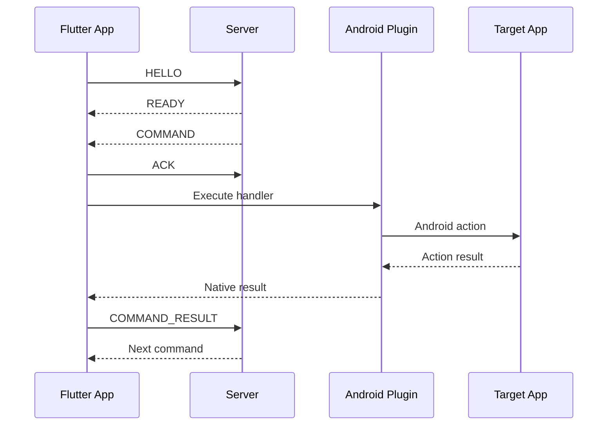

# 3. Luồng khi Customer bấm Run

## 3.1. Chuẩn bị trước khi chạy

A2MaTex App kiểm tra:

- Customer đã đăng nhập.
- Device đã đăng ký.
- Accessibility Service đang bật.
- Runtime version tương thích.
- Không có execution khác đang chạy trên device.
- Các input bắt buộc đã được nhập.

## 3.2. Tạo Execution

Flutter gọi REST API:

```http
POST /executions
```

```json
{
  "productId": "product_01J...",
  "deviceId": "device_01J...",
  "inputs": {
    "accountName": "example",
    "minimumAmount": 1000000
  }
}
```

Server kiểm tra:

```text
User ACTIVE?
→ Device active?
→ Product ACTIVE?
→ Entitlement ACTIVE?
→ Entitlement chưa hết hạn?
→ Device quota còn?
→ Concurrent execution quota còn?
→ Runtime version tương thích?
```

Nếu hợp lệ, server trả:

```json
{
  "executionId": "exec_01J...",
  "streamToken": "short-lived-token",
  "grpcEndpoint": "runtime.a2matex.com:443",
  "expiresAt": "2026-09-24T14:10:00Z"
}
```

## 3.3. Mở gRPC stream

Flutter khởi động Runtime Agent và mở secure bidirectional stream:

```text
RunExecution(stream ClientEvent)
returns (stream ServerEvent)
```

Client gửi handshake:

```json
{
  "type": "HELLO",
  "executionId": "exec_01J...",
  "deviceId": "device_01J...",
  "streamToken": "short-lived-token",
  "runtimeVersion": "1.0.0",
  "capabilities": ["ACCESSIBILITY", "GESTURE", "INPUT_TEXT"]
}
```

Server xác thực rồi trả:

```json
{
  "type": "READY",
  "executionId": "exec_01J..."
}
```

## 3.4. Thực thi từng command



MVP chỉ có một command đang chạy tại một thời điểm.

## 3.5. Khi gặp server-side node

Nếu Workflow Engine đang chạy:

- JavaScript node.
- Condition node.
- Google Sheets node.
- Telegram node.
- Slack node.

Server xử lý mà không gửi command xuống Android. Trong thời gian đó gRPC stream vẫn mở.

Server có thể chỉ gửi progress event:

```json
{
  "type": "EXECUTION_PROGRESS",
  "currentStep": 8
}
```

Khi gặp Android node tiếp theo, server mới gửi command.

# 4. Dữ liệu nào được tải xuống Mobile?

Mobile được phép tải:

- Marketplace metadata.
- Product input schema.
- Execution ID.
- Stream token ngắn hạn.
- Từng Android command.
- Command-specific asset nếu thật sự cần.
- Execution progress/result.

Mobile không tải:

- Source graph.
- Toàn bộ node/edge.
- Execution IR.
- JavaScript source.
- Script artifact.
- Transition của các bước tiếp theo.
- Connector credential.
- Product secret.
- Logic license.

Ví dụ command:

```json
{
  "commandId": "cmd_01J...",
  "executionId": "exec_01J...",
  "deviceId": "device_01J...",
  "sequence": 4,
  "handler": "TAP_ELEMENT",
  "payload": {
    "targetPackage": "com.example.app",
    "selector": {
      "resourceId": "com.example.app:id/loginButton",
      "text": "Login"
    }
  },
  "expiresAt": "2026-09-24T14:05:30Z"
}
```

# 5. Command được thực thi thế nào?

## 5.1. Command Router

Flutter nhận command và kiểm tra:

- `executionId` đúng session.
- `deviceId` đúng thiết bị.
- `sequence` đúng thứ tự.
- `commandId` chưa được thực thi.
- Command chưa hết hạn.
- Handler nằm trong allowlist.
- Payload đúng schema.
- Target package được cho phép.

Sau đó Flutter gọi native plugin:

```text
TAP_ELEMENT
→ RuntimeBridge.executeTap(payload)
→ TapElementHandler
```

## 5.2. Native Handler Registry

```text
LAUNCH_APP        → LaunchAppHandler
WAIT_FOR_ELEMENT  → WaitForElementHandler
TAP_ELEMENT       → TapElementHandler
LONG_PRESS        → LongPressHandler
SWIPE             → SwipeHandler
INPUT_TEXT        → InputTextHandler
PRESS_BACK        → PressBackHandler
PRESS_HOME        → PressHomeHandler
GET_ELEMENT_TEXT  → GetElementTextHandler
ELEMENT_EXISTS    → ElementExistsHandler
```

Mỗi handler chỉ thực hiện một capability đã định nghĩa trước.

Không có command:

```text
EXECUTE_CODE
RUN_JAVASCRIPT
RUN_SHELL
INSTALL_APK
```
