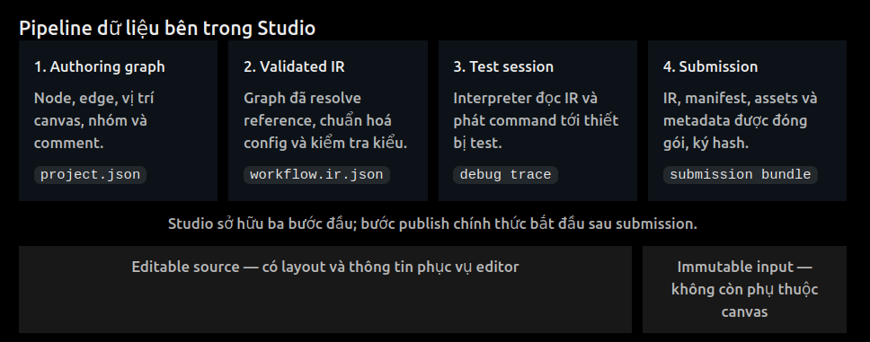

> Studio không build workflow thành APK, JavaScript bundle hay executable. Studio là IDE trực quan dùng để tạo graph, kiểm tra, debug và biên dịch graph thành một Intermediate Representation - IR có cấu trúc chuẩn.

IR này mới là đầu vào cho hệ thống thực thi sau này. Android Runtime không nhận toàn bộ graph và không tự “dịch” sản phẩm.

# 1. Định nghĩa vai trò A2MaTex Studio

A2MaTex Studio là desktop application dành cho publisher, gồm năm chức năng chính:

1. Thiết kế automation bằng node/edge.
2. Quản lý biến, input, asset và capability.
3. Validate workflow.
4. Test/debug workflow trên Android test device.
5. Tạo submission snapshot gửi lên server.

Studio không đảm nhiệm:

- Bán sản phẩm.
- Quản lý license customer.
- Chạy workflow production.
- Kết nối trực tiếp đến thiết bị của customer.
- Build APK riêng cho từng automation product.
- Thực thi JavaScript do publisher tự viết trong MVP.
