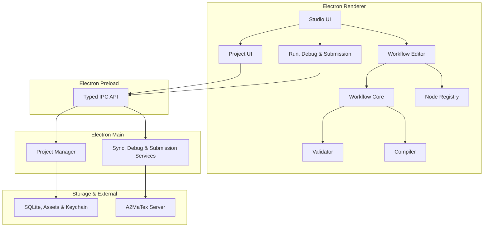

# 2. Kiến trúc bên trong Electron Studio

## Phân chia trách nhiệm

| Component                           | Công dụng                                               |
| ----------------------------------- | ------------------------------------------------------- |
| `Studio UI`                         | Khung giao diện, menu, toolbar và điều hướng chung.     |
| `Workflow Editor`                   | Canvas để tạo, sửa và kết nối node/edge.                |
| `Project UI`                        | Quản lý project, workflow, variables, inputs và assets. |
| `Run, Debug & Submission`           | Validate, chạy thử, xem trace và gửi submission.        |
| `Node Registry`                     | Danh mục và định nghĩa cấu hình của từng loại node.     |
| `Workflow Core`                     | Chứa logic xử lý graph độc lập với giao diện.           |
| `Validator`                         | Kiểm tra cấu trúc graph, node, edge và cấu hình.        |
| `Compiler`                          | Chuyển graph thành Execution IR.                        |
| `Typed IPC API`                     | Cầu nối an toàn giữa React Renderer và Electron Main.   |
| `Project Manager`                   | Mở, lưu, autosave, import/export project local.         |
| `Sync, Debug & Submission Services` | Giao tiếp với server để sync draft, debug và submit.    |
| `SQLite, Assets & Keychain`         | Lưu project local, asset và thông tin bí mật.           |
| `A2MaTex Server`                    | Lưu cloud draft, điều phối debug và nhận submission.    |

Electron khuyến nghị bật context isolation, sandbox và không expose trực tiếp privileged API sang renderer. ([Security](https://electronjs.org/docs/latest/tutorial/security))
