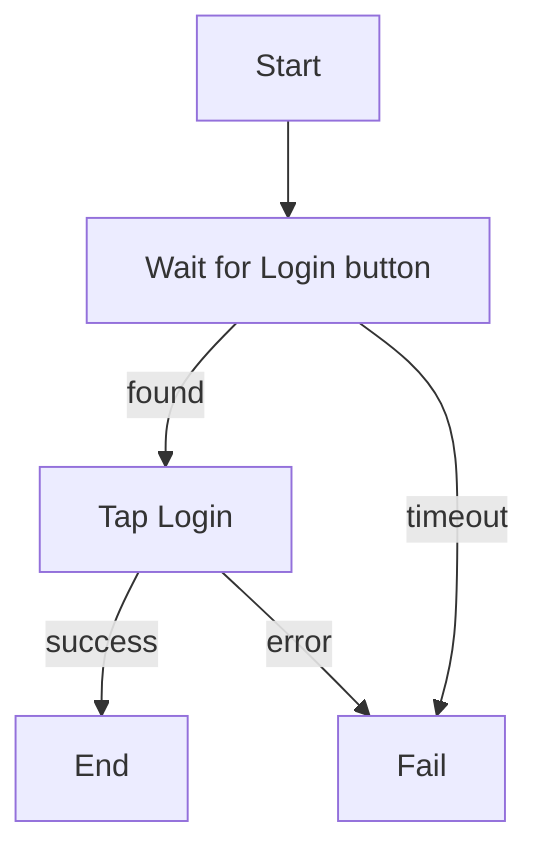

# 3. Thiết kế canvas, node và edge

## 3.1 Bố cục Studio

```text
┌─────────────────────────────────────────────────────────┐
│ Project | Save | Validate | Run | Debug | Submit        │
├────────────┬──────────────────────────┬─────────────────┤
│ Node       │                          │ Properties      │
│ Palette    │        Canvas            │ Inspector       │
│            │                          │                 │
├────────────┴──────────────────────────┴─────────────────┤
│ Problems | Variables | Debug Console | Execution Trace  │
└─────────────────────────────────────────────────────────┘
```

Nên dùng `@xyflow/react` cho canvas. React Flow hỗ trợ custom node, handle, save/restore node, edge và viewport. Tuy nhiên không nên lưu nguyên object nội bộ của React Flow làm domain model vì model thư viện có thể thay đổi giữa các phiên bản. ([Save and restore](https://reactflow.dev/examples/interaction/save-and-restore))

Cần một adapter:

```text
React Flow state ⇄ A2MaTex Graph Model
```

## 3.2 Các nhóm node MVP

### Lifecycle

- `Start`
- `End`
- `Fail`

### Android action

- `LaunchApp`
- `TapElement`
- `LongPressElement`
- `Swipe`
- `InputText`
- `PressBack`
- `PressHome`
- `WaitForElement`

### Data extraction

- `GetElementText`
- `ElementExists`
- `ReadClipboard`
- `SetVariable`

### Control flow

- `Condition`
- `Delay`
- `Repeat`
- `Retry`

Không nên có `RunJavaScript`, `RunShell` hoặc custom native code trong MVP. Các node này làm phát sinh sandbox, dependency, malware review và môi trường compile.

## 3.3 Edge là control flow

Trong MVP, edge chỉ nên biểu diễn luồng điều khiển, không làm hệ thống data-flow phức tạp.

Ví dụ một node `TapElement` có các output handle:

- `success`
- `notFound`
- `timeout`
- `error`



Node đọc dữ liệu thông qua variable reference:

```text
{{inputs.email}}
{{inputs.password}}
{{variables.otp}}
{{steps.readOtp.output.text}}
```

Không sử dụng `eval()` hoặc JavaScript expression tùy ý. Studio cung cấp expression syntax giới hạn và parser riêng.

## 3.4 Dữ liệu project

Nên phân biệt ba loại dữ liệu:

- Business graph.
- Editor state.
- Project metadata.

```json
{
  "schemaVersion": 1,
  "projectId": "proj_01J...",
  "metadata": {
    "name": "Auto Login Demo",
    "description": "Demonstration workflow",
    "version": "0.1.0"
  },
  "workflows": {
    "entryNodeId": "node_start",
    "nodes": [
      {
        "id": "node_start",
        "type": "Start",
        "typeVersion": 1,
        "config": {}
      },
      {
        "id": "node_wait_login",
        "type": "WaitForElement",
        "typeVersion": 1,
        "config": {
          "selector": {
            "resourceId": "com.example:id/loginButton",
            "text": "Login"
          },
          "timeoutMs": 10000
        }
      }
    ],
    "edges": [
      {
        "id": "edge_01",
        "sourceNodeId": "node_start",
        "sourcePort": "next",
        "targetNodeId": "node_wait_login",
        "targetPort": "input"
      }
    ]
  },
  "editor": {
    "nodes": {
      "node_start": {
        "position": { "x": 100, "y": 160 }
      },
      "node_wait_login": {
        "position": { "x": 360, "y": 160 }
      }
    },
    "viewport": {
      "x": 0,
      "y": 0,
      "zoom": 1
    },
    "groups": [],
    "comments": []
  }
}
```

Điểm quan trọng là `position`, `viewport`, comment và màu sắc không nằm trong business graph. Khi compile, toàn bộ `editor` bị loại bỏ.

## 3.5 Node definition catalog

Studio cần một registry định nghĩa node:

```ts
interface NodeDefinition<TConfig> {
  type: string;
  version: number;
  displayName: string;
  category: string;

  inputPorts: PortDefinition[];
  outputPorts: PortDefinition[];

  configSchema: ZodSchema<TConfig>;
  requiredCapabilities: string[];

  compile(node: WorkflowNode<TConfig>, context: CompileContext): CompiledStep;
}
```

Nên tạo package dùng chung:

```text
packages/workflow-core
├── node-definitions
├── schemas
├── expression-parser
├── validator
├── compiler
└── migration
```

Cả Electron Studio và NestJS sử dụng package này:

- Studio dùng để kiểm tra nhanh.
- Server dùng để compile lại bằng trusted compiler.
- Tránh trường hợp Studio hiểu node theo cách này nhưng server hiểu theo cách khác.

## 3.6 Quy tắc validation

Studio phải validate liên tục và validate toàn bộ trước khi chạy/submission.

### Structural validation

- Có đúng một `Start`.
- Có ít nhất một `End` hoặc `Fail`.
- Không có node bị mất reference.
- Không có edge trỏ đến node không tồn tại.
- Không có node unreachable.
- Không có output bắt buộc bị bỏ trống.
- Không có duplicate node ID hoặc edge ID.

### Flow validation

- Một output thông thường chỉ có tối đa một edge.
- `Condition` phải có nhánh `true` và `false`.
- `Retry` phải có `maxAttempts`.
- `Repeat` phải có `maxIterations`.
- Không cho phép cycle tự do.
- Back edge chỉ hợp lệ nếu thuộc `Repeat` hoặc `Retry`.

### Configuration validation

- Selector phải có ít nhất một thuộc tính.
- Timeout phải nằm trong giới hạn.
- Variable được tham chiếu phải tồn tại.
- Kiểu dữ liệu input phải tương thích.
- Node version phải được Studio hỗ trợ.
- Asset reference phải tồn tại.

### Safety validation

- Giới hạn tổng số node.
- Giới hạn thời gian chạy dự kiến.
- Không chứa secret hard-coded.
- Không có shell command.
- Không có arbitrary JavaScript.
- Không truy cập capability chưa khai báo.
