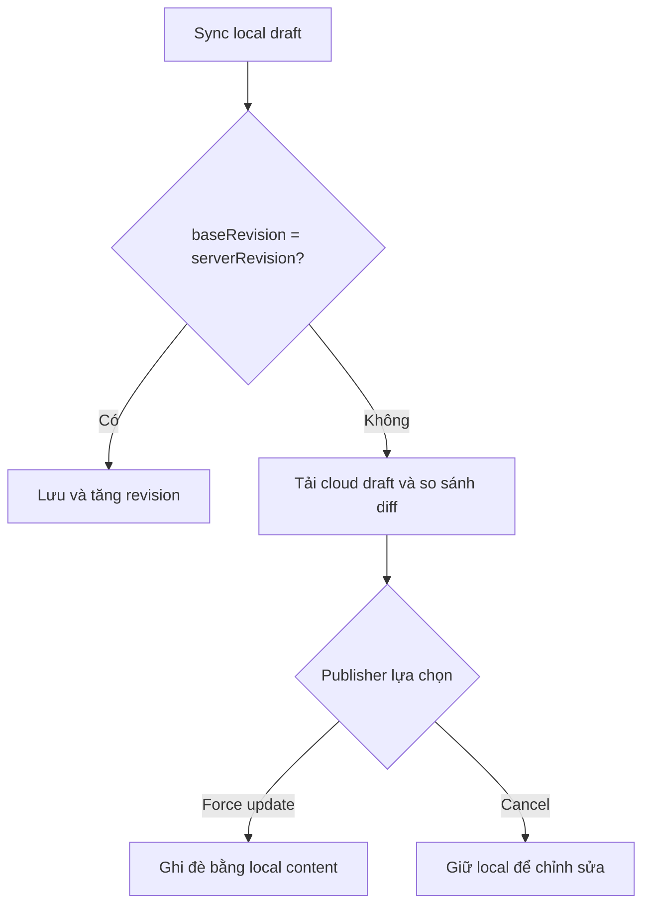

# 4. Lưu local và lưu server

Nên có ba cấp dữ liệu độc lập:

| Cấp                 | Mục đích                               | Có thể sửa? |
| ------------------- | -------------------------------------- | ----------: |
| Local working copy  | Autosave khi publisher đang phát triển |          Có |
| Cloud draft         | Backup và làm việc qua nhiều máy       |          Có |
| Submission snapshot | Phiên bản gửi review                   |       Không |

## 4.1 Local working copy

Studio luôn lưu local, kể cả khi publisher chưa đăng nhập hoặc mất mạng.

Nên dùng:

- SQLite cho metadata, project revision và history.
- Filesystem application-data cho asset.
- Có thể export thành `.a2mproj` để backup hoặc chuyển máy.

Không sử dụng `localStorage` của Electron Renderer để lưu project. vì:

- Dữ liệu bị gắn với renderer/origin.
- Không phù hợp quản lý project lớn và asset.
- Khó transaction, revision và migration.
- Khó backup/export thành project file.
- Renderer bị reset hoặc thay đổi cấu hình có thể ảnh hưởng dữ liệu.

Cấu trúc local:

```text
studio-data/
├── studio.db
└── projects/
    └── proj_01J.../
        ├── project.json
        ├── assets/
        └── snapshots/
```

### Autosave

- Thay đổi graph được giữ ngay trong state.
- Debounce khoảng 2000 ms.
- Ghi transaction xuống SQLite.
- Asset được ghi vào project directory.
- Hiển thị trạng thái `Saved locally`.

## 4.2 Cloud draft

Không tự động upload mọi thao tác canvas lên server trong MVP.

Cloud sync xảy ra khi:

- Publisher bấm `Sync`.
- Publisher bấm `Run on device`.
- Publisher bấm `Create submission`.

Mỗi draft cần:

```json
{
  "projectId": "proj_01J...",
  "revision": 12,
  "baseRevision": 11,
  "contentHash": "sha256:...",
  "project": {}
}
```

Server chỉ nhận update nếu `baseRevision` vẫn là revision mới nhất.

Nếu local và cloud cùng thay đổi:

- Không silently overwrite.
- Hiển thị conflict.
- Cho chọn `Keep local` hoặc `Use cloud`.

MVP chưa cần collaborative realtime hoặc CRDT.

## 4.3 Secret trong project

Không được lưu password, API key hoặc tài khoản test trong `project.json`.

Project chỉ khai báo input:

```json
{
  "key": "password",
  "type": "secret",
  "required": true
}
```

Giá trị dùng khi test được lưu trong OS keychain hoặc nhập lại khi chạy. Secret không được đưa vào submission.

## 4.4 Cấu trúc lưu cloud draft

Bảng `ProjectDraft`:
| Field | Type | Ý nghĩa |
| --------------- | ----------- | ---------------------------------------------- |
| `id` | UUID | ID của cloud draft |
| `projectId` | UUID | Project sở hữu draft |
| `revision` | INT | Số phiên bản, tăng sau mỗi lần sync thành công |
| `schemaVersion` | INT | Phiên bản cấu trúc project JSON |
| `studioVersion` | VARCHAR | Phiên bản Studio đã lưu draft |
| `content` | JSONB | Toàn bộ dữ liệu project có thể chỉnh sửa |
| `contentHash` | VARCHAR | SHA-256 của `content`, dùng kiểm tra thay đổi |
| `createdById` | UUID | Publisher tạo draft |
| `updatedById` | UUID | Publisher cập nhật gần nhất |
| `createdAt` | TIMESTAMPTZ | Thời điểm tạo |
| `updatedAt` | TIMESTAMPTZ | Thời điểm cập nhật |

Cấu trúc `content`:

```json
{
  "metadata": {
    "name": "Auto Login",
    "description": "Login automation"
  },
  "workflows": [
    {
      "id": "workflow_main",
      "name": "Main",
      "entryNodeId": "node_start",
      "nodes": [],
      "edges": []
    }
  ],
  "variables": [],
  "inputs": [],
  "outputs": [],
  "assetRefs": [],
  "editor": {
    "activeWorkflowId": "workflow_main",
    "viewport": {
      "x": 0,
      "y": 0,
      "zoom": 1
    }
  }
}
```

Request khi sync:

```json
{
  "projectId": "proj_01J...",
  "baseRevision": 11,
  "schemaVersion": 1,
  "studioVersion": "1.0.0",
  "contentHash": "sha256:...",
  "content": {}
}
```

baseRevision chỉ nằm trong request, không cần lưu thành field:

```json
Client baseRevision = 11
Server revision = 11
→ Cho phép update
→ Server tăng revision thành 12
```

Nếu:

```json
Client baseRevision = 11
Server revision = 12
→ Trả lỗi DRAFT_REVISION_CONFLICT
```

Mục đích của baseRevision

Ví dụ hai máy cùng mở revision 10:

```json
Máy A tải revision 10
Máy B tải revision 10

Máy A sync:
baseRevision = 10
serverRevision = 10
→ Thành công, server tăng thành 11

Máy B sync:
baseRevision = 10
serverRevision = 11
→ Conflict
```

Nếu không có baseRevision, máy B sẽ âm thầm ghi đè thay đổi của máy A.

Cơ chế optimistic concurrency control, tương tự compare-and-swap.



Khi conflict, server trả:

```json
{
  "error": "DRAFT_REVISION_CONFLICT",
  "serverRevision": 11,
  "serverContentHash": "sha256:...",
  "serverContent": {}
}
```

Studio hiển thị diff:

- Node được thêm/xóa.
- Node config thay đổi.
- Edge thay đổi.
- Variable/input thay đổi.
- Asset reference thay đổi.
- Metadata thay đổi.

Các lựa chọn trên UI:

| Lựa chọn          | Hành vi                                                  |
| ----------------- | -------------------------------------------------------- |
| Force update      | Dùng local content ghi đè cloud draft và tăng revision   |
| Cancel            | Không thay đổi cloud; giữ local content để publisher sửa |
| Use cloud version | Bỏ local content và tải cloud draft về, có xác nhận      |
