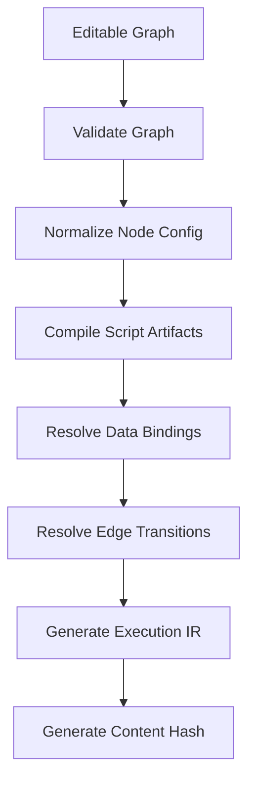
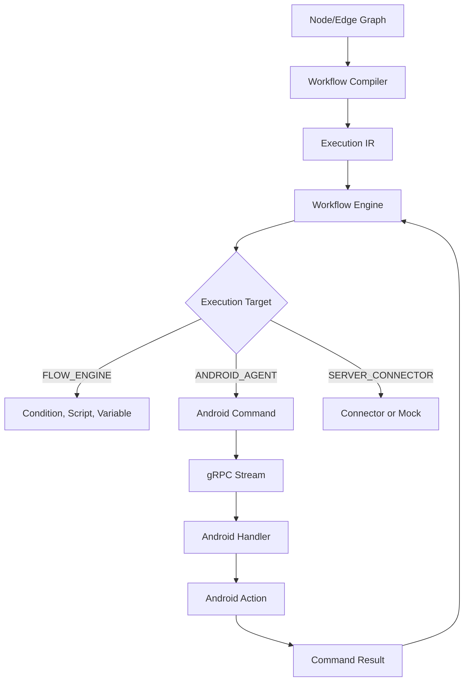

## 5.13. Tổng quan Workflow Engine

Workflow Engine chịu trách nhiệm đọc Execution IR, thực thi từng step và quyết định step tiếp theo.

```text
Execution IR
→ Load entry step
→ Resolve input và variable
→ Xác định execution target
→ Thực thi step
→ Nhận result
→ Lưu output
→ Chọn transition
→ Chạy step tiếp theo
→ Kết thúc workflow
```

Workflow Engine chạy tại hai môi trường:

| Môi trường  | Workflow Engine                     |
| ----------- | ----------------------------------- |
| Local Debug | Local Execution Engine trong Studio |
| Production  | NestJS Server Execution Engine      |

Hai môi trường phải sử dụng chung:

- Execution IR schema.
- Node definitions.
- Expression rules.
- Script API.
- Command/result contract.
- Transition rules.

## 5.14. Cấu trúc của một Node

Node trong graph chứa thông tin nghiệp vụ, cấu hình và các cổng kết nối.

```json
{
  "id": "node_tap_login",
  "type": "TapElement",
  "typeVersion": 1,
  "executionTarget": "ANDROID_AGENT",
  "config": {
    "selector": {
      "resourceId": "com.example:id/loginButton",
      "text": "Login"
    },
    "timeoutMs": 10000
  },
  "inputBindings": {},
  "outputSchema": {
    "success": "boolean"
  },
  "ports": {
    "inputs": ["input"],
    "outputs": ["success", "timeout", "error"]
  }
}
```

Các field chính:

| Field             | Công dụng                                          |
| ----------------- | -------------------------------------------------- |
| `id`              | Định danh duy nhất của node trong workflow         |
| `type`            | Loại node                                          |
| `typeVersion`     | Phiên bản định nghĩa node                          |
| `executionTarget` | Thành phần chịu trách nhiệm thực thi               |
| `config`          | Cấu hình riêng của node                            |
| `inputBindings`   | Mapping dữ liệu từ input, variable hoặc node trước |
| `outputSchema`    | Định nghĩa dữ liệu node trả về                     |
| `ports`           | Các cổng input/output để nối edge                  |

Thông tin hiển thị trên canvas được lưu riêng:

```json
{
  "nodeId": "node_tap_login",
  "position": {
    "x": 420,
    "y": 180
  }
}
```

Các thông tin như position, màu sắc, comment và viewport không được đưa vào Execution IR.

## 5.15. Node Definition

Mỗi loại node được định nghĩa trong `Node Registry`.

```ts
interface NodeDefinition<TConfig> {
  type: string;
  version: number;
  executionTarget: "FLOW_ENGINE" | "ANDROID_AGENT" | "SERVER_CONNECTOR";

  configSchema: ZodSchema<TConfig>;
  inputSchema: ZodSchema;
  outputSchema: ZodSchema;

  inputPorts: PortDefinition[];
  outputPorts: PortDefinition[];

  validate(
    node: WorkflowNode<TConfig>,
    context: ValidationContext,
  ): ValidationIssue[];

  compile(node: WorkflowNode<TConfig>, context: CompileContext): ExecutionStep;
}
```

`Node Registry` được dùng chung bởi:

- Node Palette.
- Properties Inspector.
- Validator.
- Workflow Compiler.
- Local Execution Engine.
- NestJS Execution Engine.

## 5.16. Các nhóm Node

### Flow Node

Được Workflow Engine xử lý trực tiếp:

- `Start`
- `End`
- `Fail`
- `Condition`
- `Delay`
- `Retry`
- `SetVariable`
- `JavaScript`

### Android Node

Được chuyển thành command gửi xuống Android Runtime Agent:

- `LaunchApp`
- `WaitForElement`
- `TapElement`
- `LongPressElement`
- `Swipe`
- `InputText`
- `PressBack`
- `PressHome`
- `GetElementText`
- `ElementExists`

### Server Connector Node

Được mock khi debug local và chạy trên server khi production:

- `GoogleSheetsAppendRow`
- `TelegramSendMessage`
- `SlackSendMessage`
- `HttpRequest`

## 5.17. Expression trong Node

Các field cấu hình có thể sử dụng expression:

```json
{
  "message": "Balance: {{ variables.balance }}",
  "chatId": "{{ inputs.telegramChatId }}"
}
```

Workflow Engine resolve expression trước khi thực thi node:

```text
Node config
+ Workflow inputs
+ Current variables
+ Previous step outputs
→ Resolved arguments
```

Expression có thể truy cập:

```text
inputs
variables
steps.{stepId}.outputs
execution
```

Ví dụ:

```javascript
{
  {
    variables.balance >= 1000000;
  }
}
```

Expression không được truy cập:

- Filesystem.
- Network.
- Environment variable.
- Android API.
- Database.
- Shell command.

## 5.18. JavaScript Code Node

Logic phức tạp được viết trong `JavaScript` node.

```javascript
export default function run(context) {
  const amount = Number(context.inputs.amount);

  if (!Number.isFinite(amount)) {
    return {
      branch: "invalid",
      outputs: {
        error: "Invalid amount",
      },
    };
  }

  return {
    branch: amount >= 1000000 ? "high" : "normal",
    outputs: {
      amount,
      formattedAmount: amount.toLocaleString("vi-VN"),
    },
  };
}
```

Cấu hình node:

```json
{
  "id": "node_check_balance",
  "type": "JavaScript",
  "typeVersion": 1,
  "executionTarget": "FLOW_ENGINE",
  "config": {
    "languageVersion": "ES2022",
    "sdkVersion": "1.0",
    "sourceCode": "export default function run(context) { ... }",
    "branches": ["high", "normal", "invalid"]
  },
  "inputBindings": {
    "amount": "{{ steps.readBalance.outputs.text }}"
  },
  "outputSchema": {
    "amount": "number",
    "formattedAmount": "string?",
    "error": "string?"
  }
}
```

JavaScript node:

- Nhận JSON input.
- Trả JSON output.
- Trả tên branch tiếp theo.
- Chạy trong Script Runner cô lập.
- Không được gọi Android hoặc connector trực tiếp.

## 5.19. Workflow Compiler

Workflow Compiler chuyển editable graph thành Execution IR.



### Bước 1: Validate Graph

Kiểm tra:

- Có đúng một Start node.
- Node và edge tồn tại.
- Node có thể truy cập từ Start.
- Output port kết nối hợp lệ.
- Variable reference tồn tại.
- Node configuration đúng schema.
- JavaScript không sử dụng API bị cấm.
- Retry và repeat có giới hạn.

### Bước 2: Normalize Node

Compiler:

- Thêm giá trị mặc định.
- Chuẩn hóa timeout.
- Chuẩn hóa selector.
- Chuẩn hóa input binding.
- Xác định required capability.
- Loại bỏ editor state.

### Bước 3: Compile JavaScript Artifact

JavaScript source được:

1. Parse thành AST.
2. Kiểm tra syntax.
3. Kiểm tra API bị cấm.
4. Chuẩn hóa source.
5. Tạo Script Artifact.
6. Tính content hash.

```json
{
  "artifactId": "script_01J...",
  "language": "javascript",
  "languageVersion": "ES2022",
  "sdkVersion": "1.0",
  "contentHash": "sha256:..."
}
```

Execution IR chỉ tham chiếu đến artifact, không cần nhét toàn bộ code vào step.

### Bước 4: Resolve Edge thành Transition

Graph edge:

```json
{
  "sourceNodeId": "node_check_balance",
  "sourcePort": "high",
  "targetNodeId": "node_send_notification"
}
```

Được compile thành:

```json
{
  "transitions": {
    "high": "step_send_notification"
  }
}
```

### Bước 5: Sinh Content Hash

Hash không bao gồm:

- Vị trí node.
- Viewport.
- Màu sắc.
- Comment.
- Trạng thái selection.

Hash chỉ dựa trên logic workflow và script artifact.

## 5.20. Cấu trúc Execution IR

```json
{
  "irVersion": 1,
  "compilerVersion": "1.0.0",
  "entryStepId": "step_start",
  "steps": [
    {
      "id": "step_start",
      "operation": "FLOW_START",
      "executionTarget": "FLOW_ENGINE",
      "transitions": {
        "next": "step_read_balance"
      }
    },
    {
      "id": "step_read_balance",
      "operation": "ANDROID_GET_ELEMENT_TEXT",
      "executionTarget": "ANDROID_AGENT",
      "arguments": {
        "selector": {
          "resourceId": "com.example:id/balance"
        }
      },
      "transitions": {
        "success": "step_check_balance",
        "error": "step_failed"
      }
    },
    {
      "id": "step_check_balance",
      "operation": "RUN_JAVASCRIPT",
      "executionTarget": "FLOW_ENGINE",
      "scriptArtifactId": "script_01J...",
      "inputBindings": {
        "amount": "{{ steps.step_read_balance.outputs.text }}"
      },
      "transitions": {
        "high": "step_notify",
        "normal": "step_end",
        "invalid": "step_failed"
      }
    },
    {
      "id": "step_notify",
      "operation": "TELEGRAM_SEND_MESSAGE",
      "executionTarget": "SERVER_CONNECTOR",
      "completionPolicy": "CONTINUE_AFTER_ENQUEUE",
      "arguments": {
        "message": "High balance detected"
      },
      "transitions": {
        "accepted": "step_end",
        "failed": "step_failed"
      }
    }
  ],
  "requiredCapabilities": ["android.accessibility"],
  "limits": {
    "maxSteps": 500,
    "maxDurationMs": 300000
  }
}
```

Execution IR không chứa:

- Canvas position.
- React component.
- Electron state.
- Customer license.
- Android implementation code.

## 5.21. Cách Workflow Engine thực thi IR

Workflow Engine giữ:

```text
currentStepId
variables
stepOutputs
stepCount
startedAt
```

Mỗi vòng lặp:

```text
1. Load current step
2. Resolve inputBindings và arguments
3. Kiểm tra timeout và execution limits
4. Xác định executionTarget
5. Gửi step tới đúng executor
6. Nhận execution result
7. Validate output
8. Lưu step output
9. Chọn transition
10. Cập nhật currentStepId
```

Pseudo-code:

```ts
while (execution.status === "RUNNING") {
  const step = workflow.getStep(execution.currentStepId);

  const input = resolveBindings(step, execution.context);
  const result = await executeStep(step, input);

  validateResult(step.outputSchema, result.outputs);
  saveStepResult(step.id, result);

  execution.currentStepId = step.transitions[result.branch];

  checkExecutionLimits(execution);
}
```

## 5.22. Dispatch IR theo Execution Target

```ts
async function executeStep(
  step: ExecutionStep,
  input: unknown,
): Promise<StepResult> {
  switch (step.executionTarget) {
    case "FLOW_ENGINE":
      return flowExecutor.execute(step, input);

    case "ANDROID_AGENT":
      return androidCommandExecutor.execute(step, input);

    case "SERVER_CONNECTOR":
      return connectorExecutor.execute(step, input);
  }
}
```

### `FLOW_ENGINE`

Workflow Engine xử lý trực tiếp:

```text
Condition
Delay
SetVariable
Retry
JavaScript
Start
End
Fail
```

### `ANDROID_AGENT`

Workflow Engine chuyển step thành Android command và gửi qua gRPC.

### `SERVER_CONNECTOR`

Trong Local Debug:

```text
SERVER_CONNECTOR
→ Connector Mock Engine
```

Trong Production:

```text
SERVER_CONNECTOR
→ Background Connector Worker
```

## 5.23. Từ Android IR Step thành Command

Ví dụ IR step:

```json
{
  "id": "step_tap_login",
  "operation": "ANDROID_TAP_ELEMENT",
  "executionTarget": "ANDROID_AGENT",
  "arguments": {
    "selector": {
      "resourceId": "com.example:id/loginButton"
    }
  }
}
```

`AndroidCommandExecutor` chuyển thành command:

```json
{
  "commandId": "cmd_01J...",
  "executionId": "exec_01J...",
  "stepId": "step_tap_login",
  "sequence": 4,
  "handler": "TAP_ELEMENT",
  "payload": {
    "selector": {
      "resourceId": "com.example:id/loginButton"
    }
  },
  "expiresAt": "2026-09-23T14:30:00Z"
}
```

Command được gửi qua gRPC bidirectional stream.

Runtime Agent không biết node hoặc edge tiếp theo. Nó chỉ biết command hiện tại.

## 5.24. Handler Registry trên Android Runtime Agent

Runtime Agent có danh sách handler cố định:

```text
LAUNCH_APP        → LaunchAppHandler
WAIT_FOR_ELEMENT  → WaitForElementHandler
TAP_ELEMENT       → TapElementHandler
LONG_PRESS        → LongPressHandler
SWIPE             → SwipeHandler
INPUT_TEXT        → InputTextHandler
PRESS_BACK        → PressBackHandler
GET_ELEMENT_TEXT  → GetElementTextHandler
ELEMENT_EXISTS    → ElementExistsHandler
```

Pseudo-code:

```dart
final handlers = <CommandType, CommandHandler>{
  CommandType.launchApp: LaunchAppHandler(),
  CommandType.waitForElement: WaitForElementHandler(),
  CommandType.tapElement: TapElementHandler(),
  CommandType.swipe: SwipeHandler(),
  CommandType.inputText: InputTextHandler(),
};
```

Khi nhận command:

```text
1. Validate executionId
2. Validate deviceId
3. Validate sequence
4. Validate expiresAt
5. Validate handler nằm trong allowlist
6. Validate payload schema
7. Chọn handler
8. Thực hiện Android action
9. Trả result
```

## 5.25. Từ Command thành Android Action

Ví dụ `TAP_ELEMENT`:

```text
TAP_ELEMENT command
→ Parse selector
→ Tìm AccessibilityNodeInfo
→ Kiểm tra target package
→ Kiểm tra element có thể click
→ Thực hiện ACTION_CLICK
→ Trả SUCCESS hoặc ELEMENT_NOT_FOUND
```

Ví dụ result:

```json
{
  "commandId": "cmd_01J...",
  "executionId": "exec_01J...",
  "sequence": 4,
  "status": "SUCCESS",
  "outputs": {
    "matchedSelector": {
      "resourceId": "com.example:id/loginButton"
    }
  }
}
```

Nếu element không hỗ trợ click trực tiếp, handler có thể:

1. Tìm parent có khả năng click.
2. Thực hiện accessibility action trên parent.
3. Chỉ sử dụng coordinate fallback nếu node cho phép.

## 5.26. Hoàn thành một Step Android

Khi server nhận result:

```text
Command result
→ Kiểm tra commandId và sequence
→ Validate output
→ Lưu StepResult
→ Chọn transition theo status
→ Chạy IR step tiếp theo
```

Ví dụ:

```json
{
  "transitions": {
    "success": "step_input_password",
    "elementNotFound": "step_retry",
    "timeout": "step_failed"
  }
}
```

Runtime Agent không tự chọn transition. Quyết định này luôn thuộc Workflow Engine.

## 5.27. Luồng hoàn chỉnh từ Graph đến Android Action



Luồng tổng thể:

```text
Publisher thiết kế graph
→ Workflow Compiler tạo Execution IR
→ Workflow Engine đọc từng IR step
→ FLOW_ENGINE step được xử lý trực tiếp
→ SERVER_CONNECTOR step được mock hoặc đưa cho worker
→ ANDROID_AGENT step được chuyển thành command
→ Command gửi qua gRPC
→ Android Handler thực hiện action
→ Result trả về Workflow Engine
→ Workflow Engine chọn step tiếp theo
```

Điểm quan trọng là:

> Không phải toàn bộ IR được dịch thành Android action. Chỉ những step có `executionTarget = ANDROID_AGENT` mới được chuyển thành command gửi xuống thiết bị. JavaScript, condition, variable và connector không được thực thi trong Android Runtime Agent.
