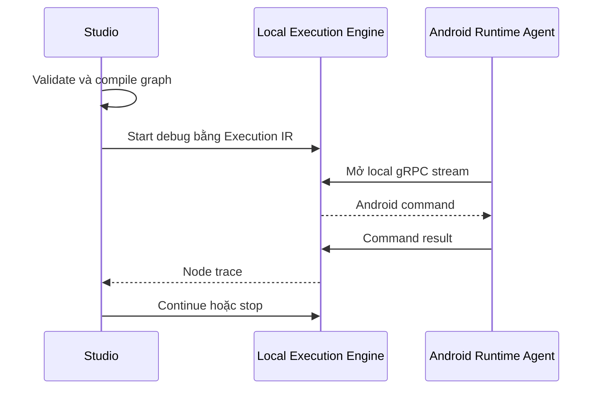

# 5. Run và Debug

A2MaTex Studio phải hỗ trợ cả:

- Workflow thao tác trực tiếp trên Android.
- Node điều khiển luồng như condition, delay, retry.
- Background node như Google Sheets, Telegram, Slack và webhook.

Không phải node nào cũng được gửi qua gRPC xuống Android Runtime Agent.

## 5.1. Phân loại Node theo nơi thực thi

Mỗi node khai báo một `executionTarget`.

| Execution target   | Nơi thực thi khi debug              | Ví dụ                                   |
| ------------------ | ----------------------------------- | --------------------------------------- |
| `FLOW_ENGINE`      | Local Execution Engine trong Studio | Condition, delay, retry, set variable   |
| `ANDROID_AGENT`    | Android Runtime Agent               | Tap, swipe, input, wait for element     |
| `SERVER_CONNECTOR` | Được mock trong Studio              | Google Sheets, Telegram, Slack, webhook |

Ví dụ workflow:

```text
Start
→ Launch App
→ Tap Login
→ Read Account Balance
→ Append Google Sheet
→ Send Telegram
→ End
```

Khi debug local:

```text
Start
→ FLOW_ENGINE chạy trong Studio

Launch App
→ ANDROID_AGENT chạy thật trên Android

Tap Login
→ ANDROID_AGENT chạy thật trên Android

Read Account Balance
→ ANDROID_AGENT chạy thật trên Android

Append Google Sheet
→ Studio trả mock result

Send Telegram
→ Studio trả mock result

End
→ FLOW_ENGINE chạy trong Studio
```

## 5.2. Các chế độ Run và Debug

MVP chỉ có hai chế độ:

| Chế độ                     | Cần Android device | Cần server/mạng |
| -------------------------- | -----------------: | --------------: |
| Validate và Simulate Local |              Không |           Không |
| Live Debug Local           |                 Có |           Không |

Chưa triển khai trong MVP:

- Cloud Debug.
- Wi-Fi Debug.
- Chạy connector thật trong Studio.
- Test riêng connector.
- Remote collaborative debugging.

## 5.3. Validate và Simulate Local

Chạy hoàn toàn trong Studio, không cần Android device hoặc A2MaTex Server.

Studio có thể kiểm tra:

- Cấu trúc graph.
- Node và edge không hợp lệ.
- Node không thể truy cập.
- Nhánh condition.
- Variable resolution.
- Retry/repeat limit.
- Missing input.
- Node transition.
- Command Android dự kiến được tạo.
- Connector request dự kiến được tạo.

Ví dụ:

```text
Start
→ WaitForElement
→ Mock result: FOUND
→ TapElement
→ Mock result: SUCCESS
→ SendTelegram
→ Mock result: ENQUEUED
→ End
```

Publisher có thể chọn mock result cho từng loại node:

```text
Android node:
SUCCESS | FAILED | TIMEOUT | ELEMENT_NOT_FOUND

Background node:
ENQUEUED | SUCCEEDED | FAILED | TIMEOUT
```

Simulator không:

- Thao tác trên Android thật.
- Gửi Telegram thật.
- Gửi Slack thật.
- Ghi Google Sheets thật.
- Gọi webhook thật.

## 5.4. Live Debug Local trên Android Device

Studio compile graph thành Execution IR và chạy Local Execution Engine.

Android Runtime Agent kết nối trực tiếp với Studio qua local gRPC stream.



Trong chế độ này:

- Studio giữ toàn bộ Execution IR.
- Local Execution Engine quyết định node tiếp theo.
- `FLOW_ENGINE` node chạy trực tiếp trong Studio.
- `ANDROID_AGENT` node chạy thật trên thiết bị.
- `SERVER_CONNECTOR` node sử dụng mock result.
- Runtime Agent chỉ nhận từng command nguyên tử.
- Runtime Agent không nhận toàn bộ workflow.
- Không cần A2MaTex Server hoặc Internet.

## 5.5. Xử lý Background Node

Background node không được gửi xuống Android Runtime Agent.

Trong Studio, background node được mô phỏng:

```text
Append Google Sheet
→ Hiển thị dữ liệu dự kiến được ghi
→ Publisher chọn mock result

Send Telegram
→ Hiển thị message dự kiến được gửi
→ Publisher chọn mock result
```

Ví dụ connector request:

```json
{
  "operation": "TELEGRAM_SEND_MESSAGE",
  "arguments": {
    "connectionId": "telegram_connection",
    "chatId": "{{inputs.chatId}}",
    "message": "Workflow completed"
  }
}
```

Studio không cần access token thật. Project chỉ lưu `connectionId` và cấu hình node.

Credential thực tế như Google OAuth token, Telegram bot token hoặc Slack token được quản lý trên server và chỉ được sử dụng khi sản phẩm chạy production.

### Completion Policy

Background node có thể khai báo một trong hai chính sách:

| Policy                   | Ý nghĩa                                                    |
| ------------------------ | ---------------------------------------------------------- |
| `WAIT_FOR_COMPLETION`    | Chờ external action thành công rồi mới chạy node tiếp theo |
| `CONTINUE_AFTER_ENQUEUE` | Chỉ cần job được đưa vào queue rồi tiếp tục workflow       |

Ví dụ notification cuối workflow:

```json
{
  "operation": "TELEGRAM_SEND_MESSAGE",
  "executionTarget": "SERVER_CONNECTOR",
  "completionPolicy": "CONTINUE_AFTER_ENQUEUE"
}
```

Trong trường hợp này, hệ thống không cần chờ người dùng đọc Telegram. Nó chỉ cần biết job đã được lưu an toàn để worker xử lý sau.

Trong Studio, cả hai policy đều được mô phỏng bằng mock result.

## 5.6. Kết nối Studio với Android Device

MVP sử dụng USB debugging qua ADB.

Luồng kết nối:

```text
Studio
→ Phát hiện Android device
→ Kiểm tra Runtime Agent
→ Cài đặt hoặc cập nhật Runtime Agent APK
→ Thiết lập ADB reverse port
→ Runtime Agent kết nối Local gRPC Server
```

Ví dụ:

```bash
adb install a2matex-runtime-agent.apk
adb reverse tcp:50051 tcp:50051
```

Runtime Agent kết nối tới:

```text
127.0.0.1:50051
```

Publisher cần:

1. Kết nối Android device bằng USB.
2. Bật Developer options.
3. Bật USB debugging.
4. Chấp nhận ADB connection.
5. Bật Accessibility Service cho Runtime Agent.
6. Bấm `Connect Device` trong Studio.

## 5.7. Các thành phần được đóng gói trong Studio

```text
A2MaTex Studio
├── Workflow Compiler
├── Local Execution Engine
├── Local gRPC Server
├── Debug Controller
├── Connector Mock Engine
├── ADB / Platform Tools
└── Runtime Agent APK
```

Runtime Agent APK được team A2MaTex build sẵn trong CI/CD.

Mỗi automation product không cần build một APK riêng.

Khi publisher chọn `Connect Device`, Studio thực hiện:

- Phát hiện thiết bị.
- Kiểm tra Runtime Agent đã được cài chưa.
- Kiểm tra Runtime Agent version.
- Cài đặt hoặc cập nhật APK nếu cần.
- Thiết lập port forwarding.
- Khởi tạo local debug session.

## 5.8. Trách nhiệm của các thành phần

### Local Execution Engine

- Đọc Execution IR.
- Quản lý current node.
- Xác định `executionTarget`.
- Resolve variable.
- Evaluate condition.
- Xử lý retry/repeat.
- Chọn node tiếp theo.
- Sinh Android command.
- Sinh connector request.
- Quản lý breakpoint.
- Gửi execution trace về Debug UI.

### Android Runtime Agent

- Nhận command qua gRPC.
- Thực hiện tap.
- Thực hiện swipe.
- Điền input.
- Chờ UI element.
- Đọc thông tin UI element.
- Thực hiện back hoặc home.
- Trả command result.
- Báo lỗi hoặc timeout.

Runtime Agent không:

- Compile graph.
- Quyết định node tiếp theo.
- Nhận toàn bộ workflow.
- Thực hiện background connector.
- Chứa logic riêng của automation product.

### Connector Mock Engine

- Nhận connector request từ Local Execution Engine.
- Hiển thị request dự kiến.
- Cho publisher chọn mock result.
- Trả mock result về Local Execution Engine.
- Không gọi external service thật.

## 5.9. Debug Feature cho MVP

Các chức năng cần có:

- Connect device.
- Disconnect device.
- Validate.
- Simulate.
- Run.
- Stop.
- Run from start.
- Breakpoint trước node.
- Continue.
- Step over.
- Highlight node đang chạy.
- Hiển thị node input.
- Hiển thị Android command.
- Hiển thị connector request.
- Hiển thị command result.
- Hiển thị variable hiện tại.
- Chọn mock result.
- Execution time.
- Error code và error message.
- Debug console.

Chưa triển khai:

- Step backward.
- Time-travel debugging.
- Resume sau khi mất kết nối.
- Hot reload graph trong khi chạy.
- Parallel branch debugging.
- Wi-Fi debugging.
- Cloud debugging.
- Remote collaborative debugging.
- Emulator management.

Nếu publisher sửa graph trong khi execution đang chạy, Studio phải dừng execution và yêu cầu chạy lại từ đầu.

Nếu mất kết nối USB hoặc gRPC stream:

- Android command hiện tại thất bại.
- Debug session chuyển thành `FAILED`.
- Publisher phải chạy lại workflow từ đầu.

## 5.10. Môi trường Compile

Publisher không cần cài đặt:

- Node.js.
- npm.
- Android Studio.
- Android SDK đầy đủ.
- Gradle.
- Flutter SDK.
- Java.
- Kotlin.
- JavaScript runtime riêng.

Electron package chứa:

- Node definitions.
- Project và graph schemas.
- Validator.
- Workflow Compiler.
- Expression Parser.
- Local Execution Engine.
- Local gRPC Server.
- Debug Controller.
- Connector Mock Engine.
- ADB Platform Tools.
- Runtime Agent APK.

Studio không compile Flutter hoặc Kotlin theo từng automation product.

Studio chỉ compile:

```text
Node/Edge Graph
→ Execution IR
```

Runtime Agent APK là ứng dụng generic, được build sẵn và có khả năng thực hiện các Android command mà A2MaTex hỗ trợ.

## 5.11. Đồng nhất giữa Local Debug và Production

Local debug và production sử dụng chung:

- Project schema.
- Execution IR schema.
- Node definitions.
- Workflow Compiler.
- Expression rules.
- Protobuf command contract.
- Command/result model.
- Connector request model.
- Android Runtime Agent.

Khác biệt nằm ở nơi chạy Execution Engine và cách xử lý connector.

```text
Local Debug:

Studio Local Execution Engine
├── FLOW_ENGINE → Xử lý trong Studio
├── ANDROID_AGENT → Android Runtime Agent
└── SERVER_CONNECTOR → Connector Mock Engine
```

```text
Production:

NestJS Server Execution Engine
├── FLOW_ENGINE → Xử lý trên server
├── ANDROID_AGENT → Android Runtime Agent
└── SERVER_CONNECTOR → Background Connector Worker
```

Local debug không cần server vì background connector được mock.

Production bắt buộc online để server:

- Kiểm tra quyền sử dụng.
- Kiểm tra license.
- Quản lý execution.
- Giữ Execution IR phía server.
- Gửi từng Android command xuống customer device.
- Điều phối background connector.
- Quản lý external credential.

## 5.12. Phạm vi MVP

MVP triển khai:

- Validate local.
- Simulate local.
- Live Debug Android qua USB ADB.
- Local gRPC Server.
- Local Execution Engine.
- Mock background connector.
- `FLOW_ENGINE`.
- `ANDROID_AGENT`.
- `SERVER_CONNECTOR`.
- `WAIT_FOR_COMPLETION`.
- `CONTINUE_AFTER_ENQUEUE`.
- Runtime Agent APK build sẵn.
- Debug trace.

Không triển khai:

- Chạy connector thật trong Studio.
- Test riêng connector.
- Full Cloud Debug.
- Wi-Fi Debug.
- Resume execution.
- Parallel workflow.
- Collaborative debugging.
- Custom JavaScript node.
- Custom native plugin.
