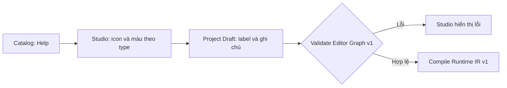

# Node Catalog và metadata của node — v1

## Overview

Contract targeting đã được đưa vào source catalog Backend. Studio tự chọn icon
và màu theo `type`. Catalog cung cấp Help chung và schema của từng targeting
mode; Project Draft chỉ lưu mode được chọn, values, tên và ghi chú riêng cho
từng node. Studio loại bỏ metadata hiển thị khi compile Runtime IR.



## Catalog response sau khi triển khai

```json
{
  "statusCode": 200,
  "data": {
    "catalogHash": "aaaaaaaaaaaaaaaaaaaaaaaaaaaaaaaaaaaaaaaaaaaaaaaaaaaaaaaaaaaaaaaa",
    "nodes": [
      {
        "type": "android.tap",
        "name": "Tap",
        "description": "Tap an absolute coordinate on the selected Android device.",
        "category": "ANDROID",

        "runtimeHandler": "android.tap",
        "minimumRuntimeVersion": "0.1.0",
        "defaultTimeoutMs": 30000,

        "configSchema": {
          "type": "object",
          "properties": {
            "targetMode": {
              "type": "string",
              "enum": ["ABSOLUTE_PIXELS", "SCREEN_PERCENT", "SELECTOR_ID"]
            }
          },
          "required": ["targetMode"],
          "additionalProperties": false
        },

        "inputSchema": {
          "type": "object",
          "properties": {},
          "required": [],
          "additionalProperties": false
        },

        "outputSchema": {
          "type": "object",
          "properties": {},
          "required": [],
          "additionalProperties": false
        },

        "outputPorts": {
          "ports": ["success", "error"]
        },

        "editorHints": {
          "targeting": {
            "modes": [
              {
                "mode": "ABSOLUTE_PIXELS",
                "bindingSchema": {
                  "type": "object",
                  "properties": {
                    "x": { "type": "integer", "minimum": 0, "maximum": 100000 },
                    "y": { "type": "integer", "minimum": 0, "maximum": 100000 }
                  },
                  "required": ["x", "y"],
                  "additionalProperties": false
                }
              },
              {
                "mode": "SCREEN_PERCENT",
                "bindingSchema": {
                  "type": "object",
                  "properties": {
                    "xPercent": {
                      "type": "integer",
                      "minimum": 0,
                      "maximum": 100
                    },
                    "yPercent": {
                      "type": "integer",
                      "minimum": 0,
                      "maximum": 100
                    }
                  },
                  "required": ["xPercent", "yPercent"],
                  "additionalProperties": false
                }
              },
              {
                "mode": "SELECTOR_ID",
                "bindingSchema": {
                  "type": "object",
                  "properties": {
                    "selector_id": {
                      "type": "string",
                      "pattern": "^[^\\s:]+:id/[^\\s/]+$"
                    }
                  },
                  "required": ["selector_id"],
                  "additionalProperties": false
                }
              }
            ]
          }
        },

        "capabilities": [
          {
            "code": "android.device.control",
            "name": "Android Device Control",
            "description": "Allows a workflow to send interaction commands to an Android device.",
            "isSensitive": true
          }
        ]
      }
    ]
  }
}
```

## Phân chia trách nhiệm

- Catalog: giữ `description` ngắn. `editorHints.targeting.modes` là source cho mode selector và form bindings; Project Draft không copy các schema này. Catalog dùng chung theo `type` và giữ cơ chế `catalogHash` hiện có.
- Studio: sở hữu icon, màu, labels và thứ tự field theo identifier, có fallback cho giá trị chưa có mapping. Render output dots theo thứ tự key trong `outputPorts.ports`. `STOP` luôn có; `ERROR_BRANCH` chỉ có khi ports chứa `error`.
- Project Draft: thêm `editor.label` và `editor.description` (chuỗi không rỗng hoặc `null`) vào Editor Graph v1. Label giúp phân biệt “Tap Login” và “Tap Confirm”; ghi chú giải thích mục đích của từng bước. Label `null` dùng tên từ definition; description `null` thì ẩn ghi chú. Khi đọc graph cũ, trường thiếu được xử lý như `null`. Từ chối chuỗi rỗng. Không lưu icon/màu theo instance.
- Local Runtime validation: cập nhật decoder v1 đồng bộ với Backend trước khi Studio gửi trường mới. Runtime IR v1 không chứa ba trường mới hoặc icon/màu.

Studio tính connections từ edges; index chỉ phục vụ hiển thị, không quyết định thứ tự chạy. Display mode có thể là preference local. Chưa thêm disable/bypass hoặc `allowedActions`.

Kiểm chứng khi triển khai: graph cũ, `null` và chuỗi có nội dung đều hợp lệ; chuỗi rỗng và sai kiểu bị từ chối nhất quán; draft round-trip giữ metadata; Runtime IR không chứa metadata hiển thị.
