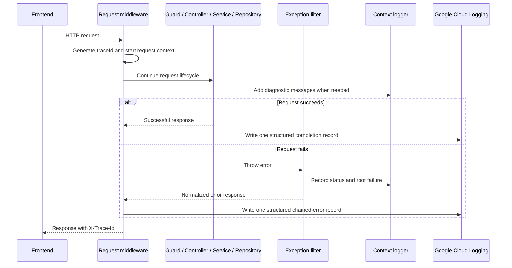

# Contextual Request Logging and Cloud Collection

## 1. Overview

This feature gives every Backend HTTP request one server-generated trace ID and
one final structured log record. Code in guards, controllers, services,
repositories, and shared infrastructure may add short diagnostic messages to
the current request through an injectable context logger. The Backend gathers
those messages during the request and writes them once when the response ends.

For a failed request, the final message is ordered from the outer operation to
the root cause. For example:

```text
failed to create product: failed to check existing product name: connection credentials is invalid
```

The API returns the trace ID in `X-Trace-Id`. A developer can copy that value
from the frontend, search it in Google Cloud Logging, and inspect the single
request record without first reproducing the failure locally.



This feature implements request correlation, message aggregation, structured
stdout logging, and collection in Google Cloud Logging. It does not implement
OpenTelemetry spans, Cloud Trace timelines, metrics, alerting, a log database,
or a queue-based logging pipeline.

## 2. Goals

The feature shall:

- assign one correlation ID to every Backend HTTP request before guards and
  validation execute;
- make the current request context available to injectable logging code across
  asynchronous controller, service, repository, and infrastructure calls;
- gather explicitly written diagnostic messages instead of emitting one cloud
  log entry from every layer;
- produce an outermost-to-innermost error message that ends with the root
  cause text selected by the developer;
- write one structured log record when the HTTP response completes or closes;
- return the trace ID to the caller and make the header readable by browser
  clients;
- store the structured record in Google Cloud Logging; and
- prevent sensitive request, authentication, payment, storage, workflow, and
  database values from entering logs.

## 3. Non-goals

The MVP does not include:

- distributed tracing or span creation;
- Google Cloud Trace integration;
- application version or API version fields in log records;
- a `service` field while the request logger belongs only to the Backend API;
- a second request ID in addition to `traceId`;
- a persisted `entries` array containing logger calls or class names;
- request or response body capture;
- database tables for logs;
- Kafka, a worker queue, or direct calls from the Backend to the Cloud Logging
  API;
- automatic diagnosis of successful business-logic defects; or
- aggregation of detached work that continues after the HTTP response ends.

Cron and other background processes may reuse the structured logger later, but
job-scoped correlation is outside this request-logging feature.

## 4. Request context

The Backend shall use Node.js `AsyncLocalStorage` to keep one mutable logging
context for the lifetime of a request.

```ts
type RequestLogContext = {
  traceId: string;
  startedAt: number;
  userId?: string;
  messages?: string[];
  rootError?: Error;
  cause?: string;
  failureStatusCode?: number;
  hasOperationalError?: boolean;
  truncated?: boolean;
  finalized?: boolean;
};
```

`messages` is temporary request memory. It shall not be serialized as a
separate field in the final log record.

The request middleware shall:

1. generate a new server-controlled trace ID;
2. set `X-Trace-Id` before the request continues;
3. capture the start time and resolve the HTTP method and normalized route at
   finalization;
4. run the remainder of the NestJS lifecycle inside the context; and
5. retain a reference to the context for response finalization.

The trace ID shall be 32 lowercase hexadecimal characters so it can later be
used as a standards-compatible trace identifier. The MVP shall not accept an
arbitrary client-provided `X-Trace-Id`, because an external caller must not be
able to merge unrelated requests under one trusted server correlation value.

The route shall exclude query parameters. When the matched route template is
unavailable, the logger shall use the URL pathname without its query string.

After an access token is successfully decoded, the access-token guard shall
add `userId` to the existing request context. Public and rejected unauthenticated
requests may therefore have no `userId`.

## 5. Context logger contract

The shared context logger shall be injectable and shall also implement Nest's
application logger contract so existing framework and `Logger` calls use the
same structured output boundary.

The request-scoped operations are:

```ts
logger.log(message: string): void;
logger.warn(message: string): void;
logger.error(message: string, error?: unknown): void;
contextLogger.errorWithCause(message: string, error: Error, cause: string): void;
```

Within an active HTTP request:

- `log` appends an informational message;
- `warn` appends a warning message;
- `error` appends an error-context message;
- the first concrete `Error` passed to `error` or `errorWithCause` is retained
  as the deepest known root error and supplies its name to the record;
- `errorWithCause` also selects text to append as the final cause; and
- none of these calls writes immediately to stdout.

Outside an HTTP request, the logger shall write a structured record immediately
because there is no request completion boundary that can flush accumulated
messages.

Messages shall describe the operation that failed, not repeat a class name.
For example:

```ts
// Repository, with an Error whose message is safe to log
this.contextLogger.errorWithCause("failed to check existing product name", error, error.message);

// Service
this.logger.error("failed to create product", error);
```

The message text is the source-level identifier. Developers may use IDE global
search to find the code that contributed a message. The final record therefore
does not need an `entries` array or per-message `context` field.

## 6. Message construction

### 6.1 Successful request

When no explicit messages were recorded, the final message shall be:

```text
request completed
```

Routine CRUD success messages shall not be added. If code deliberately records
an informational or warning message during an otherwise successful request,
the final message may append the recorded text after `request completed`.

### 6.2 Failed request

Messages are normally recorded from the deepest layer outward because the
repository catches the failure before the calling service. Finalization shall
reverse the relevant diagnostic messages so the persisted message reads from
the user-level operation toward the root cause.

The calls in Section 5 contribute the following text:

```text
Repository: failed to check existing product name
Service:    failed to create product
Root error: connection credentials is invalid
```

the final message shall be:

```text
failed to create product: failed to check existing product name: connection credentials is invalid
```

The formatter appends the selected cause directly. Repeated text is allowed.
Developers can also attach a fixed diagnostic message to an HTTP exception
with `withRequestLogMessage(exception, message)`. The exception filter uses
that text as the cause when the request has no cause already. Keep attached
messages short and safe for production.

When a failed request has neither diagnostic text nor a selected cause, the
logger uses the HTTP status text, such as `Unprocessable Entity`, or
`request failed` if status text is unavailable. The API continues to return
a safe generic response for unexpected failures.

## 7. Final structured log contract

The Backend shall write one JSON object per completed HTTP request.

### 7.1 Success example

```json
{
  "timestamp": "2026-10-28T10:20:31.190Z",
  "severity": "INFO",
  "traceId": "92c44ef036f049379c6862f46a4067ce",
  "method": "POST",
  "route": "/api/v1/products",
  "statusCode": 201,
  "durationMs": 70,
  "userId": "usr_123",
  "message": "request completed"
}
```

### 7.2 Failure example

```json
{
  "timestamp": "2026-10-28T10:22:04.422Z",
  "severity": "ERROR",
  "traceId": "a7821072051a42d4882ed69afe630d38",
  "method": "POST",
  "route": "/api/v1/products",
  "statusCode": 500,
  "durationMs": 94,
  "error": "PrismaClientInitializationError",
  "userId": "usr_123",
  "message": "failed to create product: failed to check existing product name: connection credentials is invalid"
}
```

`userId` and `error` are optional. When present, `error` is the error
name as a string and immediately follows `durationMs`. The logger writes
`message` last. The record shall not contain `entries`,
`context`, `service`, `version`, `environment`, or `requestId`.

The severity shall be selected as follows:

| Condition                                                                 | Severity  |
| ------------------------------------------------------------------------- | --------- |
| Successful response with no recorded error                                | `INFO`    |
| HTTP `4xx` or `5xx` response                                              | `ERROR`   |
| Successful response containing a deliberately swallowed operational error | `ERROR`   |

## 8. HTTP lifecycle and error ownership

Request finalization shall be the only component that writes the HTTP request
record.

- Request middleware owns context creation, response-header assignment,
  duration measurement, and the final write.
- Guards may add authenticated user context and diagnostic messages.
- Controllers, services, repositories, decorators, and infrastructure may add
  messages when the message gives useful failure context.
- Exception filters own HTTP status and safe response normalization. They shall
  record the thrown exception and resolved status in the request context but
  shall not emit another log record.
- The existing error logging interceptor shall be removed from global
  registration because it would duplicate the final request record.

The middleware shall finalize on the response `finish` event. It shall also
handle `close` as a fallback for an aborted connection. A finalization guard
shall prevent both events from writing the same request twice.

This lifecycle must include failures from authentication guards, permission
checks, validation pipes, serialization interceptors, controllers, services,
repositories, Prisma, and exception filters.

## 9. Sensitive-data and size boundaries

Contextual request records shall exclude:

- authorization headers, cookies, access tokens, or refresh tokens;
- passwords, OTP values, API keys, or connection credentials;
- Sepay authentication values or complete webhook payloads;
- object-storage credentials or presigned URLs;
- request or response bodies;
- Prisma query parameters;
- Project Draft documents, Workflow Revisions, Editor Graphs, or Runtime IR;
- raw private Profile data; or
- arbitrary objects supplied as logger metadata.

Call sites shall use fixed diagnostic text or values reviewed for production
logging, including any original exception message explicitly selected as the
cause. For unexpected errors, the `error` field contains the error name.
Stack traces are reserved for detailed debugging outside the request
record. The request logger performs no regex redaction.

Before merging changes that affect production logging, reviewers shall verify
the sources of values passed to logger calls, including interpolated values
and forwarded errors. This check also covers direct console calls and
library logging configuration.

`PRISMA_LOG_IGNORED_ENVIRONMENTS` includes `production`. Environments in
the array suppress Prisma's direct query, info, and error output. Development
prints SQL and its bound parameter values as queries complete. Query
output emitted before request finalization precedes that request's contextual
record. Requests that run no queries produce no SQL output. Output from
concurrent requests can interleave. Database failures can still contribute a
safe cause description to the contextual record.

The implementation shall define shared constants for these limits:

| Limit                | MVP value | Behavior when exceeded                                                     |
| -------------------- | --------: | -------------------------------------------------------------------------- |
| Messages per request |        25 | Stop accepting additional messages and mark the final message as truncated |
| One logger message or explicit cause passed to `errorWithCause` | 2 KiB | Truncate before storing |

These limits bound temporary memory and Cloud Logging record size. They are
operational constants, not business rules.

## 10. Cloud collection and retention path

The Backend shall serialize the final record as one compact JSON line to
stdout. It shall not synchronously call Google Cloud from the request handler.

The production deployment shall:

1. retain Docker stdout logs with bounded local rotation;
2. run Google Ops Agent on the Compute Engine VM;
3. collect the API container's Docker logs;
4. parse both the Docker log envelope and the application JSON payload;
5. map the application severity to Cloud Logging severity; and
6. preserve `traceId` as a structured `jsonPayload` field.

The support lookup contract is:

```text
jsonPayload.traceId="a7821072051a42d4882ed69afe630d38"
```

The first staging deployment shall verify the actual Docker log path and parser
shape before the Ops Agent configuration is promoted to production. Agent or
parser failure must not prevent the Backend from serving requests; local
rotated Docker logs remain the immediate fallback.

Cloud retention duration and log-based alerts are deployment policy and are
not defined by this feature.

## 11. Implementation mapping

The expected Backend implementation is:

```text
src/shared/infrastructure/logging/
├── request-log-context.ts
├── request-log-context.service.ts
└── context-logger.service.ts

src/shared/constants/logging.constant.ts
deploy/google-cloud-ops-agent.yaml
```

The change is also expected to update:

- `src/main.ts` to install the application logger and expose `X-Trace-Id` through
  CORS;
- `src/app.module.ts` to remove duplicate interceptor logging;
- `src/shared/shared.module.ts` to export the shared logging providers;
- `src/shared/middlewares/request-logging.middleware.ts` to own context and
  finalization;
- the global exception filters to record failures without writing duplicates;
- `src/shared/guards/access-token.guard.ts` to add the authenticated `userId`;
- existing request-scoped error call sites whose messages need to contribute to
  the final chain;
- `deploy/docker-compose.prod.yaml` for local log rotation; and
- the deployment runbook and Backend shared-infrastructure notes.

`src/shared/services/prisma.service.ts` suppresses direct Prisma output in
ignored environments and prints SQL and bound parameters when enabled.

The feature requires no database migration and no new application dependency.

## 12. Efficiency and concurrency

Request contexts must be isolated when asynchronous requests execute
concurrently. One request must never read another request's trace ID, user ID,
messages, root error, or finalization state.

Aggregation is bounded in memory and lasts only until response finalization.
The request path performs no database write, queue publication, or Cloud API
call for logging. The final local operation is one JSON serialization and one
stdout write.

Detached asynchronous work that outlives the response shall not keep writing
into a finalized request context. Such work requires a later job-context
contract.

## 13. Acceptance criteria

The feature is accepted when all of the following behavior is demonstrated:

1. Every API response, including guard and validation failures, contains a
   server-generated `X-Trace-Id` header.
2. Browser clients can read `X-Trace-Id` through the configured CORS response.
3. A normal successful request produces exactly one structured request record.
4. A failed request produces exactly one structured request record rather than
   separate repository, service, interceptor, filter, and completion records.
5. Repository and service diagnostics appear in the final `message` chain
   from the outer operation to the inner operation. Repeated text is allowed.
6. An explicitly selected cause terminates the chain, including the original
   error message when selected with `errorWithCause`. The `error` field
   contains the error name as a string when available. A failed request
   without diagnostics or a selected cause uses fallback text.
7. The persisted record contains no `entries` or per-layer context array.
8. Concurrent requests retain independent trace IDs and message chains.
9. Request bodies, credentials, tokens, Prisma parameters, workflow documents,
   and presigned URLs do not appear in contextual request records or in
   production logs.
10. Production suppresses direct Prisma output. In development, SQL and bound
    parameter output emitted before request finalization appears before that
    request's contextual record.
11. Searching the response trace ID in Google Cloud Logging returns the
    structured request record from the staging deployment.
12. Ops Agent or Cloud Logging unavailability does not block API request
    processing.

## 14. Deferred work

The following work is intentionally deferred until there is a demonstrated
need:

- OpenTelemetry instrumentation and span propagation;
- Cloud Trace request timelines;
- correlation across Backend, Runtime, workers, and external services;
- job or cron-run context aggregation;
- deployment version fields;
- multiple-service naming fields;
- log-derived metrics, dashboards, and alert policies;
- long-term log export to another storage system; and
- frontend support UI beyond capturing and displaying the response trace ID.
