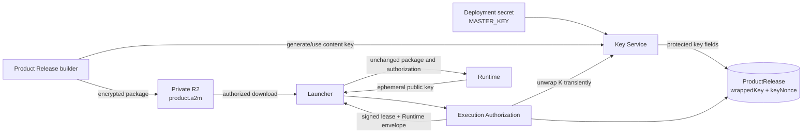

# Product Cryptographic Keys and Security

**Status:** Proposed cross-module security contract

**Scope:** Product Release build, private package download, Key Service, Launcher, Runtime, and
Production Execution Authorization

## Overview

This document identifies only the cryptographic material used to build, distribute, authorize, and
execute an encrypted A2MaTeX Product. Product Release, Key Service, and Production Execution
Authorization specifications remain authoritative for their detailed business and API contracts.



The Product package remains encrypted in R2, during Launcher transport, and on Launcher disk.
Backend unwraps the Release content key only inside Key Service; Runtime receives that key only in
an envelope encrypted for its ephemeral session public key.

## 1. Product cryptographic material

| Class                       | Product examples                                         | Purpose                                      |
| --------------------------- | -------------------------------------------------------- | -------------------------------------------- |
| Symmetric key               | `MASTER_KEY`, per-Release content key `K`                | Wrap content keys and encrypt Runtime IR     |
| Asymmetric private key      | Runtime RSA private key, Backend Ed25519 signing key     | Open Runtime envelope and sign leases        |
| Asymmetric public key       | Runtime RSA public key, Backend Ed25519 verification key | Wrap content key and verify leases           |
| Hash/digest                 | Workflow hash, `packageHash`, public-key thumbprint      | Bind exact bytes and identities; not a key   |
| Short-lived bearer material | R2 presigned URL, execution lease, Runtime key envelope  | Authorize package access or one Runtime flow |

No plaintext key, Runtime private key, plaintext protected workflow, full presigned URL, or signed
authorization material may be written to logs, queue messages, error responses, analytics, or
ordinary business payloads.

## 2. Product business-flow inventory

### 2.1 Product Release build

| Material                    | Use                                            | Owner and storage                             | Required handling                                                                                         |
| --------------------------- | ---------------------------------------------- | --------------------------------------------- | --------------------------------------------------------------------------------------------------------- |
| Release content key `K`     | AES-256-GCM encryption of canonical Runtime IR | Plaintext transient only inside Key Service   | Random 256-bit key; never persisted or returned through an API                                            |
| Wrapped release key         | Durable protected form of `K`                  | `ProductRelease.wrappedKey`                   | AES-256-GCM ciphertext plus tag; immutable and hidden from responses                                      |
| Key-wrapping nonce          | Makes wrapping unique                          | `ProductRelease.keyNonce`                     | Random 12 bytes; authenticated to the Release ID; distinct from workflow nonce                            |
| Master key                  | Protects all MVP Release content keys          | Deployment secret `MASTER_KEY` in Key Service | Exactly 32 bytes; never stored in PostgreSQL or logs; must be backed up and remain unchanged during MVP   |
| Workflow nonce              | Makes workflow encryption unique               | `manifest.json` inside package                | Fresh 12 random bytes for every build attempt with a given key; non-secret; never reuse with the same key |
| Workflow authentication tag | Authenticates workflow ciphertext              | Appended to `workflow.enc`                    | Verify before accepting plaintext                                                                         |
| `packageHash`               | SHA-256 of exact final ZIP bytes               | ProductRelease                                | Integrity binding, not a key                                                                              |

ProductRelease stores only protected `wrappedKey` and non-secret `keyNonce`. Key Service uses those
fields with the Release ID:

```text
ProductRelease release-123
  -> wrappedKey + keyNonce
  -> KeyService.withKey(release-123, wrappedKey, keyNonce, operation)
  -> authenticates and unwraps K inside the Key Service boundary
  -> supplies K only to the authorized in-process operation
```

The fields are allocated idempotently and become immutable together. Disabling a Release does not
clear them because the immutable package still requires its matching content key. The implementation
contract is [Key Service](../components/a2matex-backend/security/key_service.md).

### 2.2 Private package download

| Material                  | Use                                       | Owner and storage                     | Required handling                                          |
| ------------------------- | ----------------------------------------- | ------------------------------------- | ---------------------------------------------------------- |
| Customer access token     | Authenticates download request            | Customer/Backend auth flow            | Verify before Entitlement and Release checks               |
| R2 presigned download URL | Temporary access to one encrypted package | Backend generates after authorization | Short TTL; exact object; never persist or log complete URL |
| `packageHash`             | Launcher verifies downloaded bytes        | ProductRelease/API response           | Compare with exact ZIP before Runtime admission            |

The download path exposes neither the Release content key nor ProductRelease wrapped-key fields.
Launcher verifies `packageHash` before passing the package to Runtime.

### 2.3 Production execution authorization

| Material                            | Use                                                   | Owner and storage                      | Required handling                                                                 |
| ----------------------------------- | ----------------------------------------------------- | -------------------------------------- | --------------------------------------------------------------------------------- |
| Runtime ephemeral RSA private key   | Unwrap one Release content-key envelope               | Runtime memory only                    | Never leave Runtime; destroy at session end or hard expiry                        |
| Runtime ephemeral RSA public key    | Backend wraps `K` for one Runtime session             | Runtime -> Launcher -> Backend         | Bind by thumbprint and session ID                                                 |
| Runtime key envelope                | Transports `K` without plaintext exposure to Launcher | Backend -> Launcher -> Runtime         | Bind to Release, Runtime session, algorithm, and public-key thumbprint            |
| Backend Ed25519 signing private key | Signs execution leases                                | Backend signing service/secret manager | Never export; identify by signing-key ID                                          |
| Backend Ed25519 verification key    | Verifies lease authenticity                           | Runtime trust configuration            | Public; retain old keys through the maximum lifetime of leases they signed        |
| Execution lease                     | Time-bounded authorization                            | Backend -> Launcher -> Runtime         | Signed and bound to customer, entitlement, Product, Release, package, and session |

Launcher forwards the encrypted package, lease, and envelope but cannot open the envelope through
the normal flow. Runtime verifies every binding before decrypting `K`, then uses the workflow nonce
from `manifest.json` to authenticate and decrypt `workflow.enc` in memory.

The complete initial-run, renewal, hard-expiry, cleanup, and resume contract is
[Production Execution Authorization](production_execution_authorization_v1.md).

## 3. Product storage and access rules

- `MASTER_KEY` comes from deployment secrets, never source control, Docker Compose literals,
  frontend configuration, or PostgreSQL.
- Only processes performing Product Release build or execution authorization receive `MASTER_KEY`.
- Development, staging, and production use different values.
- Product Release and execution-authorization code may load wrapped-key fields only to pass them
  directly into Key Service.
- Product/Release administrative permissions do not grant direct key export.
- Product APIs, Admin APIs, Marketplace APIs, and download responses never expose wrapped-key fields.
- Backups containing ProductRelease wrapped-key fields remain access-controlled. Restoring usable
  Releases also requires the separately backed-up matching `MASTER_KEY`.
- Launcher and Runtime never receive R2 credentials; Runtime never receives `MASTER_KEY`.

## 4. Product-key rotation and revocation

| Material              | MVP behavior                                                                                                                           |
| --------------------- | -------------------------------------------------------------------------------------------------------------------------------------- |
| Release content key   | Immutable package keeps its matching random key; exposure requires disabling it and publishing a newly reviewed Release                |
| `MASTER_KEY`          | Not rotated in the MVP; replacing or losing it makes all existing wrapped Release keys unreadable                                      |
| Lease-signing key     | Publish the new verification key before use and retain the old public key through the maximum lifetime of leases it signed             |
| Runtime ephemeral key | Generate a new pair for every new authorization session; destroy it at completion, cancellation, shutdown, or hard expiry              |
| R2 presigned URL      | Let it expire naturally; revoke package access by disabling authorization and, when required, removing or replacing the private object |

Multiple master-key versions and rewrapping are deferred. If a Release content key is believed
exposed, disable that Release. Re-encrypting the workflow changes immutable package bytes and
therefore requires a new reviewed Product Release.

## 5. Product crypto logging and incidents

Logs may contain stable Product/Release/session IDs, algorithm name, operation, outcome, duration,
and hash prefix. They must not contain keys, wrapped-key bytes, nonces, plaintext workflow,
ciphertext package bytes, complete presigned URLs, execution leases, key envelopes, or Runtime
private material.

On suspected exposure:

1. stop new download or execution authorization for the affected Release;
2. disable the Release when its content key or package confidentiality may be affected;
3. preserve sanitized trace/audit identifiers without copying secret material;
4. identify the affected environment, Releases, and time range; and
5. publish a newly reviewed Release when new package encryption is required.

User-facing errors remain generic. Operational errors use stable reason codes and identifiers only.

## 6. Implementation mapping

| Area                                      | Owner                                                       |
| ----------------------------------------- | ----------------------------------------------------------- |
| Release content key/master-key protection | Key Service and protected ProductRelease fields             |
| Runtime IR/package encryption             | Product Release package builder                             |
| Private package upload/download           | Product Release, Static storage, and download authorization |
| Runtime ephemeral key/envelope            | Production Execution Authorization and Runtime              |
| Lease signing/verification                | Backend authorization signer and Runtime trust store        |

No controller may become a general secret, wrapped-key, or plaintext-key export API.

## 7. Acceptance criteria

- Every Product cryptographic material has an owner and storage boundary.
- ProductRelease contains protected `wrappedKey` and non-secret `keyNonce`, never plaintext `K`.
- Wrapped fields are immutable after assignment and authenticated to their ProductRelease ID.
- Published package encryption, workflow hash, and package hash have distinct documented roles.
- Launcher never receives plaintext Runtime IR or `K` through the normal flow.
- Runtime private key remains memory-only and Backend signing private key remains Backend-only.
- Complete presigned URLs, leases, envelopes, keys, and protected workflow content are not logged.
- The MVP consequence of replacing or losing `MASTER_KEY` is explicit.

## 8. Deferred product security work

- Multiple master-key versions and safe rewrapping of existing Release keys.
- External KMS/HSM integration behind Key Service.
- Hardware-backed Runtime keys, device attestation, and stronger DRM.
- Detailed Product key-access audit records beyond structured operational logs.
