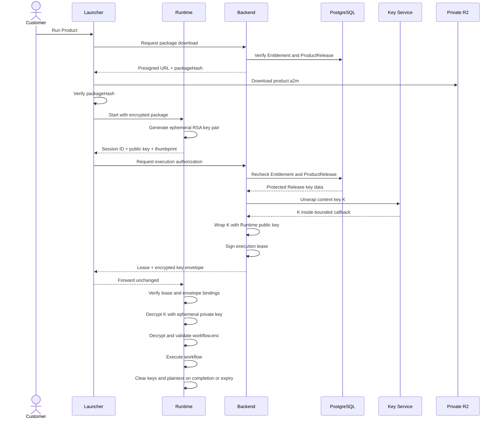
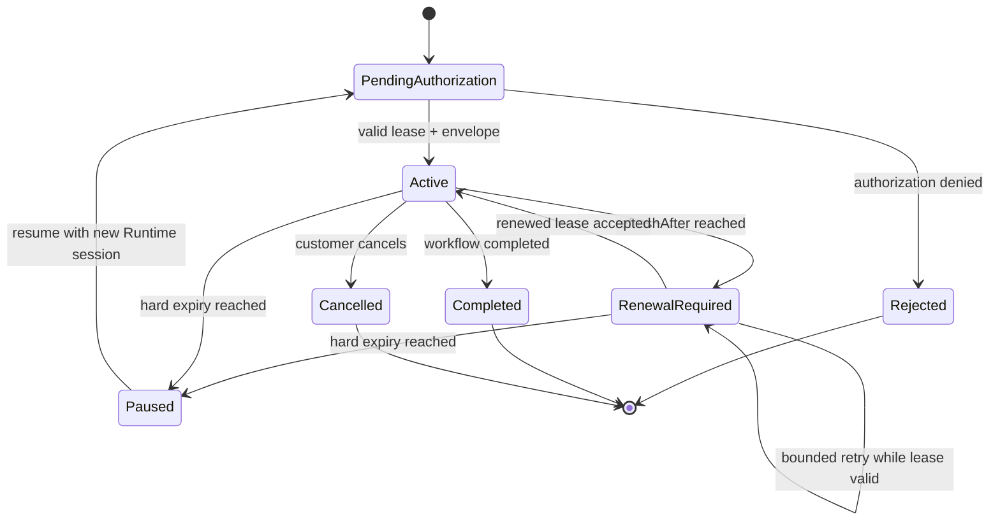

# Production Execution Authorization v1

## 1. Overview and scope

This contract defines how an entitled customer runs an encrypted Product
Release through Launcher and Runtime without giving Launcher the plaintext
workflow key.

The MVP authorizes the customer and exact Product Release only. It does not
limit installations, machines, Android devices, active leases, or concurrent
executions. Runtime may still bound local parallel work for resource safety;
that is scheduling, not commercial authorization.

This contract owns Production authorization. The Studio authoring API remains
defined by `components/a2matex-runtime/contracts/local_api_v1.md`. Runtime may
register both API families concurrently; selecting an endpoint selects the
operation, so no global Development/Production mode switch is required.



The stop paths are fail-closed: a denied entitlement, invalid Release, package mismatch, invalid
lease/envelope, or failed authenticated decryption dispatches no workflow node. Renewal and hard
expiry behavior are shown in Sections 7–8.

## 2. Cryptographic model

| Item                        | Purpose                                                  | Lifetime and location                                              |
| --------------------------- | -------------------------------------------------------- | ------------------------------------------------------------------ |
| Release content key         | Encrypt and decrypt `workflow.enc`                       | Created during release build; protected by the Backend key service |
| Runtime session public key  | Let Backend wrap the content key for one Runtime session | Returned to Launcher and Backend                                   |
| Runtime session private key | Open the key envelope                                    | Runtime memory only; destroyed at hard expiry or session end       |
| Backend signing private key | Sign execution leases                                    | Backend signing service only                                       |
| Backend verification key    | Verify execution leases                                  | Runtime trust configuration                                        |
| Key envelope                | Content key encrypted for one Runtime session            | May pass through Launcher; contains no plaintext key               |
| Execution lease             | Signed, time-bounded permission to execute               | Launcher and Runtime memory; contains no decryption key            |

The keys are independent. The Runtime key pair transports the release content
key; the Backend signing key proves who issued the lease.

```text
workflow.enc = AES-256-GCM(contentKey, Runtime IR)
keyEnvelope  = RSA-OAEP-SHA256(runtimePublicKey, contentKey)
lease        = signed by the Backend and verified by Runtime
```

The release content key does not technically expire. Authorization expires.
Runtime enforces expiry by stopping workflow advancement and removing plaintext
workflow data and transient key material.

MVP algorithm choices are:

- AES-256-GCM for the protected Runtime IR;
- RSA-OAEP with SHA-256 for wrapping the 256-bit content key;
- Ed25519 for execution-lease signatures;
- SHA-256 over the Runtime public key's DER SubjectPublicKeyInfo encoding for
  `runtimeKeyThumbprint`.

Implementations must use established cryptographic libraries and must not log
or persist plaintext keys, Runtime private keys, protected Runtime IR, or signed
authorization material.

## 3. Release build and download

For every immutable Product Release, Backend:

1. loads the approved immutable Workflow Revision Runtime IR;
2. asks Key Service to unwrap the Release's random 256-bit content key using the ProductRelease ID,
   `wrappedKey`, and `keyNonce`;
3. encrypts Runtime IR with AES-256-GCM and stores required nonce/tag metadata;
4. builds the immutable standard ZIP package using the `product.a2m` filename and calculates its
   package hash;
5. stores only protected `wrappedKey` and non-secret `keyNonce` on ProductRelease;
6. uploads the encrypted package to object storage.

Launcher downloads the encrypted package after entitlement-based download
authorization and verifies `packageHash`. The package remains encrypted on
disk.

## 4. Initial Product Run

The initial run follows the overview sequence. Launcher transports the encrypted package and
authorization material, while Runtime owns the ephemeral private key, authenticated decryption, and
execution admission.

Backend authorization checks only:

- authenticated customer owns an active entitlement for the Product;
- customer and Product are allowed to operate;
- requested Product Release is published, supported, and not disabled;
- supplied `packageHash` equals the immutable Product Release artifact;
- Runtime public-key encoding and thumbprint are valid.

Backend does not receive device IDs or device counts and performs no machine or
concurrency check.

Runtime admits the run only after it verifies:

- Backend signature and signing-key ID;
- `notBefore`, `refreshAfter`, and `expiresAt` with the allowed clock skew;
- Product, Release, and package hashes;
- Runtime session ID and public-key thumbprint;
- key-envelope algorithm and binding;
- package integrity and Runtime compatibility;
- decrypted Runtime IR hash and graph validity.

Launcher identifies the downloaded package through a Runtime-constrained
package reference. The reference may be a package ID or a relative folder/file
name below the Runtime-owned package root; Production APIs must not accept an
arbitrary absolute path, traversal segment, symlink escape, or URL. The Runtime
resolves and verifies the package before returning authorization-session
material.

After successful authorization and decryption, Runtime retains the validated
plaintext Runtime IR and required input schema only in memory for the active
authorized session so execution does not repeat package decryption for every
node. It must never persist or return plaintext workflow content or the content
key. Failed authorization or admission, terminal completion, cancellation,
shutdown, and hard authorization expiry release the plaintext and key material;
resume after hard expiry decrypts again under a new authorization session.

### Production validation disclosure

G1 may create detailed internal findings while validating the decrypted Runtime
IR, but the Production customer response exposes only the generic A6
`VALIDATION_FAILED` failure. It must not include the Studio validation
object or reveal Phase C diagnostic codes, graph paths, node or edge
identifiers, handler names, installed registry contents, schema details, or
protected workflow values.

Admission failure creates no run and dispatches no device command. It rejects
that Product Run request but does not normally terminate the Runtime Agent, so
the process can continue to provide health, recovery, and later valid requests.
Only an invalid system-owned Runtime installation or registry may fail process
startup/readiness, using a generic external failure and sanitized operational
logging.

## 5. Execution lease

The lease is a compact signed token with these required claims:

| Claim                    | Meaning                                                          |
| ------------------------ | ---------------------------------------------------------------- |
| `leaseId`                | Unique issued-token ID; also used for replay/idempotency checks  |
| `leaseFamilyId`          | Stable ID across successful renewals of one active authorization |
| `sequence`               | Strictly increasing renewal number, beginning at `1`             |
| `entitlementId`          | Entitlement used for the decision                                |
| `customerId`             | Authorized customer                                              |
| `productId`              | Authorized Product                                               |
| `releaseId`              | Exact immutable Product Release                                  |
| `packageHash`            | Exact encrypted package                                          |
| `runtimeSessionId`       | Pending Runtime session receiving the run                        |
| `runtimeKeyThumbprint`   | SHA-256 identity of the Runtime public key                       |
| `issuedAt` / `notBefore` | Issue and earliest-valid times                                   |
| `refreshAfter`           | Time at which Launcher should begin renewal                      |
| `expiresAt`              | Hard authorization deadline                                      |

The protected signature header includes the token type, `EdDSA`, and Backend
signing-key ID. Runtime trusts only configured active Backend verification keys.
Signing-key rotation must overlap long enough to verify every unexpired lease.

The time invariant is:

```text
issuedAt <= notBefore < refreshAfter < expiresAt
```

Backend owns lease duration and renewal-window configuration. Five minutes
before expiry is an example, not a Runtime constant.

The authorization response also returns `serverTime`. Runtime validates signed
timestamps with a small configured clock-skew allowance, then derives local
renewal and expiry deadlines from a monotonic clock so later wall-clock changes
do not silently extend authorization.

## 6. Key envelope

The envelope contains:

```json
{
  "releaseId": "product-release-id",
  "algorithm": "RSA-OAEP-SHA256",
  "runtimeSessionId": "runtime-session-id",
  "runtimeKeyThumbprint": "sha256:...",
  "encryptedKey": "base64..."
}
```

Backend transiently obtains the content key through the key service and wraps
it with the supplied Runtime public key. Launcher transports the envelope but
cannot open it through the normal application flow. Runtime accepts it only
when its Release ID, session, and thumbprint match the signed lease.

This raises extraction cost but is not hardware-backed DRM. A customer who
controls the machine can modify software or inspect privileged memory. Hardware
attestation and TPM-backed keys are deferred hardening.

## 7. Renewal and retry

Launcher owns Backend communication because it owns the customer login session.
Runtime owns the authoritative local deadline and enforcement.



At `refreshAfter`, Runtime emits `AUTHORIZATION_RENEWAL_REQUIRED`. Launcher
requests renewal while the old lease remains valid. A successful renewal must:

- keep the same lease family, customer, entitlement, Product, Release, package,
  Runtime session, and public-key thumbprint;
- increment `sequence`;
- provide later `refreshAfter` and `expiresAt` values;
- pass the same signature and time checks.

Runtime atomically replaces the active lease. Normal renewal does not need a
new envelope or workflow decryption because the same authorized Runtime session
is still active.

Launcher retries only transient timeout, connectivity, `429`, and `5xx`
failures with bounded exponential backoff and jitter. It reuses one request ID
for idempotency and stops retrying at the current lease deadline. Authorization
denial, revoked entitlement, disabled release, package mismatch, and invalid
session binding are not blind-retry conditions.

Launcher owns the Runtime it starts for a Product Run. During an active run,
Launcher offers **Stop and exit** or **Stay open**. On confirmed exit, the
Runtime blocks new work, settles the run within the shutdown deadline, saves
terminal state, and exits. If Launcher disappears unexpectedly, the Runtime
stops dispatch and exits after bounded cleanup. D6 handles unfinished state
at the next start. Lease enforcement remains active throughout shutdown.

## 8. Hard expiry and resume

A valid lease is required before Runtime starts a node attempt. Runtime must
not start an attempt when its declared timeout plus a safety margin exceeds the
remaining lease duration.

At hard expiry Runtime:

1. stops admitting new node attempts and retries;
2. safely cancels a cancellable active operation, or lets an already admitted
   bounded operation reach its safe result boundary;
3. commits the latest unambiguous checkpoint before emitting events;
4. moves the execution to `PAUSED` with reason `AUTHORIZATION_EXPIRED`;
5. removes decrypted Runtime IR, the content key, session private key, envelope,
   and temporary plaintext buffers from memory as far as the platform permits.

An Android side effect already dispatched cannot be undone. Runtime records the
observed result but does not blindly replay an attempt whose completion is
unknown.

Resume after hard expiry is a new authorization session:

1. Runtime generates a new session key pair;
2. Launcher requests a new lease and new key envelope;
3. Runtime verifies the new authorization and decrypts the same package again;
4. Runtime verifies the package/IR hashes against the paused run;
5. Runtime resumes after the last confirmed checkpoint.

Lease resume while the process remains alive is distinct from crash recovery.
After a Runtime restart, the persisted execution contract determines whether a
run is `INTERRUPTED`; side-effecting attempts are never automatically replayed
when their outcome is ambiguous.

## 9. Ownership and API boundary

| Component | Responsibility                                                                                                                          |
| --------- | --------------------------------------------------------------------------------------------------------------------------------------- |
| Backend   | Entitlement decision, Release/key lookup, lease signing, renewal, revocation, and key wrapping                                          |
| Launcher  | Customer authentication, package download, authorization/renewal requests, and forwarding responses to Runtime                          |
| Runtime   | Session key generation, signature/envelope verification, in-memory decryption, deadline enforcement, cleanup, checkpoint, and execution |

Production endpoints are an I2 contract and do not alter Studio authoring API
v1.
They coexist with the Studio validation endpoint and never send an encrypted
package to C5. The Production API must cover:
The Production API must cover:

- prepare Runtime authorization session;
- start a protected Product Run;
- submit a renewed lease;
- reauthorize a run paused by expiry;
- expose authorization state and renewal-required events.

Exact request/response schemas and error codes must be approved before I2
implementation. That later transport contract must preserve the generic-only
validation disclosure rule above.

## 10. Acceptance rules

- No server-side installation, machine, device-count, or concurrent-run limit.
- Launcher never receives plaintext Runtime IR or the plaintext content key in
  the normal application flow.
- Copying a package, lease, and envelope to a different Runtime session cannot
  decrypt or admit the run.
- Renewal before expiry does not interrupt execution.
- Missing renewal prevents every new node attempt at hard expiry.
- Resume after hard expiry requires a new key pair, lease, and envelope.
- Authorization failures and cryptographic material are logged only as
  sanitized identifiers and reason codes.
- Production admission failures disclose only the generic validation failure,
  create no run, dispatch no command, and leave a healthy Runtime Agent
  available for recovery or a later valid request.
